<p align="center">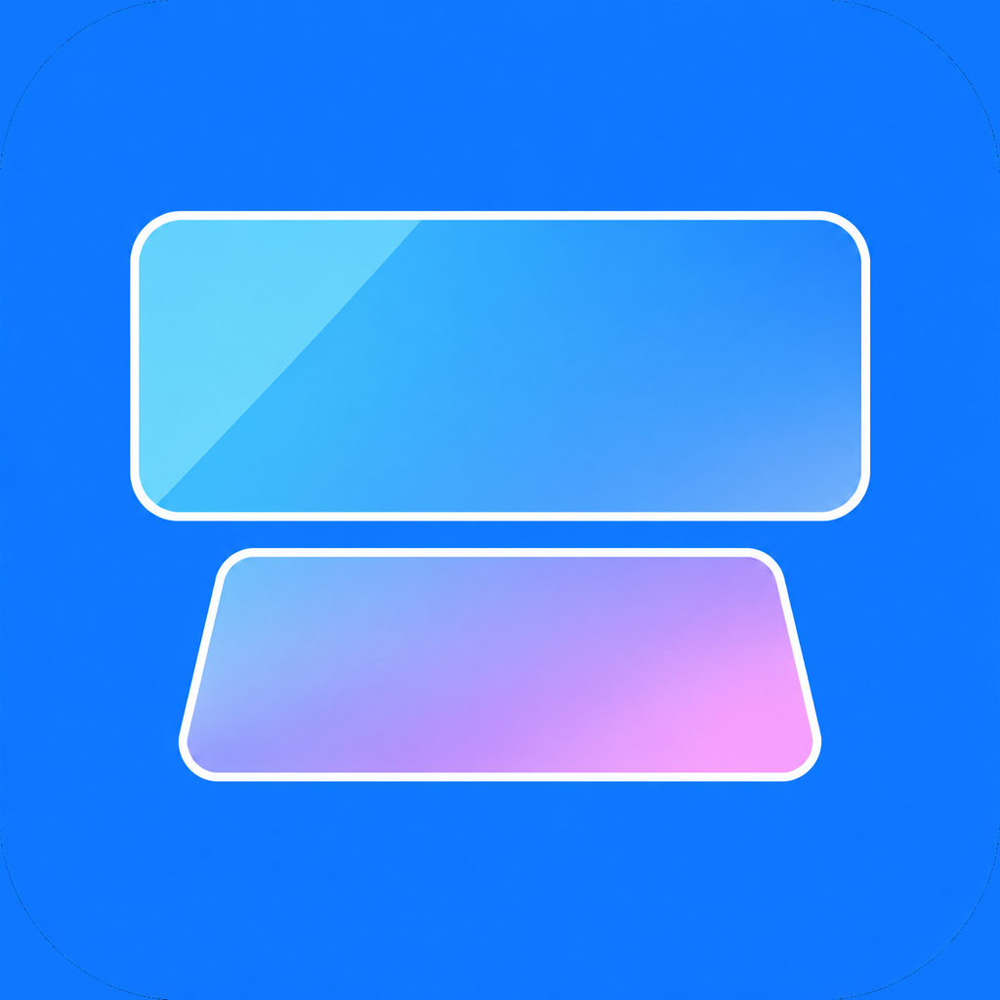</p>

<h1 align="center">3ds2apple</h1>

<p align="center">
  <a href="README.md">EN</a> · <a href="README.zh-CN.md">简体中文</a> · <a href="README.ja.md">日本語</a> · <a href="README.ko.md">한국어</a>
</p>

<p align="center">
  <a href="#ダウンロード"><b>ダウンロード</b></a> ·
  <a href="https://hfykratos.github.io/3ds2apple/">公式サイト</a> ·
  <a href="https://hfykratos.github.io/3ds2apple/press/">プレスキット</a> ·
  <a href="https://github.com/HFYKratos/3ds2apple/releases">リリース</a> ·
  <a href="https://github.com/HFYKratos/3ds2apple/discussions">Discussions</a> ·
  <a href="CONTRIBUTING.md">コントリビュート</a>
</p>

<p align="center">
  <a href="LICENSE"></a>
  <a href="https://github.com/HFYKratos/3ds2apple/releases/tag/v0.3.1"></a>
  <a href="https://github.com/HFYKratos/3ds2apple/releases/latest"></a>
  <a href="https://github.com/HFYKratos/3ds2apple/releases"></a>
  <a href="https://github.com/HFYKratos/3ds2apple/actions/workflows/ci.yml"></a>
</p>

> [!NOTE]
> これはコミュニティ翻訳です。基準となるのは英語版 [README.md](README.md) で、内容が食い違う場合は英語版が優先されます。

**自分で所有する Nintendo 3DS のゲームを iPhone と iPad でネイティブに動作——AOT コンパイルされた ARM64、MoltenVK 経由の Metal、CPU JIT なし、インタプリタのフォールバックなし。**

## ダウンロード

<p align="center">
  <a href="https://github.com/HFYKratos/3ds2apple/releases/download/v0.3.1/3ds2apple-0.3.1-windows-x64.zip"></a>
  <a href="https://github.com/HFYKratos/3ds2apple/releases/download/v0.3.1/3ds2apple-0.3.1-macos-universal.zip"></a>
  <a href="https://github.com/HFYKratos/3ds2apple/releases/download/v0.3.1/3ds2apple-0.3.1-linux-x86_64.tar.gz"></a>
  <a href="https://github.com/HFYKratos/3ds2apple/releases"></a>
</p>

<p align="center"><sub><b>最新の安定版: v0.3.1</b> · Windows 10/11 ランチャー（検証済みの経路）· macOS 13+ ランチャー（開発者プレビュー、<a href="https://github.com/HFYKratos/3ds2apple/issues/1">#1</a> を参照）· Linux x86_64 ランチャー（検証済みの経路；ローカル AOT 対応：3dsrecomp + LLVM/LLD 23.1.6 を同梱）· iOS アプリはランチャーがあなた自身の Apple ID で構成・署名・インストールするため、iOS 単体のダウンロードはありません。</sub></p>

<p align="center">
  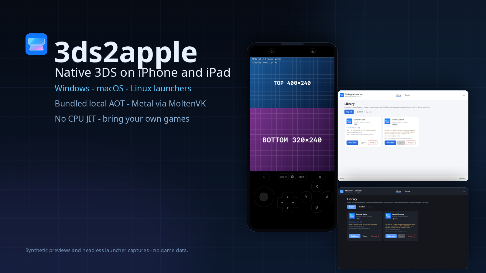
</p>

> [!NOTE]
> 3ds2apple は無料のオープンソースソフトウェア（Apache-2.0）です。ランチャーと iOS アプリにはゲーム、キー、BIOS は一切含まれません。自分で所有し自分で吸い出した復号済み ROM から、自分のゲームライブラリを構築してください。

## 30秒でわかる3ds2apple

3ds2apple は、自分で所有する Nintendo 3DS ゲームのためのネイティブ移植パイプラインであり、エミュレーターアプリではありません。自分で吸い出した復号済み ROM を Windows、macOS、Linux のランチャーにインポートすると、3dsrecomp が 3DS のコードを C に変換し、ローカルの LLVM または Apple clang ツールチェーン（Linux ランチャーは同梱の 3dsrecomp + LLVM/LLD 23.1.6）がタイトルごとに 1 つの ARM64 `GamePack` をビルドします。ランチャーは ROM を含まないベース IPA を構成し、あなた自身の Apple ID で署名・インストールしたうえで、ゲームデータ（`GameRom.cci` + `GameInfo.json`）だけをアプリの Documents フォルダーへプッシュします。スマートフォン側では Zakuro HLE ランタイムがそのネイティブコードを直接実行し、MoltenVK が PICA200 GPU の呼び出しを Metal に変換します。1 つのアプリにライブラリ全体が収まり、ポーズメニューから画面レイアウト、コントロール、セーブステート、診断まで扱えます。ゲーム、キー、BIOS は含まれません。ゲームは自分で用意してください。

## デモ

<p align="center">
  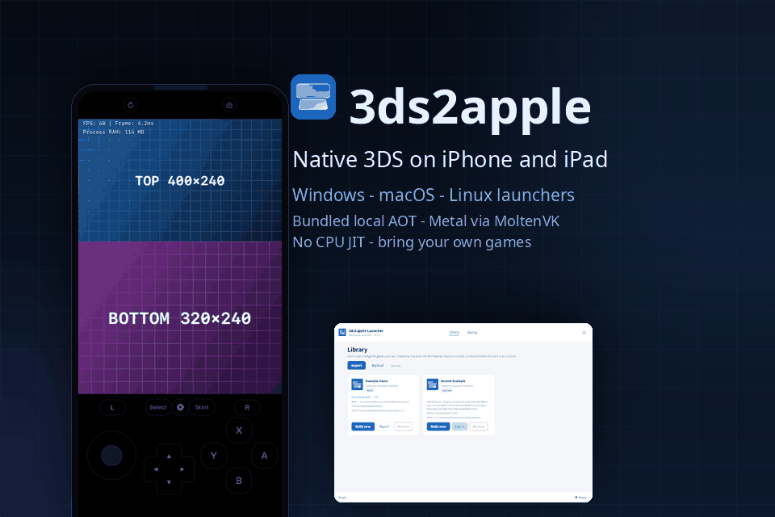
</p>

<p align="center"><sub>0.2.1 合成プレビュー、ゲームデータなし：縦画面コントロール → 横画面コントロール → ゲーム内メニュー → パフォーマンスオーバーレイ設定。</sub></p>


## 機能一覧

<table>
  <tr>
    <td align="center" width="25%">⚡<br><b>エミュレーションではなくネイティブ AOT</b><br><sub>各ゲームは実行前に ARM64 へ再コンパイルされます。出荷経路に CPU JIT もインタプリタのフォールバックもありません。</sub></td>
    <td align="center" width="25%">📚<br><b>1 つのアプリにライブラリ全体</b><br><sub>選択した各タイトルは 1 つの署名済みアプリ内の GamePack です。プッシュしたゲームデータは更新後も残ります。</sub></td>
    <td align="center" width="25%">🎮<br><b>New 3DS のコントロールを網羅</b><br><sub>十字キー、A/B/X/Y、L/R、ZL/ZR、Start/Select、本物のアナログ Circle Pad、C スティック。既定レイアウトは縦画面 ModernFS / 横画面 ModernHybrid の 2 つの Delta リファレンススキンに従い、設定ボタンはスキンの HOME スロットに常時表示されます。編集可能な早送り、クイックセーブ、クイックロード、画面入れ替えボタン。MFi、Xbox、DualSense コントローラーに対応。</sub></td>
    <td align="center" width="25%">🧭<br><b>横 6 種 + 縦 3 種、すべて GPU</b><br><sub>横 6 種・縦 3 種のプリセットに任意のカスタム矩形を加えたすべてを GPU プレゼンターが毎フレームのリードバックなしで描画。四方向の回転と上下画面の入れ替え、さらに 6 つの実験的なレンダラー最適化スイッチに対応。</sub></td>
  </tr>
  <tr>
    <td align="center" width="25%">✏️<br><b>ゲーム内でコントロールを編集</b><br><sub>ポーズして画面の上でコントロールをドラッグし「完了」をタップ。ボタンごとの表示、10%〜200% のサイズ、透明度に対応。</sub></td>
    <td align="center" width="25%">💾<br><b>セーブとセーブステート</b><br><sub>バッテリーセーブはアプリのコンテナに保存、ゲームごとに 3 つのセーブステートスロット、セーブマネージャーでエクスポートとインポート、そしてコードごとに切り替えられる自分用の Citra/Azahar チートファイル。</sub></td>
    <td align="center" width="25%">⏩<br><b>早送り、パフォーマンスオーバーレイ、HUD</b><br><sub>2x 早送りトグル、編集可能なクイックセーブとクイックロード、任意のパフォーマンスオーバーレイ（画面の最上端に表示。FPS、フレーム時間、速度、アプリメモリ、空きメモリ。6 つの位置、行の切り替え、任意の背景）、システム Metal HUD（デフォルトはオフ）、ワンタップの診断エクスポート。</sub></td>
    <td align="center" width="25%">🖥️<br><b>Windows、macOS、Linux のランチャー</b><br><sub>1 つのウィンドウでインポート → ビルド → 署名 → インストール → プッシュ。Windows と Linux のランチャーが検証済みの経路です：Windows はゲームデータを保つ増分デプロイに対応し、Linux ランチャーは同じ UI を共有し、同梱の plumesign-linux で署名・インストールします（Linux は同梱の 3dsrecomp + LLVM/LLD 23.1.6 で GamePack をローカルビルドでき、.32a のインポートも可）。ビルド済みゲームのエクスポートダイアログ 1 つで、完成済みビルドパッケージ（.32a）か署名可能パッケージ（未署名の自己完結型単体ゲーム IPA）を書き出せ、インポートで ROM を取り込み、.32a パッケージも取り込み直せます。高度な AOT ビルド設定は設定ページにあります。</sub></td>
  </tr>
</table>

## 画面レイアウト：横 6 種、縦 3 種

**設定 → ディスプレイ → 画面レイアウト** では、横画面と縦画面を独立して設定できます。

- **横画面レイアウト（6 種）**：大画面 · 単一画面 · 並列画面 · ハイブリッド · オリジナル · カスタムレイアウト。
- **縦画面レイアウト（3 種）**：デフォルト · オリジナル · カスタムレイアウト。

**ハイブリッド**は大きな上画面の横に小さな画面 2 つを上下に並べる構成、縦画面の**デフォルト**は上画面を全幅で下画面の上に置く構成です。

横画面ではピクチャーボックスが上寄せになります：**大画面**・**並列画面**・**ハイブリッド**は画面の上端に密着し（画面上部の黒帯がなくなり）、水平方向は中央のまま、アスペクト比と整数スケーリングも変わりません。

プリセットの配置はすべて GPU プレゼンターが描画します。Metal 経路で毎フレームの画面リードバックはありません。**カスタムレイアウト**は 2 つの画面を任意の矩形に配置します。X/Y/幅/高さをパーセントで編集でき（フィールドの下にライブプレビュー）、画面をドラッグして編集することもできます。カスタムレイアウトも GPU プレゼンターが描画し（任意の矩形、四方向の回転、上下画面の入れ替え）、低速なリードバック経路には戻りません。カスタムレイアウトは引き続き次回のゲーム読み込みから適用されます。

画面の回転とインターフェースの向きは保持されます。レンダリング解像度（1x〜4x）は 2 つの部分に分かれます: 表示用の drawable はすぐに変わりますが、ホスト GPU の 3D レンダラー内部の倍率はシステム読み込み時に固定されるため、実行中のゲームは再読み込みするまで古い内部解像度のままです——Settings → Graphics とゲーム内メニューの両方の Resolution 行に「**再起動が必要**」バッジと「**ゲームを再起動すると反映されます**」の注記があります。Integer scaling と Screen aspect（Fit / 4:3 / Stretch）は Settings → Graphics の個別オプションで、レンダラーは自動選択です（旧 read-only の Renderer 行はなくなりました）。

## レンダラー最適化（実験的）

**設定 → グラフィックス → レンダラー最適化** には、ハードウェア（Vulkan/MoltenVK）レンダラーの描画方法を変える 6 つの実験的なスイッチがあります。6 つとも**既定ではオフ**で、レンダラーがゲーム読み込み用のデバイスを作るときに一度だけ読み取られるため、変更はアプリを強制終了して起動し直したあとに反映されます。

- **等価ドロー省略** — どちらのバッファーも変えられない等価なドローを省略します。
- **重複キャプチャー省略** — 何も描画されなかった繰り返しの画面キャプチャーを省略します。
- **レンダーパス統合** — 深度バッファーのないドローを、すでに深度バッファーを持つパスに統合します。
- **高速イメージクリア** — 全画面イメージをイメージクリアコマンドでクリアします。
- **不透明ドローソート** — バッチ内の不透明ドローを手前から奥の順に描画します。
- **レンダーバリアの限定** — レンダーターゲット切り替え後のバリアをアタッチメント段階に限定します。

これらのスイッチは GPU 経路にのみ影響します。ソフトウェア PICA200 レンダラーのときは読み取られず、何も変わりません。ゲームに描画の差異が出た場合は、原因のスイッチを特定するために 1 つずつオフにしてください。**リセット**で 6 つともオフに戻ります。診断レポートにはそのセッションでオンだったスイッチが記録されます。

## バーチャルコントローラーとポーズメニュー

画面上のパッドは New 3DS のフルセットです。十字キー、A/B/X/Y、L/R、ZL/ZR、Start/Select、本物のアナログ Circle Pad、New 3DS の C スティックを備えます。Circle Pad は（軸ごとに -1〜1、小さなデッドゾーン付きで指を休めると正確に 0）本物のアナログ値を報告し、2 つ目の十字キーにはなりません。C スティックも同様です。位置とサイズは 2 つの Delta リファレンススキンのジオメトリに基づきます（ジオメトリのみ、アートワークは含みません）：縦画面は **ModernFS**、横画面は **ModernHybrid**。スキンの HOME スロットは **設定** ボタン 1 つで、ゲーム内メニューを開きます（設定ページ本体はメニューの「グローバル設定」行にあります）。スキンの音量キーは実装していません。縦画面では本体のコントロールが画面下の黒い帯に収まり（ショルダー行、その下にメインセット。D-pad は 4 つの独立ボタンではなく 1 つの十字（4 方向の押圧領域、押したままスライドで方向変更）として描画されます）、クイックセーブ／クイックロードはノッチ直下の左右の角（左 LOAD、右 SAVE）にあります。横画面のコントロールのジオメトリは従来どおりで、クイックセーブ／クイックロードは左のノッチ脇にあり、SAVE が上半分、LOAD が下半分で画面中央に対して対称です（横画面の Dynamic Island 領域を避けます）。スキンが描かない 5 つのコントロール——ZL、ZR、C スティック、早送り、画面入れ替え——は両方向でデフォルト非表示です。**コントロールの切り替え**で有効にすると、ゲーム画面上部の 1 行（左から ZL、早送り、C スティック、画面入れ替え、ZR）に現れ、レイアウト編集モードで任意の位置へドラッグできます。ゲーム実行中はシステムのステータスバー（時刻・バッテリー・電波）を非表示にします。ゲーム内メニューは設定と同じ iOS グループ表示で、縦画面は単一のスライドアップ、横画面は中央カード、ネイティブの push/pop サブページ、ヘッダーにゲーム名を表示します。

ハードウェアコントローラーの左スティックは Circle Pad、右スティックは C スティックに割り当てられ、L2/R2 は ZL/ZR に対応します。複数の指でボタンを押しながらスティックを操作できます。

ポーズしたゲームの **バーチャルコントローラー** カードでパッドをカスタマイズします。

- **パッドの表示/非表示**、パフォーマンスオーバーレイ、ハプティクス。パッドをオフにすると、**設定** ボタン以外の仮想コントロールはすべて非表示になります。設定ボタンは HOME スロットの元の位置に残り、ゲーム内メニューを開けます。
- **オンスクリーンボタン**——常に表示される設定ボタン（ゲーム内メニューを開く）、早送りトグル（2x オン/オフ）、クイックセーブ、クイックロード、画面入れ替え。設定以外のボタンは本体のコントロールと同じように移動・サイズ変更・表示/非表示ができますが、設定ボタンは移動とサイズ変更のみで非表示にはできません。
- **レイアウトを編集**——ポーズ中の画面の上でコントロールをドラッグし、中央の **完了** で現在の向きを保存して再開。
- **コントロールの切り替え**——向きごとの表示設定：ZL、ZR、C スティック、早送り、画面入れ替えは両方向でデフォルト非表示、既定スキンが描くその他のコントロール（縦画面の D-pad を含む）はデフォルト表示。設定ボタンは非表示にできないため一覧に表示されません（「サイズを調整」では変更できます）。古い設定データで設定ボタンを隠していた場合は自動的に解除されます。変更していない 0.2.0、0.2.1-beta1、0.2.1-beta2 の既定表示セットは一度だけ新しい既定へ移行し、ユーザーが変更したセットは保持されます。
- **サイズを調整**——ボタンまたはグループごとに 10%〜200%、デフォルトは 100%（グローバル）。
- **透明度を調整** と **リセット**。

表示は向きごとに設定します（「コントロールの切り替え」は現在の向きを編集）。サイズと透明度はグローバルで、縦画面と横画面の位置はそれぞれ独立しています。C スティックは New 3DS のヌブを読むゲームで、かつ現在のランタイムでビルドされたシェルが必要です（`scripts/build-zakuro-ios.sh` をソースからビルドしたシェルに含まれます）。

## ゲーム内でレイアウトを編集

ゲームをポーズして **バーチャルコントローラー → レイアウトを編集** を開きます。各コントロールには独自のヒット領域があるため、掴んだコントロールだけをポーズ中の画面の上でドラッグでき、中央の **完了** で現在の向きを保存して再開します。同じカードでボタンごとの表示、10%〜200% のサイズ、透明度、**リセット** も扱えます。縦画面と横画面の位置は別々に保存されます。

<p align="center"><sub>0.2.1 合成プレビュー、ゲームデータなし：縦画面コントロール → 横画面コントロール → ゲーム内メニュー → パフォーマンスオーバーレイ設定。</sub></p>

## 設定・ゲームパッド・アップデート

アプリの **Settings** は iOS 26/27 の inset-grouped 言語——General、System、Gamepad、Cheats、Graphics、Layout、Sound、Debug、Other——を使い、各項目に 2 行の説明があります。ゲーム内メニューも同じ言語で、ネイティブの push/pop サブページを備えます。

- **実行速度** — Default と Turbo はそれぞれ 1×–4×。Run speed limit / Turbo limit をオフにすると上限がなくなり、真に無制限の速度になります（熱・バッテリー・消音の警告は残ります）。早送りは別の 1× / 2× / 4× コントロールです。
- **アップデートチャンネル** — Stable / Beta チャンネルで GitHub を確認。手動またはバックグラウンド（24 時間に最大 1 回）で確認し、新リリースがあればローカル通知を出します。
- **ゲームパッドレイヤー** — 物理コントローラーのアナログデッドゾーン、ボタン再マップ、2–4 ボタンのホットキー、Standard / High contrast のオンスクリーンコントロール、アプリ別 Gamepad プロファイル。
- **アプリ別設定** — タイトル ID ごとに画面回転、画面入れ替え、Integer scaling、Screen aspect、デッドゾーン、コントロール外観、ボタン割り当てを上書き。
- **グラフィックス** — Integer scaling と Screen aspect（Fit / 4:3 / Stretch）は Settings → Graphics にあり、6 つの実験的レンダラー最適化も同じ場所です。レンダラーは自動選択されます。
- **セーブマネージャーとストレージ** — Save Manager はライブラリの全ゲームを対象に、選択ゲームのバッテリーセーブを ZIP に書き出し、ZIP または単体セーブファイルを読み込み、個別ファイルを削除できます（そのゲーム実行中は読み込み・削除が無効）。Storage ページはセーブデータ・旧ゲームファイル・ログ・パイプラインキャッシュの使用量を表示し、ゲーム未実行時にグラフィックスパイプラインキャッシュを消去できます。
- **AOT 検証** — Settings → Debug に AOT の状態、コードカバレッジ、インタープリタ/フォールバック回数が表示され、診断エクスポートにも同じ内容が含まれます。インタープリタでしか動かないタイトルは赤いエラーで起動を拒否します。

## チートコード

チートコードはアプリやランチャーが同梱するものではなく、自分で用意する Citra/Azahar 形式のテキストファイルです。アプリは `Documents/Cheats/<TITLEID>.txt`（ゲームフォルダーと同じ 16 桁のタイトル ID）から読み込みます。形式はデスクトップツールと同じで、`[name]` 行、任意の `*citra_enabled` 行、その後に `XXXXXXXX YYYYYYYY` のコード行を並べます。

- **設定 → チート** にはライブラリ内の各ゲームとそのチートファイルが並びます。ファイル App から UTF-8 の `.txt` をインポートし、内蔵エディターで貼り付けや編集を行い、チートごとにオン/オフを切り替え、共有シートで現在のファイルをエクスポートできます。
- **ゲーム内メニュー → チート** では実行中のゲームのコードを表示し、プレイ中に切り替えられます。変更は次のフレームから適用され、同じファイルへ書き戻されます。
- **コードデータベースは同梱していません。** アプリはコードを一切同梱せず、ダウンロードもしません。使用するのは自分で用意したコードだけです。ランタイムは最大 128 件のチート、1 ファイル 256 KiB、1 チート 1024 行まで受け付けます。
- **対象はデータパッチのみです。** ゲーム自体のコードを書き換えるコードは AOT ビルドで遅くなるか、オフにする必要があります。ゲームデータを変更するコードがサポート対象です。チートを使う前にセーブをバックアップしてください。

## ポータブルビルドパッケージ、単体ゲーム IPA、ビルドオプション

デスクトップランチャーはビルド済みゲームをパッケージ化し、AOT コードのコンパイル方法を調整できます。

ビルド済みゲームの **エクスポート** はライブラリに 1 つだけ（実際の AOT GamePack ができるまで無効で、カードは先にビルドするよう案内します）。ヘッダーの **インポート** は 1 つだけで、ファイル選択ダイアログは復号済み ROM（`.3ds` / `.cci` / `.ncch` / `.cxi`、複数選択可）と `.32a` ビルドパッケージの両方を受け付け、拡張子で自動的に振り分けます——ROM はヘッダーのみ読んでライブラリへ、`.32a` はビルドパッケージのインポート（置換の確認フロー付き）へ。存在しないファイルや未対応ファイルは通知され、何もインポートされません。

- **エクスポートダイアログ** — **エクスポート** を押すとウィンドウ内ダイアログが開き、形式（**完成済みビルドパッケージ**（.32a）か **署名可能パッケージ**（未署名の単体ゲーム IPA））と保存先（.32a はフォルダー、IPA は保存ファイルのパス。既定はそれぞれ `workspace/export/32a` と `workspace/export/ipa`）を選びます。警告（ユーザー自身のゲームデータを含む場合がありローカル保管のみ、IPA は未署名で Sideloadly か AltStore が必要）も表示します。どちらの形式もファイル名は `<TITLEID>-<SMDH の英語名><拡張子>`（バージョン番号や `unsigned` の接尾辞なし）で、書き出し成功時のメッセージは `Exported: <path>` です。署名・インストール・アップロードは何も行いません。
- **完成済みビルドパッケージ（.32a）** — エクスポートダイアログの **完成済みビルドパッケージ** 形式が、`<TITLEID>-<SMDH の英語名>.32a` を `<ポータブルデータフォルダー>/workspace/export/32a`（または選択したフォルダー）に書き出します。ZIP にはエクスポートマニフェスト、GamePack、`GameInfo.json`、SMDH カバー、そして既定ではユーザー自身のゲームデータ（ROM）が入ります。ヘッダーの **インポート** で `.32a` を選ぶと、まずパッケージ全体（マニフェストの schema、タイトル ID、pack の SHA-256 と Mach-O、すべての任意ペイロードのハッシュ）を検証してからランチャーのワークスペースへインストールするため、ビルドを別のパソコンへ移してデプロイしたり再エクスポートしたりできます。同名タイトルが既にある場合、明示的な**置換**の確認があるまで上書きされません。`.32a` をインポートすると、ライブラリ項目の ROM パスはインポートした `.32a` ファイル自体になり、以降のビルド・デプロイ・IPA エクスポートではその中に含まれる ROM が使われるため、元の ROM ファイルを隣に置いておく必要はありません。Windows では、パッケージ内の `manifest.json` が現在のビルド方法（ツールチェーン、AOT オプションの O レベル/LTO/fast-math、GamePack ABI）と一致する場合、インポート時にビルド記録も復元されます。インポート状態に**ビルドキャッシュを記録**と表示され、次のデプロイではパッケージ内の GamePack をそのまま再利用するため再コンパイルは不要です。ビルド方法/ツールチェーンが異なる場合、ゲームデータ未内包、または manifest の無い旧 CLI のパッケージは安全に記録されず、理由が表示されて次のデプロイで再コンパイルされます。**.32a には自分のゲームデータが含まれることがあります。ローカルに保管し、決してアップロードしたりリポジトリへコミットしたりしないでください。**
- **署名可能パッケージ（未署名の単体ゲーム IPA）** — エクスポートダイアログの **署名可能パッケージ** 形式が、`<TITLEID>-<SMDH の英語名>.ipa` を `<ポータブルデータフォルダー>/workspace/export/ipa`（または選択した保存先）に書き出します（未署名で自己完結した単体ゲーム IPA）。シェルテンプレートにその 1 つの GamePack と単体ゲーム用の `GameCatalog.json` を組み合わせ、アプリアイコンをゲームの SMDH カバーに置き換え、ライブラリの準備ができ次第そのゲームを開くようカタログに指定し、さらにユーザー自身のゲームデータ（ROM）を IPA に内包するため、ファイルサイズはおよそ ROM + コードになります。Sideloadly または AltStore で自分で署名してインストールすると、ホーム画面にはゲーム自身の名前（ランチャーが SMDH のローカライズ名でアプリ表示名を書き換え、該当言語がなければ英語名。3ds2apple ではない）が表示され、アプリを開くと直接そのゲームが始まります——単体ゲームビルドにはライブラリもホームページもありません。内蔵データの検証に失敗した場合は、ライブラリに戻らず **再試行** と **ログを書き出す** を備えた専用のエラー画面を表示します。ゲーム内メニューは通常と同じですが、単体ゲームビルドには **ゲームを閉じる** と **アプリ別設定** の行がありません（ランチャーからのプッシュは不要です）。IPA には自分のゲームデータが含まれるため、ローカルに保管してください。**決してアップロードしたりリポジトリへコミットしたりしないでください。** ランチャーは署名もアップロードも行いません。
- **詳細ビルド設定** — ランチャーの **設定** ページにあります（デプロイページにはもうありません）：AOT 最適化レベル（**O1 / O2 / O3 / Oz**、既定は **O2**）、リンク時最適化（既定は**オフ**。ビルド/リンクが遅くなります）、fast-math（既定は**オフ**。guest の浮動小数点結果が変わるため測定・実験用のみ）を設定できます。各項目に影響の説明と**既定値に戻す**があり、既定値は出荷時のビルドと同じで、変更は次回のビルドに適用され、影響を受ける GamePack のキャッシュが無効になるため、古い pack を再利用せず再ビルドされます。
- **カード操作** — 各カードに **今すぐビルド**、**エクスポート**、赤字の破壊的スタイルの **削除**（確認ダイアログ付き）が並びます。最小ウィンドウ幅ではボタン行が折り返し、はみ出しません。
- **署名の更新 / Refresh signing** — 両方のランチャーの Deploy ページにある **署名の更新** ボタンは、直近にデプロイで構成した IPA、または単体ゲームとしてエクスポートした IPA をその場で再署名して上書きインストールし、無料 Apple ID の 7 日間の署名を更新します。Windows は同梱の Impactor/plumesign を使い、macOS はローカルの Apple Development 証明書と保存済みの entitlements/プロビジョニングプロファイルを再利用して `devicectl` で上書きインストールするため、同じアプリを更新します（置き換えではありません）。再コンパイル・再構成・ゲームの追加・GamePack の更新は行いません（それらはデプロイを使用）。インストール済みアプリのゲームデータとセーブは保持されます。IPA がまだ無いときはボタンが無効です（先にデプロイかエクスポートを一度実行）。macOS では前回署名した shell App も必要で、無い場合は先に一度デプロイするよう案内します。

## スクリーンショット

**デスクトップランチャー**——現行 0.3.1 ランチャーのスクリーンショット：Windows は公式パッケージのライトテーマ（合成デモ項目）、macOS はランチャーのヘッドレススナップショットレンダラーによる空ライブラリです。ゲーム画像は含まれません。

| Windows launcher | Windows launcher (简体中文) | macOS launcher |
|:---:|:---:|:---:|
| 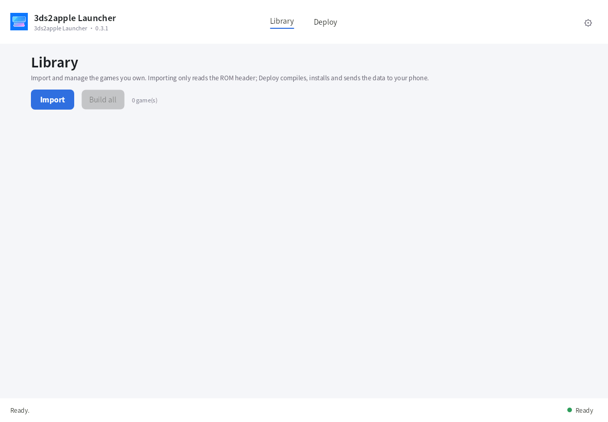 | 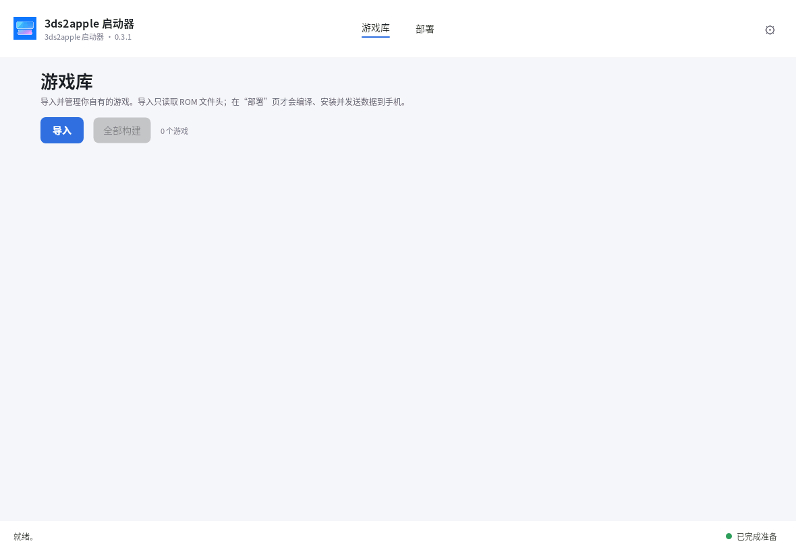 | 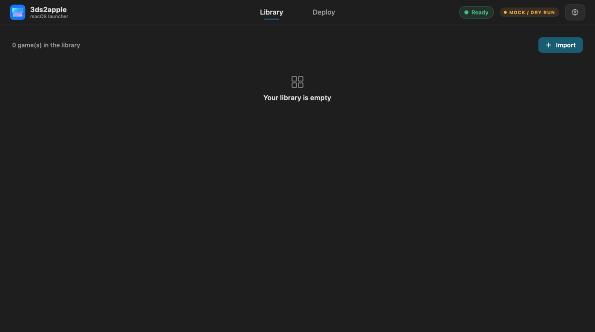 |
| ライブラリ（English） | ライブラリ（中文） | 空のライブラリ（ダーク） |

| Windows launcher · synthetic demo library | macOS launcher · light theme | macOS launcher · Settings (headless mock capture) |
|:---:|:---:|:---:|
| 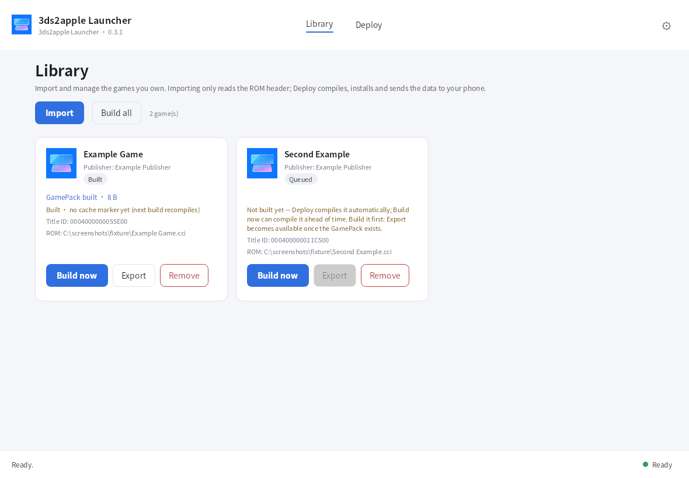 | 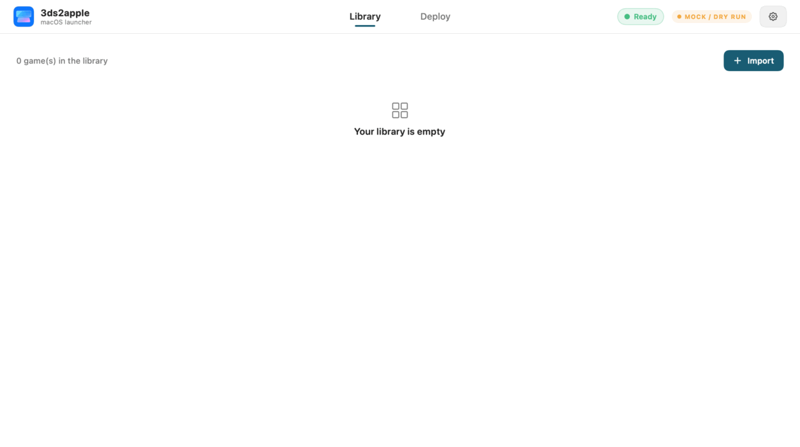 | 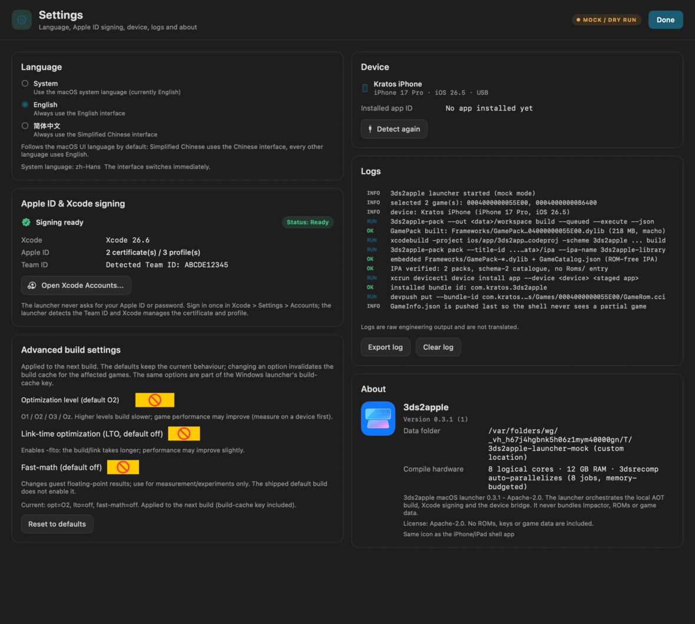 |
| 合成デモ項目 | 空のライブラリ（ライト） | 設定（mock キャプチャ） |

**Linux ランチャー**——0.3.1 Linux パッケージのヘッドレスキャプチャ。ライブラリは内蔵の合成デモ項目で、ゲームデータは含まれません。

| English | 简体中文 |
|:---:|:---:|
| 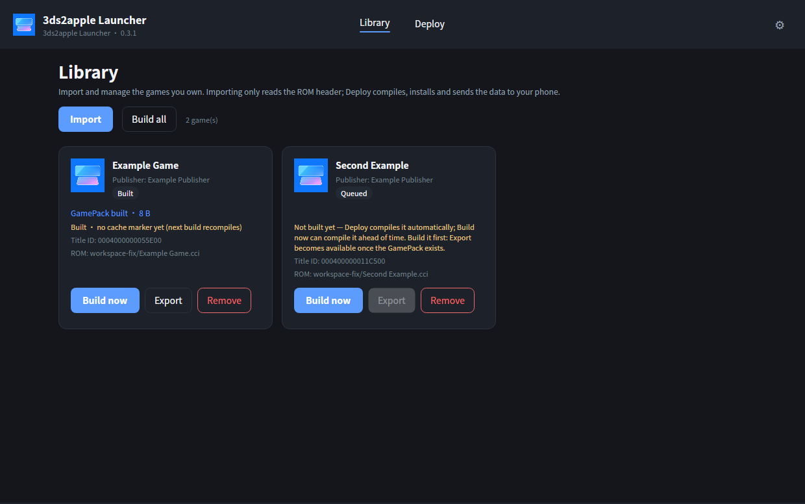 | 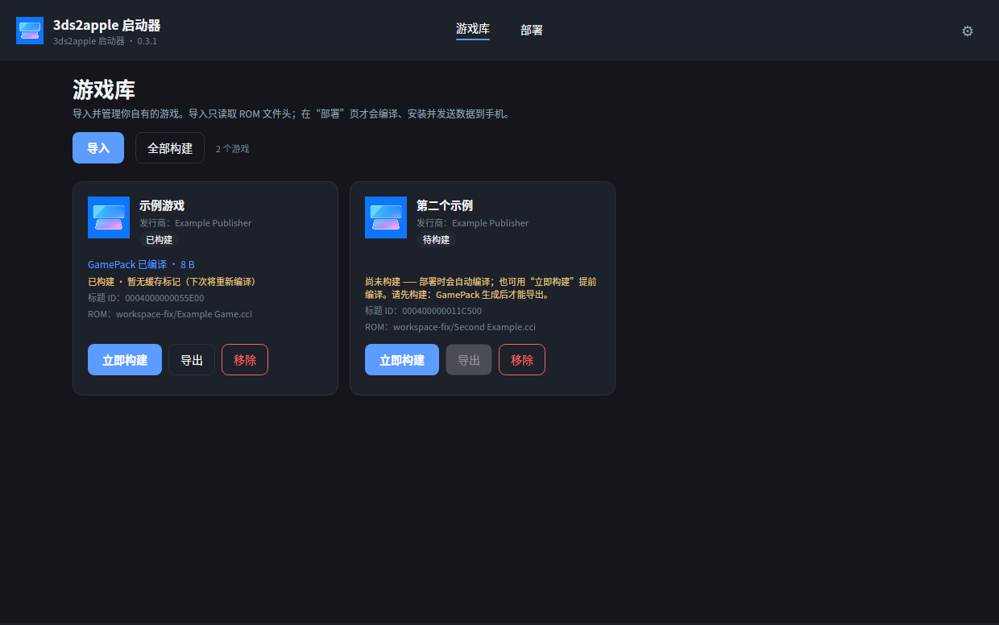 |
| ライブラリ（English） | ライブラリ（中文） |

**iOS アプリ**——オンスクリーンコントロールとパフォーマンスオーバーレイの 0.2.1 合成プレビューに加え、設定ページの 0.3.1 実機キャプチャです。ゲームデータは含まれません。

| Portrait | Landscape |
|:---:|:---:|
| 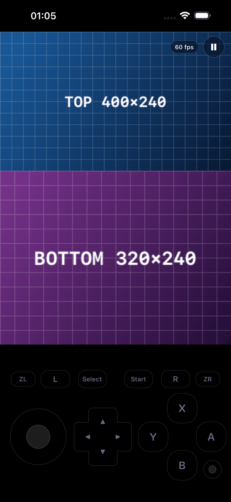 | 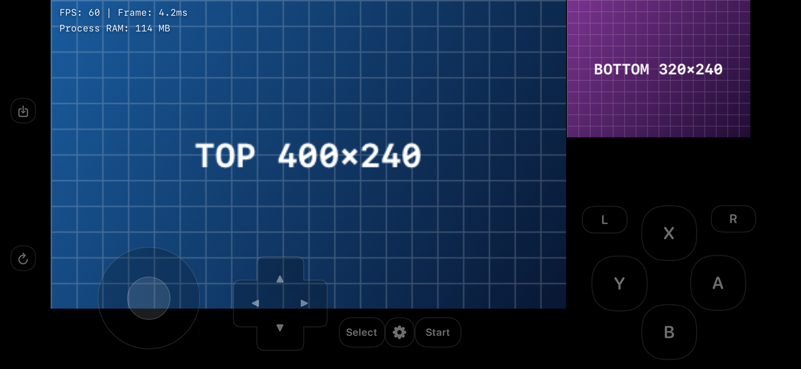 |
| 縦画面コントロール | 横画面コントロール |

**設定（0.3.1 実機キャプチャ）**——アプリの設定ページの実機 iPhone キャプチャ（簡体字中国語のシステム UI）です。ゲームデータは含まれません。

| Settings | System | Layout |
|:---:|:---:|:---:|
| 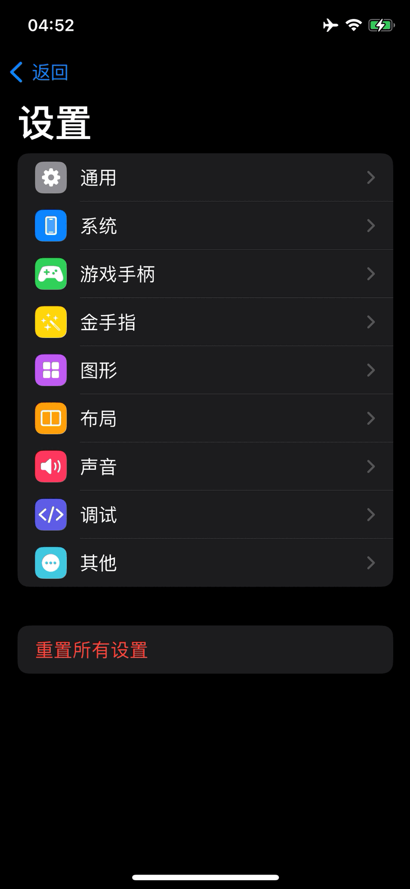 | 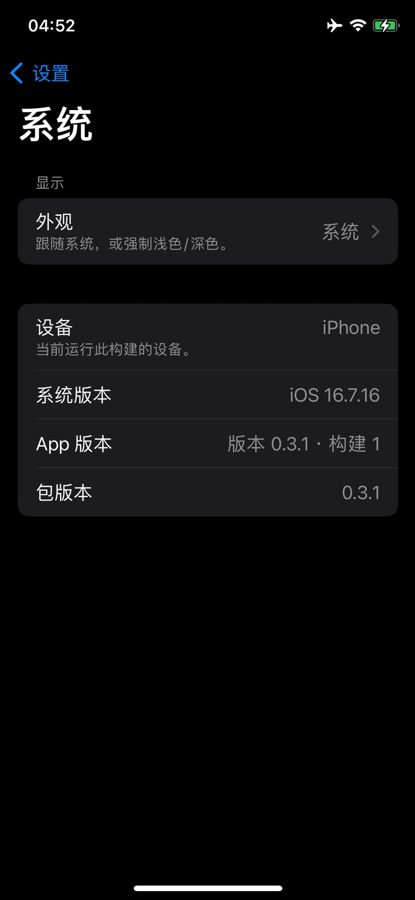 | 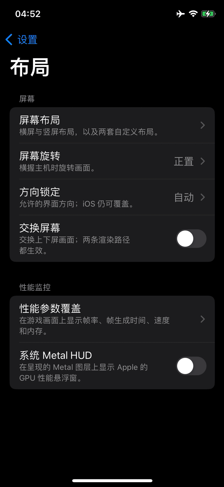 |
| グローバル設定 | システム | レイアウト |

## クイックスタート

**必要条件**：自分で所有する復号済み 3DS ROM、開発者モードを有効にした iOS 16+ の iPhone/iPad、USB ケーブル、署名用の自分自身の Apple ID。ゲームデータは含まれません。

1. **ランチャーをダウンロード。** Windows 10/11：zip を書き込み可能なフォルダー（`Program Files` 以外）に展開し、`3ds2apple-launcher.exe` を実行します。USB でスマートフォンに接続できるよう *Apple Devices* をインストールしてください。macOS 13+：`3ds2apple-launcher.app` を展開します（開発者プレビュー。Xcode 15+、`xcodegen`、リポジトリのチェックアウト、ビルド済みツールも必要です）。Linux x86_64：`3ds2apple-<version>-linux-x86_64.tar.gz` を書き込み可能なフォルダーに展開します（ペイロードは自己完結）。
2. **インポートしてデプロイ。** ヘッダーの **インポート** で自分で吸い出した復号済みの `.3ds`/`.cci`（同じダイアログで `.32a` ビルドパッケージも選べます）を読み込み、ゲームを選択して唯一のデプロイボタンを押します。ランチャーはゲームごとに GamePack をコンパイルし（インポートした `.32a` のビルド方法が一致すればその GamePack を再利用して再コンパイルしません）、ROM を含まない IPA を構成し、あなた自身の Apple ID で署名・インストールしてから、ゲームデータだけをプッシュします。
3. **プレイ。** スマートフォンでアプリを開きます。ゲームの追加・削除は再デプロイで行い、プッシュしたゲームデータは再インストールや更新後も残ります（完全なアンインストールで消去されます）。

macOS のセットアップと署名の制限を含む詳細な手順は[セットアップ](#セットアップ)にあります。

## FAQ

### 3ds2apple はエミュレーターですか？

いいえ。ネイティブ移植と再コンパイルのパイプラインです。各ゲームは C に変換され、事前に ARM64 へコンパイルされ、Zakuro HLE ランタイムを通して直接実行されます。出荷経路に CPU JIT もインタプリタのフォールバックもありません。

### すべてのゲームが動きますか？

互換性はゲームごとに異なります。起動できないタイトルや描画がおかしくなるタイトルがあり、一部のタイトルの一部メニューが正しく描画されないことがあります（[#2](https://github.com/HFYKratos/3ds2apple/issues/2) で追跡）。互換性や性能の保証はありません。16 桁のタイトル ID を添えた報告を歓迎します。

### ROM、キー、BIOS はどこで入手できますか？

このプロジェクトでは提供しません。3ds2apple はゲームデータを同梱せず、ROM、BIOS、キーのダウンロードや海賊版の支援も行いません。サポート対象は、あなたが合法的に所有し自分で吸い出した復号済み ROM のみです。

### Mac は必要ですか？

不要です。Windows と Linux のランチャーはどちらも GamePack をローカルビルドし（Windows は同梱の LLVM/LLD、Linux は同梱の 3dsrecomp + LLVM/LLD 23.1.6）、それぞれ同梱の Impactor / plumesign で署名・インストールするため、どちらの検証済み経路にも Mac は不要です。macOS ランチャーは**開発者プレビュー**です。macOS 13+、Apple ID でサインインした Xcode 15+、`xcodegen`、リポジトリのチェックアウト、ビルド済みツールが必要で、実機へのインストールはまだメンテナーによって検証されていません（issue [#1](https://github.com/HFYKratos/3ds2apple/issues/1)）。

### Linux ランチャーはありますか？

はい。Linux x86_64 の GUI ランチャーで、Windows ランチャーの Avalonia UI とエンジンを共有します。ROM と `.32a` パッケージのインポート、一致するパッケージのビルドキャッシュ再利用、同梱の公式 `plumesign-linux` による署名・上書きインストール（Apple ID と 2FA は端末と plumesign 自身のストアにのみ残ります）、同梱の Linux `devpush` と `usbmuxd` によるゲームデータのプッシュ、**署名の更新** による 7 日署名の更新に対応します。ローカル AOT にも対応：同梱の 3dsrecomp + LLVM/LLD 23.1.6 で GamePack をビルドし、そのまま署名・インストールできます。**完成済みビルドパッケージ**（`.32a`）をインポートして GamePack とビルドキャッシュを再利用することもできます。詳細は [launcher/linux/README.md](launcher/linux/README.md)。

### App Store で配信されていますか？

いいえ。ランチャーがあなた自身の Apple ID でアプリを構成・署名し（Windows は同梱の公式 Impactor、macOS は Xcode の自動署名、Linux は同梱の plumesign-linux）、USB 経由でインストールします。3ds2apple は Nintendo や Apple と提携しておらず、承認も受けていません。

### 1 週間ほどでアプリが起動しなくなるのはなぜですか？

無料の Apple ID では 1 デバイスあたり 3 アプリ、署名は約 7 日間に制限されます。Windows では Deploy ページの **署名の更新** で直近の IPA を再署名して上書きインストールでき（再ビルド不要、アプリの Documents データとセーブは保持）、macOS でも同じ **署名の更新** ボタンで、ローカルの Apple Development 証明書を使って直近の IPA を再署名でき、アプリのデータとセーブは保持されます。SideStore でインストールしたアプリは SideStore 自身が更新します。有料の開発者アカウントならこの制限はありません。ゲームごとのコードは署名済み IPA の中に置く必要があり（iOS は Documents から未署名の dylib を読み込みません）、ゲームの追加・更新には 1 回の上書きインストールが必要です——ゲームデータとセーブは保持されます。

### 再デプロイするとセーブやゲームデータは消えますか？

ゲームデータは `Documents/Games/<TITLEID>/`、セーブとセーブステートはアプリのコンテナにあります。プッシュ済みデータとセーブは再インストールや更新後も残り、完全なアンインストールで削除されます。残したいものは事前にバックアップしてください。ゲームの追加や GamePack の更新は、新しい IPA を上書きインストールする 1 回のデプロイです。アプリ自体は削除されず、Documents のゲームデータ、セーブ、プッシュ済みデータは保持されます。**署名の更新** は同じ IPA の署名だけを更新します。パソコン上の ROM は影響を受けません。

### 性能はどのくらいですか？

メンテナーが実機 iPhone で Windows ランチャー経路を使い、**ある市販タイトル 1 本**を計測したところ約 57〜60 fps、AOT 100%、Metal GPU レンダラーでした。これはその 1 本の計測結果であり保証ではありません。互換性と性能はゲームごとに異なります。

### カスタム画面レイアウトはプリセットより遅いですか？

いいえ、もう遅くありません。0.1.6 からカスタムレイアウトも GPU プレゼンターが描画します（任意の矩形、四方向の回転、上下画面の入れ替え）。プリセットと同じ、毎フレームのリードバックがない Metal 経路のままです。カスタムレイアウトは引き続き次回のゲーム読み込みから適用されます。

### ビルド済みのゲームを別のパソコンへ移せますか？

はい。ライブラリのカードで **エクスポート** を選び、**完成済みビルドパッケージ** 形式と保存先フォルダーを指定してから、別のマシンのランチャー上部の **インポート**（ファイル選択は ROM と `.32a` ビルドパッケージの両方に対応し、`.32a` を選べばビルドパッケージのインポートになります）で取り込めば、そのままデプロイも再エクスポートもできます。パッケージには GamePack、`GameInfo.json`、アイコン、そして既定では自分のゲームデータが入るため、ローカルに保管してください。**決してアップロードしたりリポジトリへコミットしたりしないでください。** 同名タイトルへのインポートは明示的な**置換**の確認が必要で、無関係なファイルは削除されません。単体ゲーム IPA のエクスポートも自己完結（そのゲームのデータを内包）ですが、これは署名してインストールするための成果物であり、ランチャーのビルドパッケージではありません。署名して実機にインストールし、ローカルに保管して、決してアップロードしたりリポジトリへコミットしたりしないでください。

### エクスポートした単体ゲーム IPA は署名済みですか？

いいえ。同じ **エクスポート** ダイアログの **署名可能パッケージ** 形式が書き出すのは、未署名で自己完結した単体ゲーム IPA です。アプリアイコンはゲームの SMDH カバーになり、ユーザー自身のゲームデータ（ROM）も内包され、インストール後のアプリはゲーム自身のローカライズ名でライブラリページを持たないため、Sideloadly または AltStore で署名してインストールすれば、アプリを開くと直接そのゲームが始まります（ランチャーからのプッシュは不要です）。データの検証に失敗した場合はライブラリではなく **再試行** 付きのエラー画面を表示します。ファイルサイズはおよそ ROM + コードで、自分のゲームデータを含むためローカルに保管してください。**決してアップロードしたりリポジトリへコミットしたりしないでください。** ランチャーは署名もアップロードも行いません。

### チートコードはどう追加しますか？

自分で用意した Citra/Azahar の `.txt` を `Documents/Cheats/<TITLEID>.txt` に置きます。**設定 → チート**から（ファイル App でインポートするかテキストを貼り付けて）追加するか、ファイル App で直接置いてください。オン/オフは **設定 → チート** またはゲーム内メニューの**チート**ページで行います。コードは同梱もダウンロードもされず、サポート対象はデータパッチのみです。ゲームのコードを書き換えるコードは AOT ビルドで遅くなることがあります。使用前にセーブをバックアップしてください。

### 実験的なレンダラー最適化は効果がありますか？

あるかもしれません。**設定 → グラフィックス → レンダラー最適化** の 6 つのスイッチは既定でオフで、反映にはアプリの再起動が必要です。効果があるのは GPU（Vulkan/MoltenVK）経路だけです。ゲームによってはどれかをオンにすると描画が変わる場合があります。有効化後にゲームの挙動がおかしくなったら、1 つずつオフにする（または**リセット**）して原因を特定してください。

## 法的情報と制限

- **ゲームは自分で用意。** ROM、キー、BIOS、システムファイル、ゲームアセットは提供もリンクもしません。海賊版の支援もありません。合法的に所有し自分で吸い出した復号済み ROM のみを使用してください。
- **提携・承認はありません。** 3ds2apple は Nintendo や Apple と提携しておらず、スポンサーや承認も受けていません。App Store でも配信されません。あなた自身の Apple ID で署名してインストールします。
- **保証はありません。** 互換性と性能はゲームごとに異なります。起動できないタイトルや描画がおかしいタイトルがあり、一部のタイトルの一部メニューが正しく描画されないことがあります（issue [#2](https://github.com/HFYKratos/3ds2apple/issues/2)）。互換性や性能の保証はありません。
- **macOS は開発者プレビュー。** パッケージは自己完結しておらず、実機へのインストールもまだメンテナーによって検証されていません（issue [#1](https://github.com/HFYKratos/3ds2apple/issues/1)）。Windows と Linux が検証済みの経路です。
- **カスタム画面レイアウトは 0.1.6 から GPU 経路です。** 任意の矩形、四方向の回転、上下画面の入れ替えを GPU プレゼンターが描画します（0.1.5 以前は低速なリードバック経路でした）。適用は引き続き次回のゲーム読み込みからです。
- **設計上 CPU JIT はありません。** 出荷経路は AOT コードと Zakuro HLE ランタイムで、インタプリタのフォールバックはありません。

## プロジェクトリンク

| | |
|---|---|
| **公式サイト** | <https://hfykratos.github.io/3ds2apple/> |
| **プレスキット** | <https://hfykratos.github.io/3ds2apple/press/> |
| **ダウンロード** | [GitHub Releases](https://github.com/HFYKratos/3ds2apple/releases) |
| **Issues** | <https://github.com/HFYKratos/3ds2apple/issues> |
| **Discussions** | <https://github.com/HFYKratos/3ds2apple/discussions> |
| **コントリビュート** | [CONTRIBUTING.md](CONTRIBUTING.md) |
| **ライセンス** | [Apache-2.0](LICENSE) |

## 対応プラットフォーム

| プラットフォーム | サポート |
|---|---|
| **iPhone / iPad** | iOS 16 以降。1 つのアプリにライブラリ、刷新されたゲーム内メニュー、ゲーム内レイアウト編集付きの New 3DS フルコントロール、横 6 種/縦 3 種の画面レイアウト、セーブステート、パフォーマンスオーバーレイ、アプリ別設定、自分用のチートファイル、6 つの実験的なレンダラー最適化が入ります。 |
| **Windows** | Windows 10/11 x64。自己完結の単一ファイルランチャー。Mac なしでビルド、署名、インストール、プッシュができ、ポータブル `.32a` ビルドと、ゲームデータを内包した未署名の自己完結型単体ゲーム IPA のエクスポート、設定ページに高度な AOT ビルド設定があります。**検証済みの経路。** |
| **macOS** | macOS 13+（Intel + Apple シリコン）。Xcode 署名を使う SwiftUI ランチャー。パッケージはまだ自己完結しておらず、実機へのインストールはメンテナーによって検証されていません。**開発者プレビュー。** |
| **Linux** | Linux x86_64 デスクトップ（X11 または Wayland）。Windows と Avalonia UI・エンジンを共有する GUI ランチャー：ROM と `.32a` パッケージのインポート、一致するパッケージのビルドキャッシュ再利用、同梱の公式 plumesign-linux による署名・上書きインストール、同梱 devpush と usbmuxd によるゲームデータのプッシュに対応。**ローカル AOT 対応**：同梱の 3dsrecomp + LLVM/LLD 23.1.6 で GamePack をビルドでき、`.32a` のインポートとビルドキャッシュ再利用にも対応します。メンテナーの CachyOS x86_64 マシンでエンドツーエンド検証済み。**検証済みの経路。** |
| **ビルドホスト** | Windows（同梱の LLVM/LLD）、macOS（Apple clang + Xcode）、または Linux（同梱の 3dsrecomp + LLVM/LLD 23.1.6）。 |

## セットアップ

**必要条件**：自分で所有する復号済み 3DS ROM、開発者モードを有効にした iOS 16+ の iPhone/iPad、USB ケーブル、署名用の自分自身の Apple ID。ゲームデータは含まれません。

### Windows ランチャー

1. `3ds2apple-<version>-windows-x64.zip` をダウンロードし、書き込み可能なフォルダー（`Program Files` 以外）に展開します。USB でスマートフォンに接続できるよう *Apple Devices* をインストールしてください。
2. `3ds2apple-launcher.exe` を実行します（コード署名なし。ダイジェストを確認し、*詳細情報 → 実行* を選びます）。設定 → セルフテストを一度実行し、緑になることを確認してください。
3. **ライブラリ → インポート** で、自分で吸い出した復号済みの `.3ds`/`.cci`（または `.32a` ビルドパッケージ）を読み込みます。読み取るのは ROM ヘッダーと SMDH のアイコン/メタデータのみです。
4. **デプロイ**：ゲームを選択して唯一のデプロイボタンを押します。ランチャーはゲームごとに GamePack をコンパイルし（インポートした `.32a` のビルド方法が一致すればその GamePack を再利用して再コンパイルしません）、ROM を含まない IPA を構成し、同梱の Impactor（自分自身の Apple ID でサインイン）で署名・インストールしてから、ゲームデータだけをプッシュします。ランチャーはまずスマートフォンの状態を確認します。インストール済みのアプリと選択したゲームが最新ならデプロイを完全にスキップし、上書き更新ではゲームデータ、セーブ、ROM を保持します。ローカルライブラリにないゲームがスマートフォンにある場合は一覧を示して更新前に確認し、決して削除しません。無料 Apple ID の署名は約 7 日で期限切れになります。Deploy ページの **署名の更新** で再ビルドせずに更新できます（アプリのデータとセーブは保持されます）。ゲームの追加や GamePack の更新には、新しい IPA を上書きインストールする 1 回のデプロイが必要です。アプリ自体は削除されず、Documents のゲームデータ、セーブ、プッシュ済みデータは保持されます。**署名の更新** は同じ IPA の署名だけを更新します。
5. スマートフォンでアプリを開いてプレイします。通常のマルチゲームビルドはライブラリを開きます。単体ゲーム IPA はホーム画面にゲーム自身の名前で表示され、開くとそのゲームが直接始まります。ゲームの追加・削除は再デプロイで行い、プッシュ済みデータは再インストール後も残ります（完全なアンインストールで消去されます）。

### macOS ランチャー

1. `3ds2apple-<version>-macos-universal.zip` をダウンロードすると `3ds2apple-launcher.app` が得られます（公証なし。初回起動時は右クリック → *開く*）。
2. パッケージは**まだ自己完結していません**。macOS 13+、Apple ID でサインインした Xcode 15+、`xcodegen`、リポジトリのチェックアウト、ビルド済みツール（`scripts/build-zakuro-ios.sh`、`builder` の pack CLI、`tools/devpush`）が必要です。ランチャーは自身のバンドル、チェックアウト、`PATH` を探します。
3. インポート → デプロイ：Apple clang が GamePack をコンパイルし、Xcode の自動署名 + `devicectl` が構成済み IPA をインストールし、続いてゲームデータをプッシュします。選択ルールは Windows と同じです。無料 Apple ID の署名は約 7 日で期限切れになります。Deploy ページの同じ **署名の更新** ボタンで、ローカルの Apple Development 証明書を使って直近の IPA を再署名して上書きインストールできます（アプリのデータとセーブは保持されます）。ゲームの追加や GamePack の更新には、新しい IPA を上書きインストールする 1 回のデプロイが必要です。アプリは削除されず、ゲームデータとセーブは保持されます。

### Linux ランチャー

1. [GitHub Releases](https://github.com/HFYKratos/3ds2apple/releases/latest) から `3ds2apple-<version>-linux-x86_64.tar.gz` をダウンロードし、書き込み可能なフォルダーに展開します。パッケージは自己完結（ランチャー、固定の ROM なしシェルテンプレート、同梱の plumesign-linux/devpush、ローカル AOT ツールチェーン（3dsrecomp + clang/LLD 23.1.6）、3 つのライセンス文）で、X11 または Wayland のある x86_64 Linux デスクトップが必要です。
2. `usbmuxd` をインストールして起動し、iPhone/iPad を USB で接続してロック解除し「信頼」をタップします。ランチャーは同梱の `devpush` 経由でデバイスに接続します（読み取り専用の `usbmuxd` ソケットは `THREEDS2APPLE_USBMUXD_SOCKET` で上書き可能）。
3. 自分で吸い出した復号済み ROM を **インポート** してローカルで GamePack をビルドします——同梱の 3dsrecomp + LLVM/LLD 23.1.6 ツールチェーンが Linux 上で動作します。Windows/macOS でビルドした**完成済みビルドパッケージ**（`.32a`）をインポートし、その GamePack とビルドキャッシュを再利用することもできます。
4. **設定 → Sign in with plumesign** を開き、表示される端末で Apple ID にサインインします（パスワードと 2FA はその端末と plumesign 自身のストアにのみ残り、ランチャーは見ることもログに残すこともありません）。ゲームを選んで **デプロイ** を押すと、ランチャーが GamePack をコンパイルし、ROM なし IPA を構成し、同梱の plumesign で署名・上書きインストールしてから、`devpush` でゲームデータをプッシュします。
5. 無料 Apple ID の署名は約 7 日で期限切れになります。同じ **署名の更新** ボタンで、再ビルドせずに直近の IPA を再署名・上書きインストールできます（データとセーブは保持）。ランチャーの `--self-test` はペイロード、ツール、ライセンスを検査します。ヘッドレス機では `xvfb-run -a` で実行できます。

### スマートフォン上のデータ、セーブ、制限

- ゲームデータは `Documents/Games/<TITLEID>/` にあります（ファイル App で表示可能）。セーブとセーブステートはアプリのコンテナにあります。
- オンスクリーンコントロールはポーズメニューの **バーチャルコントローラー → レイアウトを編集** で編集します（ポーズ中の画面の上でドラッグし、**完了** をタップ）。画面レイアウトは **設定 → ディスプレイ → 画面レイアウト** にあります。プリセットは即時適用、カスタム画面レイアウトは次回のゲーム読み込みから適用されます。
- 無料の Apple ID では 1 デバイスあたり 3 アプリ、署名は約 7 日間に制限されます。Windows では Deploy ページの **署名の更新** で直近の IPA をその場で更新でき（再ビルド不要、データ保持）、macOS でも同じ **署名の更新** ボタンを使います（ローカルの Apple Development 証明書で直近の IPA を再署名）。SideStore で入れたアプリは SideStore が更新します。有料の開発者アカウントならこの制限はありません。
- アプリをアンインストールするとそのデータは削除されます。パソコン上の ROM は影響を受けません。

## ダウンロードパッケージとポリシー

公開ビルドは [GitHub Releases](https://github.com/HFYKratos/3ds2apple/releases) で公開されます。各リリースは 3 つのプラットフォームパッケージを提供します：

- `3ds2apple-<version>-windows-x64.zip` —— Windows 10/11 ランチャー：自己完結の `3ds2apple-launcher.exe` と `LICENSE`、`NOTICE`、`THIRD_PARTY.md`。
- `3ds2apple-<version>-macos-universal.zip` —— macOS 13+ ランチャー：`3ds2apple-launcher.app`（Intel + Apple シリコン）と同じ 3 つのライセンス文。
- `3ds2apple-<version>-linux-x86_64.tar.gz` —— Linux x86_64 ランチャー：自己完結のランチャー、固定の ROM なしシェルテンプレート、同梱の plumesign-linux、devpush、ローカル AOT ツールチェーン（3dsrecomp + clang/LLD 23.1.6）、ランチャーフォルダー内の 3 つのライセンス文。

0.1.1 以降、Windows/macOS の zip にはこれらのライセンス文書がルートに、Linux の tar にはランチャーフォルダー内に、リポジトリ内のコピーとバイト単位で一致する形で含まれるため、ダウンロードしたパッケージは自己完結しています。これらは個別のリリースアセットとしては公開されず、[THIRD_PARTY.md](THIRD_PARTY.md) に記載された GPL プロジェクトは読み取り専用の参照のままで、GPL のコードや文書は一切パッケージされません。0.1.0 のパッケージはこれより前のもので、リポジトリ内のコピーに依存します。ROM を含まないシェルテンプレートはすべてのランチャーに埋め込まれており、個別のダウンロードにはなりません。GitHub は各リリースアセットの SHA-256 ダイジェストを表示します。ゲームデータが添付されることはありません。

## ソースからビルド

| コンポーネント | ビルド / テスト |
|---|---|
| Windows ランチャー | `cd launcher/windows && dotnet build Launcher.slnx -c Release` / `dotnet test Launcher.slnx -c Debug` —— [launcher/windows/README.md](launcher/windows/README.md) を参照 |
| macOS ランチャー | macOS で XcodeGen + `xcodebuild` —— [launcher/macos/README.md](launcher/macos/README.md) を参照 |
| Linux ランチャー | `./launcher/linux/build-linux.sh`（開発者ビルド）。リリースペイロードには `--payload --tar --local-aot`（3dsrecomp + LLVM/LLD 23.1.6 を同梱）— [launcher/linux/README.md](launcher/linux/README.md) を参照 |
| iOS アプリ / シェル | `scripts/build-zakuro-ios.sh` → `scripts/build-ios-app.sh` → `scripts/package-ipa.sh` —— [scripts/README.md](scripts/README.md) を参照 |
| Pack CLI（`3ds2apple-pack`） | `cd builder && cargo build --workspace` / `cargo test --workspace` —— [builder/README.md](builder/README.md) を参照 |
| デバイスブリッジ（`devpush`） | `cargo build --release --manifest-path tools/devpush/Cargo.toml` —— [tools/devpush/README.md](tools/devpush/README.md) を参照 |

ホスト側のセルフチェックは ROM、スマートフォン、Xcode を必要としません。

```bash
cd builder && cargo test --workspace
cd launcher/windows && dotnet test Launcher.slnx -c Debug
bash scripts/tests/perf-selfcheck.sh
bash scripts/tests/aot-selfcheck.sh
bash scripts/tests/game-catalog-selfcheck.sh
bash scripts/tests/desktop-aot-selfcheck.sh
```

## 内部の仕組み

### エミュレーターではなくネイティブ移植

各ゲームは事前に再コンパイルされます。3DS のコードは 3dsrecomp によって C に変換され、ローカルの LLVM または Apple clang ツールチェーンで ARM64 の `GamePack` にビルドされます。スマートフォンは Zakuro HLE ランタイムを通してそのネイティブコードを直接実行します。CPU JIT もインタプリタのフォールバックもありません。PICA200 GPU 経路は MoltenVK によって Metal に変換され、GPU プレゼンターがすべての画面レイアウト（プリセットとカスタム矩形）を `CAMetalLayer` に直接描画します（毎フレームの画面リードバックはありません）。

### 1 つのアプリにライブラリ全体

選択した各ゲームは独自の `GamePack<TITLEID>.dylib` にコンパイルされ、`GameCatalog.json` とともに 1 つの署名済みアプリへ構成されます。1 つのアプリをインストールすればライブラリ全体が付いてきます。ゲームの追加・削除は再デプロイで行い、プッシュしたゲームデータは再インストールや更新後も残ります。ゲームごとのコードは署名済み IPA の中に置く必要があります。iOS は `Documents` から未署名のコードを読み込まないためです。

ライブラリカードは、ランチャーがインポート時に ROM から読み取った情報だけから作られます。ゲーム自身の SMDH アイコン、アプリの言語でのタイトル、パブリッシャー、プッシュしたゲームサイズです。ランチャーはそのメタデータを `GameInfo.json` に入れてゲームデータと一緒にプッシュするため、スマートフォンが ROM を解析することはありません。古いランチャーがプッシュしたライブラリもそのまま使えます。カードはカタログ名にフォールバックし、パブリッシャー行を隠し、プレースホルダーのアイコンを表示します。再デプロイすれば完全な表示に戻ります。

### ほぼ設定不要のグラフィカルランチャー

Windows、macOS、Linux 用のランチャーがあります。Windows と macOS では、自分で吸い出した復号済みの `.3ds`/`.cci` をインポートし、ゲームを選んで唯一のデプロイボタンを押します。ランチャーは GamePack をコンパイルし、ROM を含まないベース IPA を構成し、あなた自身の Apple ID で署名・インストールし（Windows は同梱の公式 Impactor/plumesign、macOS は Xcode の自動署名）、`GameRom.cci` + `GameInfo.json` だけをアプリの Documents フォルダーへプッシュします。Linux ランチャーは同じ Avalonia UI、エンジン、ポータブル状態、ビルドパッケージ形式を共有し、同梱の plumesign-linux で署名・上書きインストールし（Apple ID/2FA は端末内）、同梱の Linux devpush と usbmuxd でプッシュしますが、同梱の 3dsrecomp + LLVM/LLD 23.1.6 ツールチェーンで GamePack をローカルビルドでき、インポートした `.32a` パッケージの GamePack とビルドキャッシュも再利用します。

ランチャーは実行ファイル/.app（または展開した Linux フォルダー）の隣にポータブルなデータフォルダーを保持し、ROM の SMDH メタデータ（アイコン、ローカライズされた名前、パブリッシャー）を読み取り、ビルド用ハードウェアを検出して 3dsrecomp を自動的に並列化します。さらに起動時のレディネスランプとセルフテストを表示するため、ツールの不足がデプロイ中に静かに失敗することはありません。Windows のデプロイはデバイスを認識します。インストール済みのアプリとゲームを先に読み取り、最新ならスキップし、上書き更新ではゲームデータとセーブを保持します。ローカルライブラリにないゲームがスマートフォンにある場合は一覧を示して更新前に確認し、そのデータを削除することはありません。ビルド済みの各ゲームはライブラリの 1 つの **エクスポート** ダイアログから、ポータブルな `.32a` パッケージ（ユーザー自身のゲームデータを含められる）またはサイドロード用の、ゲームデータを内包した未署名の自己完結型単体ゲーム IPA としてエクスポートでき、`.32a` はヘッダーの **インポート** で取り込み直せます。次回ビルドの AOT 最適化レベル、リンク時最適化、fast-math は設定ページの **詳細ビルド設定** で調整できます。

### プレイ中にスマートフォンが表示するもの

画面はフルブリードです。タイトルバー、カードの枠、ゲーム名はありません。ゲーム実行中はシステムのステータスバー（時刻・バッテリー・電波）を非表示にします。ゲーム内メニューは設定と同じ iOS グループ表示で、縦画面は単一のスライドアップ、横画面は中央カード、ネイティブの push/pop サブページ、ヘッダーにゲーム名を表示します。アプリ自身のゲームビュー上のオーバーレイは、任意の **パフォーマンスオーバーレイ**（デフォルトはオフで手動で有効にします。有効時は画面の最上端、初期位置は左上で、最初はフレームレート行のみを表示し、フレーム時間・速度・アプリのメモリ・空きメモリは個別に有効にします）と、オンスクリーンコントロール（スキンの HOME スロットは **設定** ボタンで、ゲーム内メニューを開きます。このボタンは非表示にできず、ゲーム内メニューへの唯一の入口です）だけです。オーバーレイは **設定 → レイアウト → パフォーマンス監視 → パフォーマンスオーバーレイ** で設定します（有効化、背景、6 つの位置、表示する行）。旧デフォルトの組み合わせはアップグレード時に一度だけ新しいデフォルトへ移行され、カスタム設定は保持されます。ポーズメニューの **バーチャルコントローラー** カードからもオン/オフできます。それ以外はゲームビューの外に保たれます。AOT の状態、レンダラーの経路、Metal HUD の状態、フェーズごとのフレーム時間はデバイスログと診断レポートに記録されます（「情報」ページは診断用にランタイムの概要を繰り返しますが、ゲームの上には何も描画しません）。

設定ページには以前の「Metal backend」情報行と初回読み込み時のグラフィックスのウォームアップスイッチがなくなりました。ゲームは読み込みが終わるとすぐに表示され、ランタイムのパイプラインキャッシュは同じタイトルの次回以降の読み込みをウォームにします。Apple 独自のシステム Metal HUD スイッチ（GPU/FPS オーバーレイ）は 0.1.6 からデフォルトでオフで、設定 → レイアウト → パフォーマンス監視 にあります。

### 実測値

メンテナーが実機 iPhone で Windows ランチャー経路を使い、**ある市販タイトル 1 本**を計測した結果は約 **57〜60 fps**、**AOT 100%**、**Metal GPU** レンダラーでした。`zk_perf` は 1 フレームあたり GPU 4〜6 ms、present 10〜11 ms、画面リードバック 0 を報告します。これはメンテナーがその 1 本を計測した値です。互換性と性能はゲームごとに異なり、保証されません。

## リポジトリ構成

```text
docs/assets/       この README で使うアプリアイコン、ヒーロー画像とプレビュー
.github/           問題報告とプルリクエストのテンプレート
ios/app/           iOS アプリ：ライブラリ、ゲーム内メニュー、タッチコントロール、セーブステート
ios/zakuro-ios/    Zakuro iOS C ABI：GamePack ローダー、Metal プレゼンター、パフォーマンスカウンター
launcher/windows/  Windows ランチャー（C#/Avalonia）、単一ファイルパッケージング
launcher/macos/    macOS ランチャー（SwiftUI）、Xcode 署名とインストール
builder/           3ds2apple-pack：ROM インポート、SMDH メタデータ、パッケージ、GameCatalog
tools/devpush/     デバイスブリッジ：usbmuxd/house_arrest/AFC プッシュ、インストール検証
tools/winbuild/    Apple SDK 不要の LLVM/LLD GamePack クロスビルドツール
scripts/           ビルド、パッケージ、リリース、セルフチェックのスクリプト
licenses/          サードパーティのライセンス文書（Impactor MIT、apple-codesign MPL-2.0）
```

## 正直な限界

- **互換性はゲームごと。** 起動できないタイトルや描画がおかしくなるタイトルがあり、一部のタイトルの一部メニューが正しく描画されないことがあります（issue [#2](https://github.com/HFYKratos/3ds2apple/issues/2)）。タイトル ID を添えた報告を歓迎します——[問題報告とパフォーマンスデータ](#問題報告とパフォーマンスデータ)を参照。
- **カスタム画面レイアウトは 0.1.6 から GPU 経路です。** 任意の矩形、四方向の回転、上下画面の入れ替えを GPU プレゼンターが描画します。0.1.5 以前は画面リードバック経路でした。適用は引き続き次回のゲーム読み込みからです。
- **C スティックはゲームに依存。** New 3DS のヌブ API を通して報告されるため、ヌブを読まないタイトルは無視します。古いランタイムでビルドされたシェルでは利用できません。
- **中国本土の iPhone では、最初のテキスト入力時に「モバイルデータ通信」を尋ねられることがあります。** これは iOS の既知の癖です。システムのテキスト入力が最初に表示されたとき（たとえばゲーム内キーボードのオーバーレイ）、UIKit 自身のディクテーション/ネットワーク経路のチェックがアプリに帰属され、iOS が「モバイルデータ通信を許可」のアラートを表示します。3ds2apple はネットワーク要求を一切行わず、モバイルデータ通信の使用量は 0 のままです。*許可しない* または *Wi-Fi のみ* を選んでもすべて動作します（再インストールで再度表示されることがあります）。詳細は [ios/app/README.md](ios/app/README.md)。
- **古いインストールと古いプッシュも動作。** `GameInfo.json` は任意フィールドを追加しただけ（スキーマバージョンは 1 のまま）なので、0.1.0 のランチャーがプッシュしたゲームデータも検証に通り、動作します。再デプロイするまでカードにはパブリッシャー、実際の SMDH アイコン、サイズがありません。0.1.0 から更新したアプリはライブラリとセーブを保持します。
- **macOS パッケージは開発者プレビュー。** 自己完結しておらず、実機へのインストールもまだメンテナーによって検証されていません。実機受け入れの募集は [#1](https://github.com/HFYKratos/3ds2apple/issues/1) で追跡しています。Windows と Linux のパッケージが検証済みの経路です。
- **レンダラー最適化は実験的です。** 設定 → グラフィックスの 6 つのスイッチは既定でオフで、アプリの再起動が必要で、GPU 経路にのみ影響します。タイトルに描画の差異が出たら 1 つずつオフにしてください。
- **チートコードは自分で用意します。** アプリはチートデータベースを同梱せず、ダウンロードもしません。コードは自分で用意するテキストファイルで、ゲームデータのみを変更するべきです。ゲームのコードを書き換えるコードは AOT ビルドで遅くなることがあるため、使用前にセーブをバックアップしてください。
- **ROM、キー、BIOS は提供しません。** サポート対象は自分で所有する復号済み ROM のみです。
- **設計上 CPU JIT はありません。** 出荷経路は AOT コードと Zakuro HLE ランタイムで、インタプリタのフォールバックはありません。

## 問題報告とパフォーマンスデータ

バグ報告と互換性報告を歓迎します。まず[互換性報告フォーム](.github/ISSUE_TEMPLATE/compatibility-report.yml)から始めてください（GitHub の **New issue** に用意されています）。ゲーム名、16 桁のタイトル ID、リージョンとバージョン（base/update/DLC）、デバイスモデルと iOS バージョン、使用した 3ds2apple のバージョンまたはコミット、AOT の状態、何が起きるか、再現手順を求められます。ROM、復号キー、BIOS/ファームウェア、生成された C、ゲームの画像を含むスクリーンショットや録画、署名済み IPA、Apple の資格情報、デバイスの UDID は決して添付しないでください。

各ビルドは診断レポートをエクスポートできます。ゲーム内メニューを開いて **Export logs / ログを書き出す** を押し（メニューはフレームループを停止するため、押した瞬間にスタッターカウンターが止まります）、システムの共有シートで `.txt` を共有します。ホーム画面の **設定 → その他 → ログを書き出す** からもエクスポートできますが、ゲームをアンロードするとフレームとスタッターのカウンターがリセットされます。これらの数値が重要なときはゲーム内メニューを使ってください（設定側のコピーにも完全なセッションログは含まれます）。0.1.1 以降のビルドでは、エクスポートのたびにアプリコンテナの `Documents/Diagnostics/<timestamp>.txt` に書き出され（最新 5 件を保持）、同じフォルダーがファイル App の **この iPhone 内 → 3ds2apple → Diagnostics** に表示されます。デバイスブリッジで USB 経由で取得することもできます。

```bash
devpush ls  --bundle-id com.kratos.3ds2apple --remote Documents/Diagnostics
devpush get --bundle-id com.kratos.3ds2apple --remote Documents/Diagnostics/<timestamp>.txt --local diagnostics.txt
```

レポートにはビルドとデバイスの状態、AOT の証明（`aot_percent`、`aot_fallbacks`）、レンダラーの経路、フレームキャップ/早送り/レンダースケールの設定、フェーズごとのフレーム時間、両方のアプリログが含まれます。0.1.1 以降ではスタッター（`>33.3 ms` のフレーム）と深刻なスタッター（`>100 ms`）の回数、毎分の発生率、最悪フレーム、フェーズごとの帰属、直近 20 件のスパイクも記録されます。スタッターの報告（「おおむね 57〜60 fps だが時々引っかかる」など）では、いつどこで起きるか（タイトル + シーン/メニュー）、2 回目の実行で改善するか、使用したランチャー経路と設定も添えてください。**診断ファイルを添付してください**。カウンターとスパイクが測定データそのものであり、ファイルのないスタッター報告は通常、添付を求められるだけです。

Mac と iPhone/iPad を持つテスターは特に歓迎します。[macOS 実機受け入れフォーム](.github/ISSUE_TEMPLATE/macos-acceptance.yml)は [launcher/macos/README.md](launcher/macos/README.md#real-device-acceptance) のチェックリスト（Xcode 署名、`devicectl` インストール、`devpush` プッシュ）を順に確認し、結果を記録します。

## コントリビュートとリリース

- [CONTRIBUTING.md](CONTRIBUTING.md) —— コントリビューションのルール、問題報告、リリースポリシー。
- [Issue テンプレート](.github/ISSUE_TEMPLATE) —— 互換性レポートと macOS 実機受け入れチェックリスト。
- [LICENSE](LICENSE) —— Apache-2.0。
- [THIRD_PARTY.md](THIRD_PARTY.md) と [NOTICE](NOTICE) —— サードパーティコンポーネントと法的通知。

## 謝辞

3ds2apple はオープンソースの成果の上に立っています。**Zakuro**（MIT、HLE ランタイムと PICA200 レンダラー）、**3dsrecomp**（MIT、静的リコンパイラー）、**MoltenVK**（Apache-2.0、Metal 上の Vulkan）、**Impactor**（MIT）と **apple-codesign**（MPL-2.0、Windows からの署名）、**pocket-native**（MIT、iOS ネイティブ移植の参考）、そして LLVM プロジェクトのコンパイルツールチェーンに感謝します。実機でビルドをテストしてくれたすべての人にも感謝します。

## ライセンスと法的情報

3ds2apple は **Apache-2.0** でライセンスされています（[LICENSE](LICENSE) を参照）。Nintendo の ROM、復号キー、BIOS、システムファイル、ゲームアセット、ゲームプレイのスクリーンショットは同梱せず、ROM のダウンロードや海賊版の支援も提供しません。合法的に所有し自分で吸い出したゲームのみを使用してください。3ds2apple は Nintendo や Apple と提携しておらず、スポンサーや承認も受けていません。

サードパーティのコンポーネントとライセンスは [THIRD_PARTY.md](THIRD_PARTY.md) と [NOTICE](NOTICE) に記載されています。Windows ランチャーは公式 Impactor v2.7.3 + plumesign のリリースファイルを未改変で同梱し（MIT。埋め込まれた apple-codesign 0.29.0 は MPL-2.0）、ライセンス文書を [licenses/impactor](licenses/impactor) に保持しています。macOS ランチャーは代わりに Xcode で署名し、Impactor を同梱しません。iOS シェルテンプレートと macOS ランチャーは未改変の MoltenVK 1.4.2 フレームワーク（Apache-2.0）を埋め込んでいます。GPL プロジェクトはアーキテクチャの参考として読むだけで、GPL のコードや文書をこのリポジトリへコピーしたり、パッケージに含めたりすることはありません。
