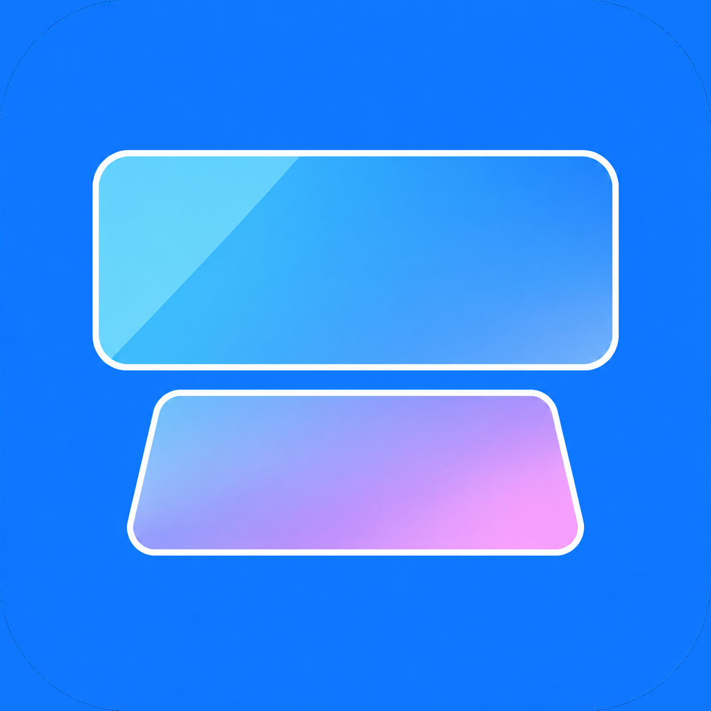
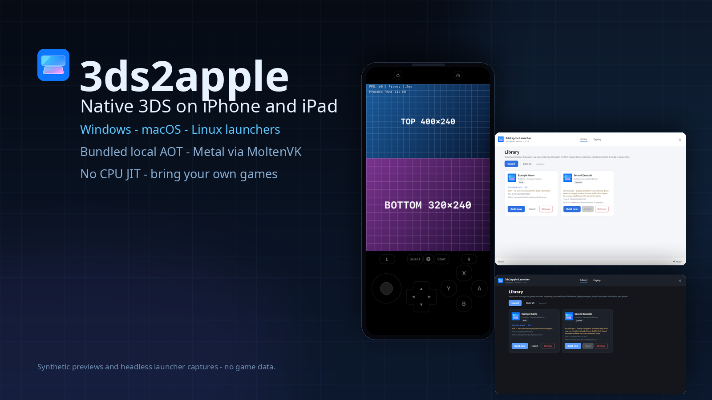
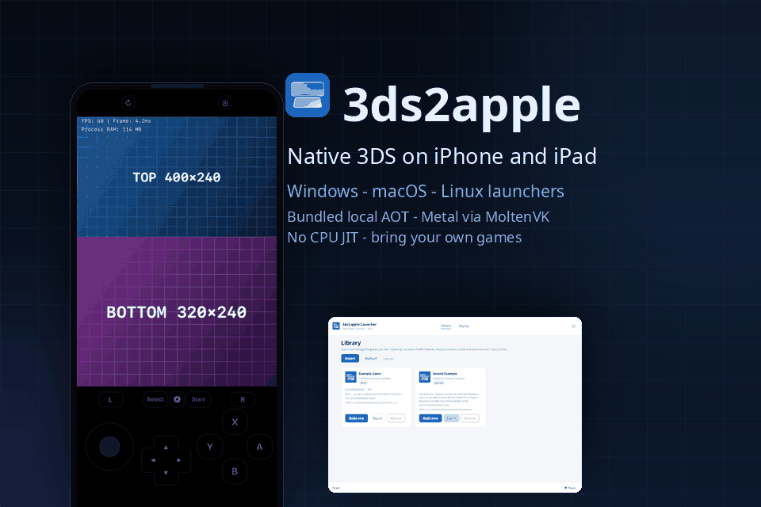
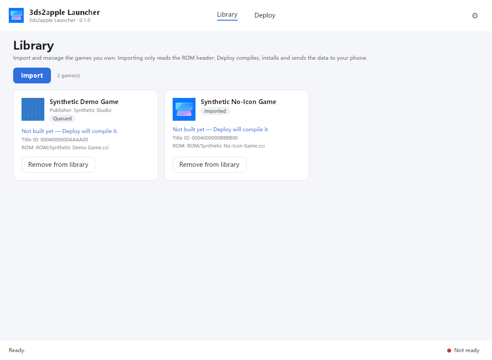
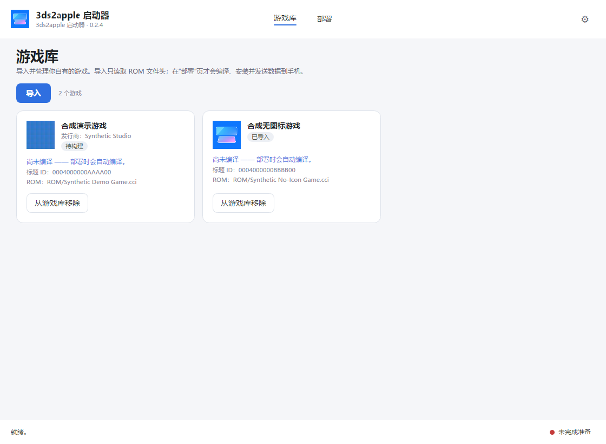
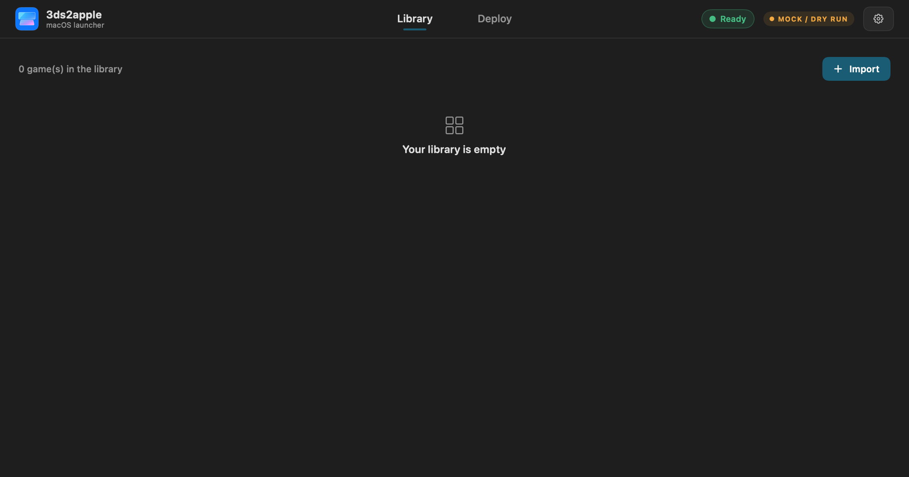
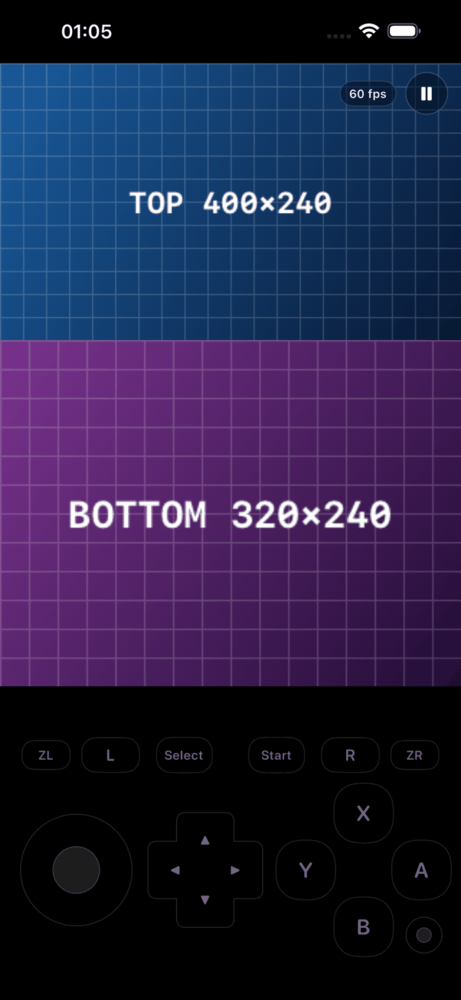
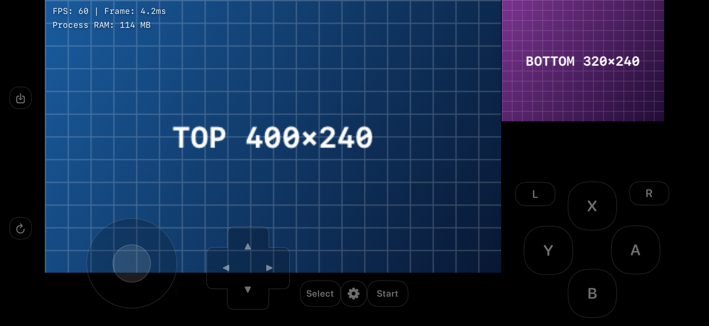

<p align="center"></p>

<h1 align="center">3ds2apple</h1>

<p align="center">
  <a href="README.md">EN</a> · <a href="README.zh-CN.md">简体中文</a> · <a href="README.ja.md">日本語</a> · <a href="README.ko.md">한국어</a>
</p>

<p align="center">
  <a href="#다운로드"><b>다운로드</b></a> ·
  <a href="https://hfykratos.github.io/3ds2apple/">웹사이트</a> ·
  <a href="https://hfykratos.github.io/3ds2apple/press/">프레스 키트</a> ·
  <a href="https://github.com/HFYKratos/3ds2apple/releases">릴리스</a> ·
  <a href="https://github.com/HFYKratos/3ds2apple/discussions">Discussions</a> ·
  <a href="CONTRIBUTING.md">기여</a>
</p>

<p align="center">
  <a href="LICENSE"></a>
  <a href="https://github.com/HFYKratos/3ds2apple/releases/tag/v0.3.1"></a>
  <a href="https://github.com/HFYKratos/3ds2apple/releases/latest"></a>
  <a href="https://github.com/HFYKratos/3ds2apple/releases"></a>
  <a href="https://github.com/HFYKratos/3ds2apple/actions/workflows/ci.yml"></a>
</p>

> [!NOTE]
> 이 문서는 커뮤니티 번역입니다. 기준은 영어판 [README.md](README.md)이며, 내용이 다를 경우 영어판이 우선합니다.

**직접 소유한 Nintendo 3DS 게임을 iPhone과 iPad에서 네이티브로 실행 — AOT로 컴파일된 ARM64, MoltenVK를 거치는 Metal, CPU JIT 없음, 인터프리터 폴백 없음.**

## 다운로드

<p align="center">
  <a href="https://github.com/HFYKratos/3ds2apple/releases/download/v0.3.1/3ds2apple-0.3.1-windows-x64.zip"></a>
  <a href="https://github.com/HFYKratos/3ds2apple/releases/download/v0.3.1/3ds2apple-0.3.1-macos-universal.zip"></a>
  <a href="https://github.com/HFYKratos/3ds2apple/releases/download/v0.3.1/3ds2apple-0.3.1-linux-x86_64.tar.gz"></a>
  <a href="https://github.com/HFYKratos/3ds2apple/releases"></a>
</p>

<p align="center"><sub><b>최신 안정 버전: v0.3.1</b> · Windows 10/11 런처(검증된 경로) · macOS 13+ 런처(개발자 프리뷰, <a href="https://github.com/HFYKratos/3ds2apple/issues/1">#1</a> 참고) · Linux x86_64 런처(검증된 경로; 로컬 AOT 지원: 3dsrecomp + LLVM/LLD 23.1.6 내장) · iOS 앱은 런처가 사용자의 Apple ID로 구성·서명·설치하므로 별도의 iOS 다운로드는 없습니다.</sub></p>

<p align="center">
  
</p>

> [!NOTE]
> 3ds2apple은 무료 오픈 소스 소프트웨어(Apache-2.0)입니다. 런처와 iOS 앱에는 게임, 키, BIOS가 포함되지 않습니다. 직접 소유하고 직접 덤프한 복호화 ROM으로 자신의 게임 라이브러리를 구축하세요.

## 30초 요약

3ds2apple은 직접 소유한 Nintendo 3DS 게임을 위한 네이티브 이식 파이프라인이며 에뮬레이터 앱이 아닙니다. 직접 덤프한 복호화 ROM을 Windows, macOS, Linux 런처로 가져오면 3dsrecomp가 3DS 코드를 C로 변환하고, 로컬 LLVM 또는 Apple clang 툴체인(Linux 런처는 내장 3dsrecomp + LLVM/LLD 23.1.6)이 타이틀마다 ARM64 `GamePack` 하나를 빌드합니다. 런처는 ROM이 없는 베이스 IPA를 구성하고 사용자의 Apple ID로 서명·설치한 뒤 게임 데이터(`GameRom.cci` + `GameInfo.json`)만 앱의 Documents 폴더로 푸시합니다. 휴대폰에서는 Zakuro HLE 런타임이 이 네이티브 코드를 직접 실행하고 MoltenVK가 PICA200 GPU 호출을 Metal로 변환합니다. 앱 하나에 라이브러리 전체가 들어가고, 일시정지 메뉴에서 화면 레이아웃, 컨트롤, 세이브 스테이트, 진단을 다룰 수 있습니다. 게임, 키, BIOS는 포함되지 않습니다. 게임은 직접 준비하세요.

## 데모

<p align="center">
  
</p>

<p align="center"><sub>0.2.1 합성 프리뷰, 게임 데이터 없음: 세로 화면 컨트롤 → 가로 화면 컨트롤 → 게임 내 메뉴 → 성능 오버레이 설정.</sub></p>


## 기능 한눈에 보기

<table>
  <tr>
    <td align="center" width="25%">⚡<br><b>에뮬레이션이 아닌 네이티브 AOT</b><br><sub>모든 게임은 실행 전에 ARM64로 다시 컴파일됩니다. 출시 경로에는 CPU JIT도, 인터프리터 폴백도 없습니다.</sub></td>
    <td align="center" width="25%">📚<br><b>앱 하나에 라이브러리 전체</b><br><sub>선택한 각 타이틀은 하나의 서명된 앱 안에 있는 GamePack입니다. 푸시한 게임 데이터는 업데이트 후에도 유지됩니다.</sub></td>
    <td align="center" width="25%">🎮<br><b>New 3DS 컨트롤 전체</b><br><sub>십자키, A/B/X/Y, L/R, ZL/ZR, Start/Select, 진짜 아날로그 Circle Pad, C 스틱. 기본 레이아웃은 세로 ModernFS / 가로 ModernHybrid 두 Delta 참조 스킨을 따르며 설정 버튼은 스킨의 HOME 슬롯에 항상 표시됩니다. 편집 가능한 빨리 감기, 빠른 저장, 빠른 불러오기, 화면 교체 버튼. MFi, Xbox, DualSense 컨트롤러 지원.</sub></td>
    <td align="center" width="25%">🧭<br><b>가로 6종 + 세로 3종, 모두 GPU</b><br><sub>가로 6종·세로 3종 프리셋에 임의의 사용자 지정 사각형까지 모두 GPU 프레젠터가 매 프레임 리드백 없이 그립니다. 네 방향 회전과 상하 화면 교체, 그리고 실험적 렌더러 최적화 스위치 6개도 지원.</sub></td>
  </tr>
  <tr>
    <td align="center" width="25%">✏️<br><b>게임 내에서 컨트롤 편집</b><br><sub>일시정지한 화면 위에서 컨트롤을 드래그하고 '완료'를 탭하세요. 버튼별 표시, 10%–200% 크기, 불투명도를 지원합니다.</sub></td>
    <td align="center" width="25%">💾<br><b>세이브와 세이브 스테이트</b><br><sub>배터리 세이브는 앱 컨테이너에 저장되고, 게임마다 세이브 스테이트 슬롯 3개가 있으며, 세이브 관리자에서 내보내기와 가져오기, 그리고 코드별로 켜고 끌 수 있는 자신의 Citra/Azahar 치트 파일을 지원합니다.</sub></td>
    <td align="center" width="25%">⏩<br><b>빨리 감기, 성능 오버레이, HUD</b><br><sub>2x 빨리 감기 토글, 편집 가능한 빠른 저장과 빠른 불러오기, 선택형 성능 오버레이(화면 맨 위 가장자리에 표시. FPS, 프레임 시간, 속도, 앱 메모리, 사용 가능 메모리. 6개 위치, 줄 전환, 선택형 배경), 시스템 Metal HUD(기본 꺼짐), 원탭 진단 내보내기.</sub></td>
    <td align="center" width="25%">🖥️<br><b>Windows, macOS, Linux 런처</b><br><sub>한 창에서 가져오기 → 빌드 → 서명 → 설치 → 푸시. Windows와 Linux 런처가 검증된 경로입니다: Windows는 게임 데이터를 보존하는 증분 배포를 지원하고, Linux 런처는 같은 UI를 공유하고 내장 plumesign-linux로 서명·설치하며, Linux는 내장 3dsrecomp + LLVM/LLD 23.1.6으로 GamePack을 로컬 빌드할 수 있으며 .32a 패키지 가져오기도 지원합니다. 빌드된 게임의 내보내기 대화상자 하나에서 빌드 완료 패키지(.32a) 또는 서명 가능한 패키지(서명되지 않은 자체 완결형 단일 게임 IPA)를 선택한 형식과 대상으로 내보낼 수 있고, 가져오기로 ROM을 추가하고 .32a 패키지도 다시 가져올 수 있으며, 고급 AOT 빌드 설정은 설정 페이지에 있습니다.</sub></td>
  </tr>
</table>

## 화면 레이아웃: 가로 6종, 세로 3종

**설정 → 디스플레이 → 화면 레이아웃**에서 가로와 세로 방향을 독립적으로 설정합니다.

- **가로 화면 레이아웃(6종)**: 큰 화면 · 단일 화면 · 나란히 보기 · 하이브리드 · 원본 · 사용자 지정 레이아웃.
- **세로 화면 레이아웃(3종)**: 기본 · 원본 · 사용자 지정 레이아웃.

**하이브리드**는 큰 상단 화면 옆에 작은 화면 두 개를 위아래로 쌓은 구성이고, 세로 **기본**은 상단 화면을 아래 화면 위에 전체 너비로 배치합니다.

가로 화면에서는 화면 박스가 위쪽에 정렬됩니다: **큰 화면**, **나란히 보기**, **하이브리드**는 화면 상단에 붙고(위쪽 검은 띠가 사라짐), 가로 방향은 가운데 정렬을 유지하며 화면 비율과 정수 배율도 그대로입니다.

모든 프리셋 배치는 GPU 프레젠터가 그립니다. Metal 경로이며 매 프레임 화면 리드백이 없습니다. **사용자 지정 레이아웃**은 두 화면을 임의의 사각형에 배치합니다. X/Y/너비/높이를 퍼센트로 편집할 수 있고(필드 아래 실시간 미리보기) 화면을 드래그할 수도 있습니다. 사용자 지정 레이아웃도 GPU 프레젠터가 그리며(임의 사각형, 네 방향 회전, 상하 화면 교체) 느린 리드백 경로로 돌아가지 않습니다. 사용자 지정 레이아웃은 여전히 다음 게임 로드부터 적용됩니다.

화면 회전과 인터페이스 방향은 유지됩니다. 렌더링 해상도(1x–4x)는 두 부분으로 나뉩니다. 표시용 drawable은 즉시 바뀌지만, 호스트 GPU 3D 렌더러의 내부 배율은 시스템 로드 시 고정되므로 실행 중인 게임은 다시 로드할 때까지 이전 내부 해상도를 유지합니다——Settings → Graphics와 게임 내 메뉴의 두 Resolution 행에 **재시작 필요** 배지와 **게임을 다시 시작하면 적용됩니다** 안내가 있습니다. 0.1.5에서 기존 화면 비율과 정수 배율 스위치는 제거되었습니다.

## 렌더러 최적화(실험적)

**설정 → 그래픽 → 렌더러 최적화**에는 하드웨어(Vulkan/MoltenVK) 렌더러의 그리기 방식을 바꾸는 실험적 스위치 6개가 있습니다. 여섯 개 모두 **기본적으로 꺼져** 있으며, 렌더러가 게임 로드를 위해 장치를 만들 때 한 번만 읽히므로 변경 사항은 앱을 강제 종료하고 다시 실행한 뒤에 적용됩니다.

- **동등 드로우 건너뛰기** — 어느 버퍼도 바꿀 수 없는 동등한 드로우를 건너뜁니다.
- **중복 캡처 건너뛰기** — 아무것도 그려지지 않은 반복 화면 캡처를 건너뜁니다.
- **렌더 패스 병합** — 깊이 버퍼가 없는 드로우를 이미 깊이 버퍼가 있는 패스에 병합합니다.
- **빠른 이미지 클리어** — 전체 화면 이미지를 이미지 클리어 명령으로 지웁니다.
- **불투명 드로우 정렬** — 배치 안에서 불투명 드로우를 앞에서 뒤로 그립니다.
- **좁은 렌더 배리어** — 렌더 타깃 전환 후 배리어를 어태치먼트 단계로 좁힙니다.

이 스위치는 GPU 경로에만 영향을 줍니다. 소프트웨어 PICA200 렌더러에서는 읽히지 않으며 아무것도 바뀌지 않습니다. 게임에 그래픽 차이가 나타나면 원인이 되는 스위치를 찾기 위해 하나씩 끄세요. **재설정**은 여섯 개를 모두 끔 상태로 되돌립니다. 진단 보고서에는 해당 세션에서 켜져 있던 스위치가 기록됩니다.

## 가상 컨트롤과 일시정지 메뉴

화면 컨트롤은 New 3DS 전체 세트입니다. 십자키, A/B/X/Y, L/R, ZL/ZR, Start/Select, 진짜 아날로그 Circle Pad, New 3DS C 스틱을 갖춥니다. Circle Pad는 (축마다 -1~1, 손가락을 쉬면 정확히 0이 되는 작은 데드존 포함) 실제 아날로그 값을 보고하며 두 번째 십자키 역할을 하지 않습니다. C 스틱도 마찬가지입니다. 위치와 크기는 두 Delta 참조 스킨의 지오메트리만을 기반으로 합니다(아트워크 없음): 세로 화면은 **ModernFS**, 가로 화면은 **ModernHybrid**. 스킨의 HOME 슬롯은 **설정** 버튼 하나이며 게임 내 메뉴를 엽니다(전체 설정 페이지는 메뉴의 '전역 설정' 행에 있습니다). 스킨의 볼륨 키는 구현하지 않았습니다. 세로 화면에서는 본체 컨트롤이 화면 아래 검은 띠에 놓이고(숄더 행, 그 아래 메인 세트. D-pad는 네 개의 개별 버튼이 아니라 하나의 십자(네 방향 누름 영역, 누른 채 밀면 방향 변경)로 그려집니다), 빠른 저장/빠른 불러오기는 노치 바로 아래 양쪽 끝(왼쪽 LOAD, 오른쪽 SAVE)에 있습니다. 가로 화면의 컨트롤 지오메트리는 이전과 같고, 빠른 저장/빠른 불러오기는 왼쪽 노치 옆에서 SAVE가 위쪽 절반, LOAD가 아래쪽 절반에 놓여 화면 중앙을 기준으로 대칭입니다(가로 화면의 Dynamic Island 영역을 피합니다). 스킨이 그리지 않는 다섯 컨트롤—ZL, ZR, C 스틱, 빨리 감기, 화면 교체—은 두 방향 모두 기본 숨김입니다. **컨트롤 전환**에서 활성화하면 게임 화면 위쪽 한 줄(왼쪽부터 ZL, 빨리 감기, C 스틱, 화면 교체, ZR)에 나타나며 레이아웃 편집 모드에서 원하는 위치로 드래그할 수 있습니다. 게임 실행 중에는 시스템 상태 표시줄(시간, 배터리, 신호)이 숨겨집니다. 게임 내 메뉴는 설정과 같은 iOS 그룹 스타일이며, 세로 화면은 단일 슬라이드업, 가로 화면은 중앙 카드, 네이티브 push/pop 하위 페이지, 헤더의 게임 이름을 사용합니다.

하드웨어 컨트롤러의 왼쪽 스틱은 Circle Pad, 오른쪽 스틱은 C 스틱에 연결되고 L2/R2는 ZL/ZR에 매핑됩니다. 여러 손가락으로 버튼을 누르면서 스틱을 조작할 수 있습니다.

일시정지한 게임의 **가상 컨트롤** 카드에서 패드를 커스터마이징합니다.

- **패드 표시/숨기기**, 성능 오버레이, 햅틱. 패드를 끄면 **설정** 버튼을 제외한 모든 가상 컨트롤이 숨겨집니다. 설정 버튼은 HOME 슬롯의 원래 위치에 남아 게임 내 메뉴를 열 수 있습니다.
- **화면 버튼** — 항상 표시되는 설정 버튼(게임 내 메뉴 열기), 빨리 감기 토글(2x 켜기/끄기), 빠른 저장, 빠른 불러오기, 화면 교체. 설정을 제외한 나머지 버튼은 본체 컨트롤처럼 이동·크기·표시/숨김을 설정할 수 있지만, 설정 버튼은 이동과 크기 조절만 가능하고 숨길 수는 없습니다.
- **레이아웃 편집** — 일시정지한 화면 위에서 컨트롤을 드래그하고 중앙의 **완료**로 현재 방향을 저장한 뒤 재개합니다.
- **컨트롤 전환** — 방향별 표시 설정: ZL, ZR, C 스틱, 빨리 감기, 화면 교체는 두 방향 모두 기본 숨김이고, 기본 스킨이 그리는 나머지 컨트롤(세로 D-pad 포함)은 기본 표시입니다. 설정 버튼은 숨길 수 없어 목록에 나오지 않습니다(크기는 '크기 조정'에서 변경 가능). 이전 저장 데이터에서 설정 버튼을 숨겼다면 자동으로 해제됩니다. 수정하지 않은 0.2.0, 0.2.1-beta1 또는 0.2.1-beta2 기본 표시 집합은 한 번만 새 기본값으로 마이그레이션되고, 사용자 지정 집합은 유지됩니다.
- **크기 조정** — 버튼 또는 그룹마다 10%–200%, 기본값 100%(전역).
- **불투명도 조정**과 **재설정**.

표시는 방향별로 설정합니다(‘컨트롤 전환’은 현재 방향을 편집). 크기와 불투명도는 전역이고 세로/가로 위치는 각각 별도로 유지됩니다. C 스틱은 New 3DS 너브를 읽는 게임과 현재 런타임으로 빌드된 셸이 필요합니다(`scripts/build-zakuro-ios.sh`를 소스에서 빌드한 셸에 포함됨).

## 게임 내 레이아웃 편집

게임을 일시정지하고 **가상 컨트롤 → 레이아웃 편집**을 엽니다. 각 컨트롤에는 고유한 히트 영역이 있어 잡은 컨트롤만 일시정지한 화면 위에서 드래그할 수 있고, 중앙의 **완료**로 현재 방향을 저장한 뒤 재개합니다. 같은 카드에서 버튼별 표시, 10%–200% 크기, 불투명도, **재설정**도 다룰 수 있습니다. 세로와 가로 위치는 별도로 저장됩니다.

화면 레이아웃은 **설정 → 디스플레이 → 화면 레이아웃**에서 따로 편집합니다. 퍼센트 필드(실시간 미리보기 포함) 또는 전체 화면 드래그 편집기(드래그로 이동, 핀치로 크기 조절. 미리보기가 손가락을 따라가고 제스처가 끝날 때 커밋되어 레이아웃이 더 이상 떨리지 않습니다)를 사용합니다. 가로 사용자 지정 레이아웃을 편집하는 동안은 가로 화면으로 고정됩니다. 프리셋은 즉시 적용되고 사용자 지정 화면 레이아웃은 다음 게임 로드부터 적용됩니다.

## 치트 코드

치트 코드는 앱이나 런처가 포함하는 것이 아니라 직접 준비하는 Citra/Azahar 형식의 텍스트 파일입니다. 앱은 `Documents/Cheats/<TITLEID>.txt`(게임 폴더와 같은 16자리 타이틀 ID)에서 읽으며, 형식은 데스크톱 도구와 같습니다. `[name]` 줄, 선택적 `*citra_enabled` 줄, 그 뒤에 `XXXXXXXX YYYYYYYY` 코드 줄이 이어집니다.

- **설정 → 치트**에는 라이브러리의 각 게임과 그 치트 파일이 나열됩니다. 파일 앱에서 UTF-8 `.txt`를 가져오고, 내장 편집기에서 붙여넣거나 편집하고, 치트마다 켜고 끄며, 공유 시트로 현재 파일을 내보낼 수 있습니다.
- **게임 내 메뉴 → 치트**는 실행 중인 게임의 코드를 보여 주고 플레이 중에 켜고 끌 수 있습니다. 변경은 다음 프레임부터 적용되며 같은 파일에 다시 기록됩니다.
- **코드 데이터베이스는 내장되어 있지 않습니다.** 앱은 코드를 포함하지 않고 아무것도 다운로드하지 않습니다. 직접 제공한 코드만 사용됩니다. 런타임은 최대 128개 치트, 파일당 256 KiB, 치트당 1024줄까지 허용합니다.
- **데이터 패치만 지원 대상입니다.** 게임 자체의 코드를 바꾸는 코드는 AOT 빌드에서 느려지거나 꺼야 할 수 있습니다. 게임 데이터를 바꾸는 코드가 지원되는 경우입니다. 치트를 쓰기 전에 세이브를 백업하세요.

## 휴대용 빌드 패키지, 단일 게임 IPA, 빌드 옵션

데스크톱 런처는 빌드된 게임을 패키징하고 AOT 코드의 컴파일 방식을 조정할 수 있습니다.

빌드된 게임에는 라이브러리에 **내보내기** 동작이 하나뿐이고(실제 AOT GamePack이 생기기 전에는 비활성화되며 카드가 먼저 빌드하라고 안내), 헤더에는 **가져오기**가 하나뿐입니다. 파일 선택기는 복호화 ROM(`.3ds` / `.cci` / `.ncch` / `.cxi`, 여러 개 선택 가능)과 `.32a` 빌드 패키지를 모두 받아들이고 확장자로 자동 분기합니다. ROM은 헤더만 읽어 라이브러리에 추가되고, `.32a`는 빌드 패키지 가져오기(교체 확인 흐름 유지)로 처리됩니다. 없는 파일이나 지원하지 않는 파일은 알려지고 아무것도 가져오지 않습니다.

- **내보내기 대화상자** — **내보내기**를 누르면 창 안 대화상자가 열리며, 형식(**빌드 완료 패키지**(.32a) 또는 **서명 가능한 패키지**(서명되지 않은 단일 게임 IPA))과 대상(.32a는 폴더, IPA는 저장 파일 경로. 기본값은 각각 `workspace/export/32a`, `workspace/export/ipa`)을 고르고, 경고(사용자 자신의 게임 데이터 포함 가능·로컬 보관만, IPA는 서명되지 않아 Sideloadly 또는 AltStore 필요)를 보여 줍니다. 두 형식 모두 파일 이름은 `<TITLEID>-<SMDH 영어 이름><확장자>`(버전 번호나 `unsigned` 접미사 없음)이며, 내보내기 성공 메시지는 `Exported: <path>`입니다. 서명·설치·업로드는 하지 않습니다.
- **빌드 완료 패키지(.32a)** — 내보내기 대화상자의 **빌드 완료 패키지** 형식이 `<TITLEID>-<SMDH 영어 이름>.32a`를 `<휴대용 데이터 폴더>/workspace/export/32a`(또는 선택한 폴더)에 씁니다. ZIP에는 내보내기 매니페스트, GamePack, `GameInfo.json`, SMDH 커버, 그리고 기본적으로 사용자 자신의 게임 데이터(ROM)가 들어 있습니다. 헤더의 **가져오기**에서 `.32a`를 고르면 먼저 패키지 전체(매니페스트 schema, 타이틀 ID, pack SHA-256과 Mach-O, 모든 선택적 페이로드 해시)를 검증한 뒤 런처 작업 공간에 설치하므로 빌드를 다른 컴퓨터로 옮겨 배포하거나 다시 내보낼 수 있습니다. 같은 타이틀이 이미 있으면 명시적인 **교체** 확인 후에만 덮어씁니다. `.32a`를 가져오면 라이브러리 항목의 ROM 경로가 가져온 `.32a` 파일 자체가 되며, 이후 빌드·배포·IPA 내보내기에서는 그 안에 담긴 ROM을 사용하므로 원본 ROM 파일을 옆에 둘 필요가 없습니다. Windows에서는 패키지의 `manifest.json`이 현재 빌드 방법(툴체인, AOT 옵션의 O 레벨/LTO/fast-math, GamePack ABI)과 일치하면 가져오기 시 빌드 기록도 복원됩니다. 가져오기 상태에 **빌드 캐시 기록됨**이 표시되고, 다음 배포에서는 패키지의 GamePack을 그대로 재사용하므로 다시 컴파일하지 않습니다. 빌드 방법/툴체인이 다르거나 게임 데이터가 내장되지 않았거나 manifest가 없는 구버전 CLI 패키지는 안전하게 기록되지 않으며, 가져오기 상태에 이유가 표시되고 다음 배포에서 다시 컴파일됩니다. **.32a에는 자신의 게임 데이터가 들어 있을 수 있습니다. 로컬에 보관하고 절대 업로드하거나 저장소에 커밋하지 마세요.**
- **서명 가능한 패키지(서명되지 않은 단일 게임 IPA)** — 내보내기 대화상자의 **서명 가능한 패키지** 형식이 `<TITLEID>-<SMDH 영어 이름>.ipa`를 `<휴대용 데이터 폴더>/workspace/export/ipa`(또는 선택한 저장 경로)에 씁니다(서명되지 않은 자체 완결형 단일 게임 IPA). 셸 템플릿에 해당 GamePack 하나와 단일 게임용 `GameCatalog.json`을 조합하고, 앱 아이콘을 게임의 SMDH 커버로 바꾸며, 라이브러리가 준비되면 해당 게임을 바로 열도록 카탈로그를 표시하고, 사용자 자신의 게임 데이터(ROM)를 IPA에 내장하므로 파일 크기는 대략 ROM + 코드입니다. Sideloadly 또는 AltStore로 직접 서명해 설치하면 홈 화면에는 게임 자체의 이름(런처가 SMDH 로컬라이즈 이름으로 앱 표시 이름을 바꾸며, 해당 언어가 없으면 영어 이름. 3ds2apple 아님)이 표시되고, 앱을 열면 바로 해당 게임이 시작됩니다——단일 게임 빌드에는 라이브러리나 홈 페이지가 없습니다. 내장 데이터 검증에 실패하면 라이브러리로 돌아가지 않고 **다시 시도**와 **로그 내보내기**가 있는 전용 오류 화면을 표시합니다. 게임 내 메뉴는 일반과 같지만 단일 게임 빌드에는 **게임 종료**와 **앱별 설정** 행이 없습니다(런처에서 푸시할 필요가 없습니다) 파일에는 자신의 게임 데이터가 들어 있으므로 로컬에 보관하세요. **절대 업로드하거나 저장소에 커밋하지 마세요.** 런처는 서명도 업로드도 하지 않습니다.
- **고급 빌드 설정** — 런처 **설정** 페이지에 있습니다(배포 페이지에는 더 이상 없음): AOT 최적화 수준(**O1 / O2 / O3 / Oz**, 기본 **O2**), 링크 타임 최적화(기본 **끔**. 빌드/링크가 느려짐), fast-math(기본 **끔**. guest 부동소수점 결과가 바뀌므로 측정·실험용)를 설정할 수 있습니다. 각 항목에 영향 설명과 **기본값으로 재설정**이 있으며, 기본값은 현재 출시 빌드와 같으며, 변경은 다음 빌드에 적용되고 영향을 받는 GamePack 캐시를 무효화하므로 오래된 pack을 재사용하지 않고 다시 빌드됩니다.
- **카드 동작** — 각 카드에 **지금 빌드**, **내보내기**, 빨간 파괴적 스타일의 **제거**(확인 대화상자 유지)가 있습니다. 최소 창 너비에서는 버튼 행이 줄바꿈되어 넘치지 않습니다.
- **서명 갱신 / Refresh signing** — 두 런처의 Deploy 페이지에 있는 **서명 갱신** 버튼은 최근 배포로 구성했거나 단일 게임으로 내보낸 IPA를 그 자리에서 다시 서명해 덮어 설치하여 무료 Apple ID의 7일 서명을 갱신합니다. Windows는 내장 Impactor/plumesign을 사용하고, macOS는 로컬 Apple Development 인증서와 저장된 entitlements/프로비저닝 프로파일을 재사용해 `devicectl`로 덮어 설치하므로 같은 앱을 업데이트합니다(교체가 아님). 다시 컴파일·재구성·게임 추가·GamePack 업데이트는 하지 않으며(그것은 배포 사용), 설치된 앱의 게임 데이터와 세이브는 유지됩니다. 사용할 IPA가 없으면 버튼이 비활성화됩니다(먼저 배포하거나 한 번 내보내세요). macOS는 마지막으로 서명한 shell App도 필요하며, 없으면 먼저 한 번 배포하라고 안내합니다.

## 스크린샷

**데스크톱 런처** — 실제 앱 스크린샷입니다. 라이브러리 항목은 합성 데모 항목이며 게임 아트는 포함되지 않습니다.

| Windows 런처 | Windows 런처(简体中文) | macOS 런처 |
|:---:|:---:|:---:|
|  |  |  |
| 라이브러리(English) | 라이브러리(中文) | 빈 라이브러리(다크) |

**iOS 앱** — 화면 컨트롤의 합성 프리뷰입니다. 게임 데이터는 없습니다.

| 세로 | 가로 |
|:---:|:---:|
|  |  |
| 세로 컨트롤 | 가로 컨트롤 |

## 빠른 시작

**필요 조건**: 직접 소유한 복호화 3DS ROM, 개발자 모드가 켜진 iOS 16+ iPhone/iPad, USB 케이블, 서명용 본인의 Apple ID. 게임 데이터는 포함되지 않습니다.

1. **런처 다운로드.** Windows 10/11: zip을 쓰기 가능한 폴더(`Program Files` 제외)에 풀고 `3ds2apple-launcher.exe`를 실행합니다. USB로 휴대폰에 연결할 수 있게 *Apple Devices*를 설치하세요. macOS 13+: `3ds2apple-launcher.app`의 압축을 풉니다(개발자 프리뷰. Xcode 15+, `xcodegen`, 저장소 체크아웃, 빌드된 도구도 필요합니다). Linux x86_64: `3ds2apple-<version>-linux-x86_64.tar.gz`를 쓰기 가능한 폴더에 풀면 됩니다(페이로드는 자체 완결형).
2. **가져오기 및 배포.** 헤더의 **가져오기**로 직접 덤프한 복호화 `.3ds`/`.cci`(같은 선택기에서 `.32a` 빌드 패키지도 선택 가능)를 가져와 게임을 선택하고 유일한 배포 버튼을 누릅니다. 런처가 게임마다 GamePack을 컴파일하고(가져온 `.32a`의 빌드 방법이 일치하면 그 GamePack을 재사용해 다시 컴파일하지 않음), ROM이 없는 IPA를 구성하고, 본인의 Apple ID로 서명·설치한 뒤 게임 데이터만 푸시합니다.
3. **플레이.** 휴대폰에서 앱을 엽니다. 게임 추가·제거는 다시 배포하면 되고, 푸시한 게임 데이터는 재설치와 업데이트 후에도 유지됩니다(완전 삭제 시 사라짐).

macOS 설정과 서명 제한을 포함한 자세한 절차는 [시작하기](#시작하기)에 있습니다.

## FAQ

### 3ds2apple은 에뮬레이터인가요?

아니요. 네이티브 이식 및 재컴파일 파이프라인입니다. 각 게임은 C로 변환되어 미리 ARM64로 컴파일되고, Zakuro HLE 런타임을 통해 직접 실행됩니다. 출시 경로에는 CPU JIT도 인터프리터 폴백도 없습니다.

### 모든 게임이 동작하나요?

호환성은 게임마다 다릅니다. 부팅에 실패하거나 렌더링이 잘못되는 타이틀이 있고, 일부 게임의 일부 메뉴가 잘못 그려질 수 있습니다([#2](https://github.com/HFYKratos/3ds2apple/issues/2)에서 추적). 호환성이나 성능 보장도 없습니다. 16자리 타이틀 ID를 포함한 제보를 환영합니다.

### ROM, 키, BIOS는 어디서 구하나요?

이 프로젝트에서는 제공하지 않습니다. 3ds2apple은 게임 데이터를 포함하지 않으며 ROM, BIOS, 키 다운로드나 불법 복제 지원을 제공하지 않습니다. 법적으로 소유하고 직접 덤프한 복호화 ROM만 지원합니다.

### Mac이 필요한가요?

아니요. Windows와 Linux 런처 모두 GamePack을 로컬 빌드하고(Windows는 내장 LLVM/LLD, Linux는 내장 3dsrecomp + LLVM/LLD 23.1.6) 각각 내장 Impactor/plumesign으로 서명·설치하므로, 두 검증된 경로 모두 Mac이 필요 없습니다. macOS 런처는 **개발자 프리뷰**입니다. macOS 13+, Apple ID로 로그인한 Xcode 15+, `xcodegen`, 저장소 체크아웃, 빌드된 도구가 필요하고, 실제 기기 설치가 아직 메인테이너에 의해 검증되지 않았습니다(이슈 [#1](https://github.com/HFYKratos/3ds2apple/issues/1)).

### Linux 런처가 있나요?

예. Linux x86_64 GUI 런처로 Windows 런처의 Avalonia UI와 엔진을 공유합니다. ROM과 `.32a` 패키지 가져오기, 일치하는 패키지의 빌드 캐시 재사용, 내장 공식 `plumesign-linux`로 서명·덮어 설치(Apple ID와 2FA는 터미널과 plumesign 자체 저장소에만 남음), 내장 Linux `devpush`와 `usbmuxd`로 게임 데이터 푸시, **서명 갱신**으로 7일 서명 갱신을 지원합니다. 로컬 AOT도 지원합니다: 내장 3dsrecomp + LLVM/LLD 23.1.6으로 GamePack을 빌드해 그대로 서명·설치할 수 있으며, **빌드 완료 패키지**(`.32a`)를 가져와 GamePack과 빌드 캐시를 재사용할 수도 있습니다. 자세한 내용은 [launcher/linux/README.md](launcher/linux/README.md)를 참고하세요.

### App Store에서 받을 수 있나요?

아니요. 런처가 본인의 Apple ID로 앱을 구성·서명하고(Windows는 내장 공식 Impactor, macOS는 Xcode 자동 서명, Linux는 내장 plumesign-linux) USB로 설치합니다. 3ds2apple은 Nintendo 또는 Apple과 제휴하거나 승인받지 않았습니다.

### 왜 일주일쯤 지나면 앱이 열리지 않나요?

무료 Apple ID는 기기당 앱 3개, 서명 약 7일로 제한됩니다. Windows에서는 Deploy 페이지의 **서명 갱신**으로 최근 IPA를 다시 서명해 덮어 설치할 수 있고(다시 빌드할 필요 없음, 앱의 Documents 데이터와 세이브 유지), macOS에서도 같은 **서명 갱신** 버튼으로 로컬 Apple Development 인증서를 사용해 최근 IPA를 다시 서명할 수 있으며 앱 데이터와 세이브는 유지됩니다. SideStore로 설치한 앱은 SideStore가 직접 갱신합니다. 유료 개발자 계정은 이 제한이 없습니다. 게임별 코드는 서명된 IPA 안에 있어야 하며(iOS는 Documents에서 서명되지 않은 dylib을 로드하지 않음), 게임 추가·업데이트에는 한 번의 덮어쓰기 설치가 필요합니다——게임 데이터와 세이브는 유지됩니다.

### 다시 배포하면 세이브나 게임 데이터가 지워지나요?

게임 데이터는 `Documents/Games/<TITLEID>/`에, 세이브와 세이브 스테이트는 앱 컨테이너에 있습니다. 푸시한 데이터와 세이브는 재설치와 업데이트 후에도 유지되며, 완전 삭제 시 제거됩니다. 필요한 것은 미리 백업하세요. 게임 추가·GamePack 업데이트는 새 IPA를 덮어 설치하는 한 번의 배포입니다. 앱 자체는 삭제되지 않고 Documents의 게임 데이터, 세이브, 푸시한 데이터는 유지됩니다. **서명 갱신**은 같은 IPA의 서명만 갱신합니다. 컴퓨터의 ROM은 영향을 받지 않습니다.

### 성능은 어떤가요?

메인테이너가 실제 iPhone에서 Windows 런처 경로로 **시판 타이틀 한 개**를 측정한 결과 약 57–60 fps, AOT 100%, Metal GPU 렌더러였습니다. 이는 그 한 타이틀의 측정값일 뿐 보장이 아니며, 호환성과 성능은 게임마다 다릅니다.

### 사용자 지정 화면 레이아웃이 프리셋보다 느린가요?

이제 아닙니다. 0.1.6부터 사용자 지정 레이아웃도 GPU 프레젠터가 그립니다(임의 사각형, 네 방향 회전, 상하 화면 교체). 프리셋과 같은, 매 프레임 리드백이 없는 Metal 경로에 머뭅니다. 사용자 지정 레이아웃은 여전히 다음 게임 로드부터 적용됩니다.

### 빌드한 게임을 다른 컴퓨터로 옮길 수 있나요?

예. 라이브러리 카드에서 **내보내기**를 선택하고 **빌드 완료 패키지** 형식과 대상 폴더를 지정한 뒤, 다른 컴퓨터의 런처 헤더에서 **가져오기**(선택기는 ROM과 `.32a` 빌드 패키지를 모두 표시하며, `.32a` 파일을 고르면 빌드 패키지 가져오기가 됩니다)를 사용하면 그곳에서 배포하거나 다시 내보낼 수 있습니다. 패키지에는 GamePack, `GameInfo.json`, 아이콘, 그리고 기본적으로 자신의 게임 데이터가 들어 있으므로 로컬에 보관하세요. **절대 업로드하거나 저장소에 커밋하지 마세요.** 기존 타이틀 위로 가져오려면 명시적인 **교체** 확인이 필요하며 관련 없는 파일은 삭제되지 않습니다. 단일 게임 IPA 내보내기도 자체 완결형(해당 게임 데이터 내장)이지만, 이것은 서명해 설치하기 위한 결과물이며 런처 빌드 패키지가 아닙니다. 서명해 기기에 설치하고 로컬에 보관하며 절대 업로드하거나 저장소에 커밋하지 마세요.

### 내보낸 단일 게임 IPA는 서명되어 있나요?

아니요. 같은 **내보내기** 대화상자에서 **서명 가능한 패키지** 형식을 선택하면 서명되지 않은 자체 완결형 단일 게임 IPA를 만듭니다. 앱 아이콘은 게임의 SMDH 커버에서 가져오고, 사용자 자신의 게임 데이터(ROM)도 내장되며, 설치된 앱은 게임 자체의 로컬라이즈 이름을 쓰고 라이브러리 페이지가 없으므로 Sideloadly 또는 AltStore로 서명해 설치하면 앱을 열 때 바로 해당 게임이 시작됩니다(런처에서 푸시할 필요가 없습니다). 데이터 검증에 실패하면 라이브러리 대신 **다시 시도**가 있는 오류 화면을 표시합니다. 파일 크기는 대략 ROM + 코드이고 자신의 게임 데이터가 들어 있으므로 로컬에 보관하세요. **절대 업로드하거나 저장소에 커밋하지 마세요.** 런처는 서명도 업로드도 하지 않습니다.

### 치트 코드는 어떻게 추가하나요?

직접 준비한 Citra/Azahar `.txt`를 `Documents/Cheats/<TITLEID>.txt`에 둡니다. **설정 → 치트**에서 파일 앱으로 가져오거나 텍스트를 붙여넣어 추가하거나 파일 앱에서 직접 넣을 수 있습니다. 코드 켜기/끄기는 **설정 → 치트** 또는 게임 내 메뉴의 **치트** 페이지에서 합니다. 코드는 포함되지도 다운로드되지도 않으며 데이터 패치만 지원 대상입니다. 게임 코드를 바꾸는 코드는 AOT 빌드에서 느려질 수 있습니다. 사용 전에 세이브를 백업하세요.

### 실험적 렌더러 최적화는 효과가 있나요?

있을 수 있습니다. **설정 → 그래픽 → 렌더러 최적화**의 스위치 6개는 기본으로 꺼져 있고 적용하려면 앱을 다시 실행해야 하며 GPU(Vulkan/MoltenVK) 경로에만 영향을 줍니다. 게임에 따라 하나를 켜면 그래픽이 달라질 수 있습니다. 활성화 후 게임이 이상하게 동작하면 하나씩 끄거나 **재설정**으로 원인을 찾으세요.

## 법적 고지와 제한

- **게임은 직접 준비.** ROM, 키, BIOS, 시스템 파일, 게임 에셋을 제공하거나 링크하지 않으며 불법 복제 지원도 없습니다. 법적으로 소유하고 직접 덤프한 복호화 ROM만 사용하세요.
- **제휴·승인 없음.** 3ds2apple은 Nintendo 또는 Apple과 제휴하거나 후원·승인받지 않았고 App Store로 배포되지 않습니다. 본인의 Apple ID로 서명해 설치합니다.
- **보장 없음.** 호환성과 성능은 게임마다 다릅니다. 부팅에 실패하거나 렌더링이 잘못되는 타이틀이 있고, 일부 게임의 일부 메뉴가 잘못 그려질 수 있습니다(이슈 [#2](https://github.com/HFYKratos/3ds2apple/issues/2)). 호환성 또는 성능 보장은 없습니다.
- **macOS는 개발자 프리뷰.** 패키지가 아직 자체 완결적이지 않고 실제 기기 설치도 메인테이너에 의해 검증되지 않았습니다(이슈 [#1](https://github.com/HFYKratos/3ds2apple/issues/1)). Windows와 Linux가 검증된 경로입니다.
- **사용자 지정 화면 레이아웃은 0.1.6부터 GPU 경로입니다.** 임의 사각형, 네 방향 회전, 상하 화면 교체를 GPU 프레젠터가 그립니다(0.1.5 이전은 느린 리드백 경로였습니다). 적용은 여전히 다음 게임 로드부터입니다.
- **설계상 CPU JIT 없음.** 출시 경로는 AOT 코드와 Zakuro HLE 런타임이며 인터프리터 폴백이 없습니다.

## 프로젝트 링크

| | |
|---|---|
| **웹사이트** | <https://hfykratos.github.io/3ds2apple/> |
| **프레스 키트** | <https://hfykratos.github.io/3ds2apple/press/> |
| **다운로드** | [GitHub Releases](https://github.com/HFYKratos/3ds2apple/releases) |
| **이슈** | <https://github.com/HFYKratos/3ds2apple/issues> |
| **Discussions** | <https://github.com/HFYKratos/3ds2apple/discussions> |
| **기여** | [CONTRIBUTING.md](CONTRIBUTING.md) |
| **라이선스** | [Apache-2.0](LICENSE) |

## 지원 플랫폼

| 플랫폼 | 지원 |
|---|---|
| **iPhone / iPad** | iOS 16 이상. 앱 하나에 라이브러리, 새로워진 인게임 메뉴, 게임 내 레이아웃 편집이 가능한 New 3DS 전체 컨트롤, 가로 6종/세로 3종 화면 레이아웃, 세이브 스테이트, 성능 오버레이, 앱별 설정, 자신의 치트 파일, 실험적 렌더러 최적화 6종이 들어갑니다. |
| **Windows** | Windows 10/11 x64. 자체 완결형 단일 파일 런처. Mac 없이 빌드, 서명, 설치, 푸시가 가능하고 휴대용 `.32a` 빌드와 게임 데이터를 내장한 서명되지 않은 자체 완결형 단일 게임 IPA 내보내기, 설정 페이지에 고급 AOT 빌드 설정이 있습니다. **검증된 경로.** |
| **macOS** | macOS 13+(Intel + Apple 실리콘). Xcode 서명을 쓰는 SwiftUI 런처. 패키지가 아직 자체 완결적이지 않고 실제 기기 설치가 메인테이너에 의해 검증되지 않았습니다. **개발자 프리뷰.** |
| **Linux** | Linux x86_64 데스크톱(X11 또는 Wayland). Windows와 Avalonia UI·엔진을 공유하는 GUI 런처: ROM과 `.32a` 패키지 가져오기, 일치하는 패키지의 빌드 캐시 재사용, 내장 공식 plumesign-linux로 서명·덮어 설치, 내장 devpush와 usbmuxd로 게임 데이터 푸시를 지원합니다. **로컬 AOT 지원**: 내장 3dsrecomp + LLVM/LLD 23.1.6으로 GamePack을 빌드할 수 있고 `.32a` 가져오기와 빌드 캐시 재사용도 지원합니다. 메인테이너의 CachyOS x86_64 머신에서 종단 간 검증 완료. **검증된 경로.** |
| **빌드 호스트** | Windows(내장 LLVM/LLD), macOS(Apple clang + Xcode) 또는 Linux(내장 3dsrecomp + LLVM/LLD 23.1.6). |

## 시작하기

**필요 조건**: 직접 소유한 복호화 3DS ROM, 개발자 모드가 켜진 iOS 16+ iPhone/iPad, USB 케이블, 서명용 본인의 Apple ID. 게임 데이터는 포함되지 않습니다.

### Windows 런처

1. `3ds2apple-<version>-windows-x64.zip`을 다운로드해 쓰기 가능한 폴더(`Program Files` 제외)에 풉니다. USB로 휴대폰에 연결할 수 있게 *Apple Devices*를 설치하세요.
2. `3ds2apple-launcher.exe`를 실행합니다(코드 서명 없음. 다이제스트를 확인한 뒤 *추가 정보 → 실행* 선택). 설정 → 자체 테스트를 한 번 실행해 초록색인지 확인하세요.
3. **라이브러리 → 가져오기**로 직접 덤프한 복호화 `.3ds`/`.cci`(또는 `.32a` 빌드 패키지)를 읽습니다. 읽는 것은 ROM 헤더와 SMDH 아이콘/메타데이터뿐입니다.
4. **배포**: 게임을 선택하고 유일한 배포 버튼을 누릅니다. 런처가 게임마다 GamePack을 컴파일하고(가져온 `.32a`의 빌드 방법이 일치하면 그 GamePack을 재사용해 다시 컴파일하지 않음), ROM이 없는 IPA를 구성하고, 내장 Impactor(본인의 Apple ID로 로그인)로 서명·설치한 뒤 게임 데이터만 푸시합니다. 런처는 먼저 휴대폰 상태를 확인합니다. 설치된 앱과 선택한 게임이 이미 최신이면 배포를 완전히 건너뛰고, 덮어쓰기 업데이트는 게임 데이터, 세이브, ROM을 보존합니다. 로컬 라이브러리에 없는 게임이 휴대폰에 있으면 목록을 보여 주고 업데이트 전에 확인하며, 절대 삭제하지 않습니다. 무료 Apple ID 서명은 약 7일 후 만료됩니다. Deploy 페이지의 **서명 갱신**으로 다시 빌드하지 않고 갱신할 수 있습니다(앱 데이터와 세이브는 유지). 게임 추가·GamePack 업데이트에는 새 IPA를 덮어 설치하는 한 번의 배포가 필요합니다. 앱 자체는 삭제되지 않고 Documents의 게임 데이터, 세이브, 푸시한 데이터는 유지됩니다. **서명 갱신**은 같은 IPA의 서명만 갱신합니다.
5. 휴대폰에서 앱을 열어 플레이합니다. 일반 멀티 게임 빌드는 라이브러리를 엽니다. 단일 게임 IPA는 홈 화면에 게임 자체의 이름으로 표시되고 열면 바로 그 게임이 시작됩니다. 게임 추가·제거는 다시 배포하면 되고, 푸시한 데이터는 재설치 후에도 유지됩니다(완전 삭제 시 제거).

### macOS 런처

1. `3ds2apple-<version>-macos-universal.zip`을 다운로드하면 `3ds2apple-launcher.app`이 나옵니다(공증 없음. 첫 실행 시 우클릭 → *열기*).
2. 패키지는 **아직 자체 완결적이지 않습니다.** macOS 13+, Apple ID로 로그인한 Xcode 15+, `xcodegen`, 저장소 체크아웃, 빌드된 도구(`scripts/build-zakuro-ios.sh`, `builder`의 pack CLI, `tools/devpush`)가 필요합니다. 런처는 자체 번들, 체크아웃, `PATH`에서 찾습니다.
3. 가져오기 → 배포: Apple clang이 GamePack을 컴파일하고 Xcode 자동 서명 + `devicectl`이 구성된 IPA를 설치한 뒤 게임 데이터를 푸시합니다. 선택 규칙은 Windows와 같습니다. 무료 Apple ID 서명은 약 7일 후 만료됩니다. Deploy 페이지의 같은 **서명 갱신** 버튼으로 로컬 Apple Development 인증서를 사용해 최근 IPA를 다시 서명하고 덮어 설치할 수 있습니다(앱 데이터와 세이브 유지). 게임 추가·GamePack 업데이트에는 새 IPA를 덮어 설치하는 한 번의 배포가 필요하며, 앱은 삭제되지 않고 게임 데이터와 세이브는 유지됩니다.

### Linux 런처

1. [GitHub Releases](https://github.com/HFYKratos/3ds2apple/releases/latest)에서 `3ds2apple-<version>-linux-x86_64.tar.gz`를 내려받아 쓰기 가능한 폴더에 압축을 풉니다. 패키지는 자체 완결형(런처, 고정된 ROM 없는 셸 템플릿, 내장 plumesign-linux/devpush, 로컬 AOT 툴체인(3dsrecomp + clang/LLD 23.1.6), 라이선스 문서 3종)이며 X11 또는 Wayland가 있는 x86_64 Linux 데스크톱이 필요합니다.
2. `usbmuxd`를 설치·실행하고 iPhone/iPad를 USB로 연결해 잠금 해제 후 '신뢰'를 탭합니다. 런처는 내장 `devpush`로 기기에 접속합니다(읽기 전용 `usbmuxd` 소켓은 `THREEDS2APPLE_USBMUXD_SOCKET`로 재정의 가능).
3. 직접 덤프한 복호화 ROM을 **가져오기**하고 로컬에서 GamePack을 빌드합니다——내장 3dsrecomp + LLVM/LLD 23.1.6 툴체인이 Linux에서 동작합니다. Windows/macOS에서 빌드한 **빌드 완료 패키지**(`.32a`)를 가져와 그 GamePack과 빌드 캐시를 재사용할 수도 있습니다.
4. **설정 → Sign in with plumesign**을 열고 표시되는 터미널에서 Apple ID로 로그인합니다(비밀번호와 2FA는 그 터미널과 plumesign 자체 저장소에만 남고 런처는 보거나 기록하지 않습니다). 게임을 선택해 **배포**를 누르면 런처가 GamePack을 컴파일하고 ROM 없는 IPA를 구성하며 내장 plumesign으로 서명·덮어 설치한 뒤 `devpush`로 게임 데이터를 푸시합니다.
5. 무료 Apple ID 서명은 약 7일 후 만료됩니다. 같은 **서명 갱신** 버튼으로 다시 빌드하지 않고 최근 IPA를 재서명·덮어 설치할 수 있습니다(데이터와 세이브 유지). 런처의 `--self-test`는 페이로드, 도구, 라이선스를 검사하며 헤드리스 머신에서는 `xvfb-run -a`로 실행할 수 있습니다.

### 휴대폰의 데이터, 세이브, 제한

- 게임 데이터는 `Documents/Games/<TITLEID>/`에 있습니다(파일 앱에서 확인 가능). 세이브와 세이브 스테이트는 앱 컨테이너에 있습니다.
- 화면 컨트롤은 일시정지 메뉴의 **가상 컨트롤 → 레이아웃 편집**에서 편집하고(일시정지한 화면 위에서 드래그한 뒤 **완료** 탭), 화면 레이아웃은 **설정 → 디스플레이 → 화면 레이아웃**에 있습니다. 프리셋은 즉시 적용되고 사용자 지정 화면 레이아웃은 다음 게임 로드부터 적용됩니다.
- 무료 Apple ID는 기기당 앱 3개, 서명 약 7일로 제한됩니다. Windows에서는 Deploy 페이지의 **서명 갱신**으로 최근 IPA를 그 자리에서 갱신하고(다시 빌드 필요 없음, 데이터 유지), macOS에서도 같은 **서명 갱신** 버튼을 사용합니다(로컬 Apple Development 인증서로 최근 IPA 재서명). SideStore로 설치한 앱은 SideStore가 갱신합니다. 유료 개발자 계정은 이 제한이 없습니다.
- 앱을 삭제하면 그 데이터도 제거됩니다. 컴퓨터의 ROM은 영향을 받지 않습니다.

## 다운로드 패키지와 정책

공개 빌드는 [GitHub Releases](https://github.com/HFYKratos/3ds2apple/releases)에만 게시됩니다. 각 릴리스는 세 가지 플랫폼 패키지를 제공합니다.

- `3ds2apple-<version>-windows-x64.zip` — Windows 10/11 런처: 자체 완결형 `3ds2apple-launcher.exe`와 `LICENSE`, `NOTICE`, `THIRD_PARTY.md`.
- `3ds2apple-<version>-macos-universal.zip` — macOS 13+ 런처: `3ds2apple-launcher.app`(Intel + Apple 실리콘)와 세 라이선스 문서.
- `3ds2apple-<version>-linux-x86_64.tar.gz` — Linux x86_64 런처: 자체 완결형 런처, 고정된 ROM 없는 셸 템플릿, 내장 plumesign-linux, devpush, 로컬 AOT 툴체인(3dsrecomp + clang/LLD 23.1.6), 런처 폴더 안의 세 라이선스 문서.

0.1.1부터 Windows/macOS zip은 루트에, Linux tar는 런처 폴더 안에 이 세 라이선스 문서를 저장소의 사본과 바이트 단위로 동일하게 포함하므로 다운로드한 패키지가 자체 완결적입니다. 이들은 별도 릴리스 자산으로 게시되지 않으며, [THIRD_PARTY.md](THIRD_PARTY.md)에 나열된 GPL 프로젝트는 계속 읽기 전용 참조입니다. GPL 코드나 텍스트는 패키징되지 않습니다. 0.1.0 패키지는 이보다 앞선 것으로 저장소 사본에 의존합니다. ROM이 없는 셸 템플릿은 모든 런처에 내장되어 있으며 별도 다운로드가 아닙니다. GitHub는 모든 릴리스 자산의 SHA-256 다이제스트를 표시하며, 게임 데이터는 절대 첨부되지 않습니다.

## 소스에서 빌드

| 컴포넌트 | 빌드 / 테스트 |
|---|---|
| Windows 런처 | `cd launcher/windows && dotnet build Launcher.slnx -c Release` / `dotnet test Launcher.slnx -c Debug` — [launcher/windows/README.md](launcher/windows/README.md) 참고 |
| macOS 런처 | macOS에서 XcodeGen + `xcodebuild` — [launcher/macos/README.md](launcher/macos/README.md) 참고 |
| Linux 런처 | `./launcher/linux/build-linux.sh`(개발자 빌드). 릴리스 페이로드는 `--payload --tar --local-aot`(3dsrecomp + LLVM/LLD 23.1.6 포함) — [launcher/linux/README.md](launcher/linux/README.md) 참고 |
| iOS 앱 / 셸 | `scripts/build-zakuro-ios.sh` → `scripts/build-ios-app.sh` → `scripts/package-ipa.sh` — [scripts/README.md](scripts/README.md) 참고 |
| Pack CLI(`3ds2apple-pack`) | `cd builder && cargo build --workspace` / `cargo test --workspace` — [builder/README.md](builder/README.md) 참고 |
| 기기 브리지(`devpush`) | `cargo build --release --manifest-path tools/devpush/Cargo.toml` — [tools/devpush/README.md](tools/devpush/README.md) 참고 |

호스트 측 자체 점검은 ROM, 휴대폰, Xcode가 필요 없습니다.

```bash
cd builder && cargo test --workspace
cd launcher/windows && dotnet test Launcher.slnx -c Debug
bash scripts/tests/perf-selfcheck.sh
bash scripts/tests/aot-selfcheck.sh
bash scripts/tests/game-catalog-selfcheck.sh
bash scripts/tests/desktop-aot-selfcheck.sh
```

## 내부 동작

### 에뮬레이터가 아닌 네이티브 이식

각 게임은 미리 재컴파일됩니다. 3DS 코드를 3dsrecomp가 C로 번역하고 로컬 LLVM 또는 Apple clang 툴체인으로 ARM64 `GamePack`을 빌드합니다. 휴대폰은 Zakuro HLE 런타임을 통해 그 네이티브 코드를 직접 실행합니다. CPU JIT도 인터프리터 폴백도 없습니다. PICA200 GPU 경로는 MoltenVK가 Metal로 변환하고, GPU 프레젠터가 모든 화면 레이아웃(프리셋과 사용자 지정 사각형)을 `CAMetalLayer`에 바로 그립니다(매 프레임 화면 리드백 없음).

### 앱 하나에 라이브러리 전체

선택한 각 게임은 자체 `GamePack<TITLEID>.dylib`으로 컴파일되고 `GameCatalog.json`와 함께 하나의 서명된 앱으로 구성됩니다. 앱 하나를 설치하면 라이브러리 전체가 따라옵니다. 게임 추가·제거는 다시 배포하면 되고, 푸시한 게임 데이터는 재설치와 업데이트 후에도 유지됩니다. 게임별 코드는 서명된 IPA 안에 있어야 합니다. iOS는 `Documents`에서 서명되지 않은 코드를 로드하지 않기 때문입니다.

라이브러리 카드는 런처가 가져오기 시점에 ROM에서 이미 읽은 정보만으로 만들어집니다. 게임 자체의 SMDH 아이콘, 앱 언어의 제목, 퍼블리셔, 푸시한 게임 크기입니다. 런처는 이 메타데이터를 `GameInfo.json`에 넣어 게임 데이터와 함께 푸시하므로 휴대폰은 ROM을 파싱하지 않습니다. 이전 런처가 푸시한 라이브러리도 계속 동작합니다. 카드는 카탈로그 이름으로 폴백하고 퍼블리셔 행을 숨기며 자리표시자 아이콘을 그립니다. 다시 배포하면 완전한 표시로 돌아옵니다.

### 거의 설정이 필요 없는 그래픽 런처

Windows, macOS, Linux용 런처가 있습니다. Windows와 macOS에서는 직접 덤프한 복호화 `.3ds`/`.cci`를 가져와 게임을 고르고 유일한 배포 버튼을 누르면 됩니다. 런처가 GamePack을 컴파일하고 ROM이 없는 베이스 IPA를 구성하고 본인의 Apple ID로 서명·설치하며(Windows는 내장 공식 Impactor/plumesign, macOS는 Xcode 자동 서명), `GameRom.cci` + `GameInfo.json`만 앱의 Documents 폴더로 푸시합니다. Linux 런처는 같은 Avalonia UI, 엔진, 휴대용 상태, 빌드 패키지 형식을 공유하며 내장 plumesign-linux로 서명·덮어 설치하고(Apple ID/2FA는 터미널 안에서) 내장 Linux devpush와 usbmuxd로 푸시하지만, 내장 3dsrecomp + LLVM/LLD 23.1.6 툴체인으로 GamePack을 로컬 빌드할 수 있고 가져온 `.32a` 패키지의 GamePack과 빌드 캐시도 재사용합니다.

런처는 실행 파일/.app(또는 압축을 푼 Linux 폴더) 옆에 휴대용 데이터 폴더를 유지하고, ROM의 SMDH 메타데이터(아이콘, 현지화된 이름, 퍼블리셔)를 읽고, 컴파일 하드웨어를 감지해 3dsrecomp를 자동으로 병렬화하며, 시작 시 준비 상태 표시등과 자체 테스트를 보여 주므로 도구 누락이 배포 도중 조용히 실패하지 않습니다. Windows의 배포는 기기를 인식합니다. 설치된 앱과 게임을 먼저 읽어 최신이면 건너뛰고, 덮어쓰기 업데이트 시 게임 데이터와 세이브를 보존하며, 로컬 라이브러리에 없는 게임이 휴대폰에 있으면 목록을 보여 주고 업데이트 전에 확인합니다. 해당 데이터는 절대 삭제되지 않습니다. 빌드된 각 게임은 라이브러리의 **내보내기** 대화상자 하나에서 휴대용 `.32a` 패키지(사용자 자신의 게임 데이터 포함 가능) 또는 사이드로드용, 게임 데이터를 내장한 서명되지 않은 자체 완결형 단일 게임 IPA로 내보낼 수 있고, `.32a`는 헤더의 **가져오기**로 다시 가져올 수 있습니다. 다음 빌드의 AOT 최적화 수준, 링크 타임 최적화, fast-math는 설정 페이지의 **고급 빌드 설정**에서 조정합니다.

### 플레이 중 휴대폰에 표시되는 것

화면은 풀블리드입니다. 타이틀 바, 카드 테두리, 게임 이름이 없습니다. 게임 실행 중에는 시스템 상태 표시줄(시간, 배터리, 신호)이 숨겨집니다. 게임 내 메뉴는 설정과 같은 iOS 그룹 스타일이며, 세로 화면은 단일 슬라이드업, 가로 화면은 중앙 카드, 네이티브 push/pop 하위 페이지, 헤더의 게임 이름을 사용합니다. 앱 자체의 게임 뷰 오버레이는 선택형 **성능 오버레이**(기본 꺼짐, 직접 켜야 함. 켜면 화면 맨 위 가장자리, 기본 위치 왼쪽 위에서 처음에는 프레임률 줄만 표시하고 프레임 시간·속도·앱 메모리·사용 가능 메모리는 항목별로 켭니다)와 화면 컨트롤(스킨의 HOME 슬롯은 게임 내 메뉴를 여는 **설정** 버튼이며, 이 버튼은 숨길 수 없고 게임 내 메뉴의 유일한 진입점입니다)뿐입니다. 오버레이는 **설정 → 레이아웃 → 성능 모니터링 → 성능 오버레이**에서 설정합니다(활성화, 배경, 6개 위치, 표시할 줄). 이전 기본 조합은 업그레이드 시 한 번 새 기본값으로 마이그레이션되며 사용자 지정 설정은 유지됩니다. 일시정지 메뉴의 **가상 컨트롤** 카드에서도 켜고 끌 수 있습니다. 나머지는 모두 게임 뷰 밖에 유지됩니다. AOT 상태, 렌더러 경로, Metal HUD 상태, 단계별 프레임 시간은 기기 로그와 진단 보고서에 기록됩니다(정보 페이지는 진단용으로 런타임 요약을 다시 보여 주지만 게임 위에 아무것도 그리지 않습니다).

설정 페이지에서 예전 "Metal backend" 정보 행과 첫 로드 그래픽 워밍업 스위치가 사라졌습니다. 게임은 로드가 끝나는 즉시 표시되고, 런타임의 파이프라인 캐시가 같은 타이틀의 이후 로드를 따뜻하게 유지합니다. Apple의 별도 시스템 Metal HUD 스위치(GPU/FPS 오버레이)는 0.1.6부터 기본으로 꺼져 있으며 설정 → 레이아웃 → 성능 모니터링에 있습니다.

### 실측 수치

메인테이너가 실제 iPhone에서 Windows 런처 경로로 **시판 타이틀 한 개**를 측정한 결과 약 **57–60 fps**, **AOT 100%**, **Metal GPU** 렌더러였습니다. `zk_perf`는 프레임당 GPU 4–6 ms, present 10–11 ms, 화면 리드백 0을 보고합니다. 이 수치는 메인테이너가 그 한 타이틀을 측정한 값이며, 호환성과 성능은 게임마다 다르고 보장되지 않습니다.

## 저장소 구조

```text
docs/assets/       이 README에서 쓰는 앱 아이콘, 히어로 이미지와 미리보기
.github/           이슈 보고와 풀 리퀘스트 템플릿
ios/app/           iOS 앱: 라이브러리, 게임 내 메뉴, 터치 컨트롤, 세이브 스테이트
ios/zakuro-ios/    Zakuro iOS C ABI: GamePack 로더, Metal 프레젠터, 성능 카운터
launcher/windows/  Windows 런처(C#/Avalonia), 단일 파일 패키징
launcher/macos/    macOS 런처(SwiftUI), Xcode 서명과 설치
builder/           3ds2apple-pack: ROM 가져오기, SMDH 메타데이터, 패키지, GameCatalog
tools/devpush/     기기 브리지: usbmuxd/house_arrest/AFC 푸시, 설치 검증
tools/winbuild/    Apple SDK가 필요 없는 LLVM/LLD GamePack 크로스 빌드 도구
scripts/           빌드, 패키징, 릴리스, 자체 점검 스크립트
licenses/          타사 라이선스 텍스트(Impactor MIT, apple-codesign MPL-2.0)
```

## 솔직한 한계

- **호환성은 게임마다.** 부팅에 실패하거나 렌더링이 잘못되는 타이틀이 있고, 일부 게임의 일부 메뉴가 잘못 그려질 수 있습니다(이슈 [#2](https://github.com/HFYKratos/3ds2apple/issues/2)). 타이틀 ID를 포함한 제보를 환영합니다 — [문제 보고와 성능 데이터](#문제-보고와-성능-데이터) 참고.
- **사용자 지정 화면 레이아웃은 0.1.6부터 GPU 경로입니다.** 임의 사각형, 네 방향 회전, 상하 화면 교체를 GPU 프레젠터가 그립니다. 0.1.5 이전은 화면 리드백 경로였습니다. 적용은 여전히 다음 게임 로드부터입니다.
- **C 스틱은 게임에 따라 다름.** New 3DS 너브 API로 보고되므로 너브를 읽지 않는 타이틀은 무시하고, 이전 런타임으로 빌드된 셸은 제공하지 않습니다.
- **중국 본토 iPhone은 첫 텍스트 입력에서 "무선 데이터"를 요청할 수 있습니다.** 알려진 iOS 특성입니다. 시스템 텍스트 입력이 처음 나타날 때(예: 게임 내 키보드 오버레이) UIKit 자체의 받아쓰기/네트워크 경로 검사가 앱에 귀속되어 iOS가 "무선 데이터 허용" 알림을 표시합니다. 3ds2apple은 네트워크 요청을 전혀 하지 않고 셀룰러 데이터 사용량은 0으로 유지됩니다. *허용 안 함* 또는 *Wi-Fi만*을 선택해도 모두 동작합니다(재설치 시 다시 표시될 수 있음). 자세한 내용은 [ios/app/README.md](ios/app/README.md).
- **이전 설치와 이전 푸시도 계속 동작.** `GameInfo.json`은 선택적 필드만 추가했고(스키마 버전은 1 유지) 0.1.0 런처가 푸시한 게임 데이터도 계속 검증·실행됩니다. 다시 배포하기 전까지 카드에는 퍼블리셔, 실제 SMDH 아이콘, 크기가 없습니다. 0.1.0에서 업데이트한 앱은 라이브러리와 세이브를 유지합니다.
- **macOS 패키지는 개발자 프리뷰.** 자체 완결적이지 않고 실제 기기 설치도 아직 메인테이너에 의해 검증되지 않았습니다. 실제 기기 승인 요청은 [#1](https://github.com/HFYKratos/3ds2apple/issues/1)에서 추적합니다. Windows와 Linux 패키지가 검증된 경로입니다.
- **렌더러 최적화는 실험적입니다.** 설정 → 그래픽의 스위치 6개는 기본으로 꺼져 있고 앱을 다시 실행해야 적용되며 GPU 경로에만 영향을 줍니다. 타이틀에 그래픽 차이가 나타나면 하나씩 끄세요.
- **치트 코드는 직접 준비합니다.** 앱은 치트 데이터베이스를 포함하지 않고 다운로드하지도 않습니다. 코드는 직접 준비한 텍스트 파일이며 게임 데이터만 바꿔야 합니다. 게임 코드를 바꾸는 코드는 AOT 빌드에서 느려질 수 있으므로 사용 전에 세이브를 백업하세요.
- **ROM, 키, BIOS는 제공하지 않습니다.** 직접 소유한 복호화 ROM만 지원합니다.
- **설계상 CPU JIT 없음.** 출시 경로는 AOT 코드와 Zakuro HLE 런타임이며 인터프리터 폴백이 없습니다.

## 문제 보고와 성능 데이터

버그 및 호환성 보고를 환영합니다. 먼저 [호환성 보고 양식](.github/ISSUE_TEMPLATE/compatibility-report.yml)에서 시작하세요(GitHub의 **New issue**에서 제공됩니다). 게임 이름, 16자리 타이틀 ID, 지역과 버전(base/update/DLC), 기기 모델과 iOS 버전, 사용한 3ds2apple 버전 또는 커밋, AOT 상태, 증상과 재현 방법을 묻습니다. ROM, 복호화 키, BIOS/펌웨어, 생성된 C, 게임 아트가 포함된 스크린샷이나 녹화, 서명된 IPA, Apple 자격 증명, 기기 UDID는 절대 첨부하지 마세요.

모든 빌드는 진단 보고서를 내보낼 수 있습니다. 게임 내 메뉴를 열고 **Export logs / 로그 내보내기**를 누르면(메뉴가 프레임 루프를 멈추므로 누르는 순간 스터터 카운터가 멈춥니다) 시스템 공유 시트로 `.txt`를 공유합니다. 홈 화면의 **설정 → 더 보기 → 로그 내보내기** 경로도 되지만 게임을 내리면 프레임과 스터터 카운터가 초기화됩니다. 이 수치가 중요할 때는 게임 내 메뉴를 사용하세요(설정 쪽 사본에도 전체 세션 로그는 들어 있습니다). 0.1.1부터는 내보낼 때마다 앱 컨테이너의 `Documents/Diagnostics/<timestamp>.txt`에 기록하고(최근 5개 보관) 같은 폴더가 파일 앱의 **내 iPhone → 3ds2apple → Diagnostics**에 나타납니다. 기기 브리지로 USB를 통해 가져올 수도 있습니다.

```bash
devpush ls  --bundle-id com.kratos.3ds2apple --remote Documents/Diagnostics
devpush get --bundle-id com.kratos.3ds2apple --remote Documents/Diagnostics/<timestamp>.txt --local diagnostics.txt
```

보고서에는 빌드와 기기 상태, AOT 증명(`aot_percent`, `aot_fallbacks`), 렌더러 경로, 프레임 상한/빨리 감기/렌더 배율 설정, 단계별 프레임 시간, 두 앱 로그가 이미 포함됩니다. 0.1.1부터는 스터터(`>33.3 ms` 프레임)와 심각한 스터터(`>100 ms`) 횟수, 분당 발생률, 최악 프레임, 단계별 귀속, 최근 스파이크 20개도 기록합니다. 스터터 보고(예: "대부분 57–60 fps지만 가끔 끊김")라면 언제 어디서 발생하는지(타이틀 + 장면/메뉴), 두 번째 실행이 더 나은지, 사용한 런처 경로와 설정도 알려 주세요. **진단 파일을 첨부하세요**. 카운터와 스파이크가 측정값 자체이므로 파일 없는 스터터 보고는 보통 첨부를 요청받게 됩니다.

Mac과 iPhone/iPad가 있는 테스터를 특히 환영합니다. [macOS 실제 기기 승인 양식](.github/ISSUE_TEMPLATE/macos-acceptance.yml)은 [launcher/macos/README.md](launcher/macos/README.md#real-device-acceptance)의 체크리스트(Xcode 서명, `devicectl` 설치, `devpush` 푸시)를 따라 결과를 기록합니다.

## 기여와 릴리스

- [CONTRIBUTING.md](CONTRIBUTING.md) — 기여 규칙, 문제 보고, 릴리스 정책.
- [이슈 템플릿](.github/ISSUE_TEMPLATE) — 호환성 보고와 macOS 실제 기기 승인 체크리스트.
- [LICENSE](LICENSE) — Apache-2.0.
- [THIRD_PARTY.md](THIRD_PARTY.md)와 [NOTICE](NOTICE) — 타사 컴포넌트와 법적 고지.

## 감사의 글

3ds2apple은 오픈 소스 작업 위에 서 있습니다. **Zakuro**(MIT, HLE 런타임과 PICA200 렌더러), **3dsrecomp**(MIT, 정적 리컴파일러), **MoltenVK**(Apache-2.0, Metal 위의 Vulkan), **Impactor**(MIT)와 **apple-codesign**(MPL-2.0, Windows에서의 서명), **pocket-native**(MIT, iOS 네이티브 이식 참고), 그리고 LLVM 프로젝트의 컴파일 툴체인에 감사합니다. 실제 기기에서 빌드를 테스트해 준 모든 분께도 감사합니다.

## 라이선스와 법적 고지

3ds2apple은 **Apache-2.0**으로 라이선스됩니다([LICENSE](LICENSE) 참고). Nintendo ROM, 복호화 키, BIOS, 시스템 파일, 게임 에셋, 게임플레이 스크린샷을 포함하지 않으며 ROM 다운로드나 불법 복제 지원도 제공하지 않습니다. 법적으로 소유하고 직접 덤프한 게임만 사용하세요. 3ds2apple은 Nintendo 또는 Apple과 제휴하거나 후원·승인받지 않았습니다.

타사 컴포넌트와 라이선스는 [THIRD_PARTY.md](THIRD_PARTY.md)와 [NOTICE](NOTICE)에 나열되어 있습니다. Windows 런처는 공식 Impactor v2.7.3 + plumesign 릴리스 파일을 수정 없이 포함하며(MIT. 내장된 apple-codesign 0.29.0은 MPL-2.0) 라이선스 텍스트를 [licenses/impactor](licenses/impactor)에 보관합니다. macOS 런처는 대신 Xcode로 서명하고 Impactor를 포함하지 않습니다. iOS 셸 템플릿과 macOS 런처는 수정되지 않은 MoltenVK 1.4.2 프레임워크(Apache-2.0)를 내장합니다. GPL 프로젝트는 아키텍처 참고용으로만 읽으며 GPL 코드나 텍스트를 이 저장소에 복사하거나 패키지에 포함하지 않습니다.
