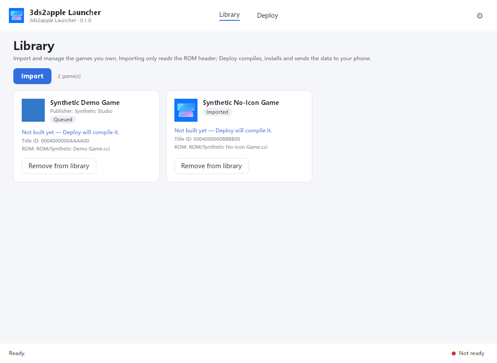
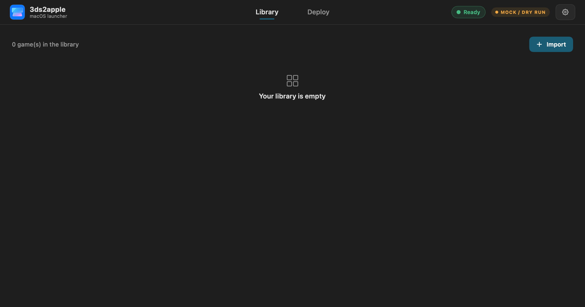

<p align="center"></p>

<h1 align="center">3ds2apple</h1>

[English](README.md) · [简体中文](README.zh-CN.md) · [Download the launchers](https://github.com/HFYKratos/3ds2apple/releases) · [All releases](https://github.com/HFYKratos/3ds2apple/releases) · [Contributing](CONTRIBUTING.md)

> [!NOTE]
> 3ds2apple is free and open source (Apache-2.0). The launchers and the iOS app ship no games, keys or BIOS: you build your own library from decrypted ROMs that you own and dump yourself.

**Your own Nintendo 3DS games, running natively on iPhone and iPad.** Game code is rewritten to native ARM64 ahead of time and runs directly on the phone processor, with graphics going to Metal through MoltenVK. Your whole library lives in one app, and a few clicks in the Windows or macOS launcher take a game from import to play.

Platforms: iPhone / iPad (iOS 16 and later) · Windows 10/11 (launcher, no Mac needed) · macOS 13+ (launcher, Intel + Apple silicon) · Build on Windows or macOS · License: Apache-2.0 · **Bring your own games**

<p align="center">
  
  
</p>
<p align="center"><sub>Windows launcher (Library; synthetic demo entries) and macOS launcher (empty library).</sub></p>

## A native port, not an emulator

Each game is recompiled ahead of time: the 3DS code is translated to C by 3dsrecomp and built into an ARM64 `GamePack` on your own computer with a local LLVM or Apple clang toolchain. The phone runs that native code directly through the Zakuro HLE runtime — there is no CPU JIT and no interpreter fallback. The PICA200 GPU path is translated to Metal by MoltenVK, and the shell presents straight to a `CAMetalLayer` with zero per-frame screen readback.

## One app, your whole library

Every game you select is compiled into its own `GamePack<TITLEID>.dylib` and composed into a single signed app together with a `GameCatalog.json`. Install one app and the whole library travels with it; adding or removing a game means deploying again, and the pushed game data survives reinstalls and updates. Per-game code must live inside the signed IPA because iOS will not load unsigned code from `Documents`.

Each library card is built from what the launcher already read out of the ROM at import time: the game's own SMDH icon, the title in the app's language, the publisher and the pushed game size. The launcher pushes that metadata in `GameInfo.json` next to the game data, so the phone never parses the ROM. A library pushed by an older launcher keeps working: the card falls back to the catalog name, hides the publisher row and draws a placeholder icon until you deploy again.

## Full 3DS controls on screen

The on-screen pad is the complete New 3DS set: D-pad, A/B/X/Y, L/R, ZL/ZR, Start/Select, a real analog Circle Pad and the New 3DS C-stick. The Circle Pad reports true analog values (-1 to 1 per axis, with a small dead zone so a resting finger reads exactly 0) instead of acting as a second D-pad, and the C-stick works the same way. A hardware controller's left stick feeds the Circle Pad and its right stick feeds the C-stick; L2/R2 map to ZL/ZR, and several fingers can hold buttons and drag the sticks at the same time.

Every control can be moved, resized and faded - or reset - in **Settings -> Controls -> Control layout**: the page offers **Default** (the shipped positions) and **Custom**, and choosing Custom opens the full-screen editor for the direction the device is in now, with the current screen layout drawn behind the controls. Portrait and landscape keep separate profiles. The editor changes position, size and opacity only: which 3DS button a control reports is fixed (no remapping in this build). The C-stick needs a game that uses the New 3DS nub, and a shell built with the current runtime (`scripts/build-zakuro-ios.sh` from source has it).

## Screen layouts: Default and Custom

The **Screen layout** page (**Settings -> Display -> Screen layout**) offers exactly two choices:

- **Default** keeps the automatic arrangement: the screens stacked in portrait and the large upper screen in landscape. The `CAMetalLayer` presenter draws it.
- **Custom** places each screen at its own rectangle. Choosing Custom opens a full-screen editor for the direction the device is in now - portrait edits the portrait layout, landscape the landscape one - with the current on-screen controls drawn over the picture so the screens can be placed between or away from them. Each direction keeps its own layout and the editor can reset it. It switches the session to the software readback path because the Metal presenter only knows the five fixed arrangements, and it applies from the next game load.

Rotation, aspect ratio, integer scaling and render resolution keep their meaning in both choices.

## What the phone shows while you play

The app's own game-view overlay is a single **FPS counter** - on by default, in the portrait title bar or a slim strip in the landscape top safe area, never over the 3DS picture, the pause button or the on-screen controls (turn it off in Settings -> Performance). Everything else is kept out of the game view: the AOT state, the renderer path, the Metal HUD state and the per-phase frame timings are recorded in the device log and the diagnostics report (the About page repeats the runtime summary for diagnostics, but nothing is drawn over the game).

The Settings page no longer shows the old "Metal backend" info row and no longer has a first-load graphics warm-up switch: a game is revealed as soon as it loads, and the runtime's pipeline cache still makes later loads of the same title warm. Apple's separate system Metal HUD switch (the GPU/FPS overlay) is still in Settings -> Performance.

## Graphical launchers, next to zero setup

There is a launcher for Windows and one for macOS. Import your own decrypted `.3ds`/`.cci`, pick the games and press the one deploy button: the launcher compiles the GamePacks, composes a ROM-free base IPA, signs and installs it with your own Apple ID (bundled official Impactor/plumesign on Windows, Xcode automatic signing on macOS), then pushes only `GameRom.cci` + `GameInfo.json` into the app Documents folder.

The launchers keep a portable data folder beside the executable/.app, read the ROM SMDH metadata (icon, localized name, publisher), detect the compile hardware and parallelise 3dsrecomp automatically, and show a startup readiness light plus a self-test so a missing tool never fails a deploy silently.

## Real numbers

On a physical iPhone, one retail title run through the Windows launcher path measures **about 57-60 fps** with **AOT 100%** and the **Metal GPU** renderer: `zk_perf` reports GPU 4-6 ms per frame, present 10-11 ms and zero screen readback. These numbers are from the maintainers testing that title; compatibility and performance are per game.

## Platforms

| Platform | Support |
|---|---|
| **iPhone / iPad** | iOS 16 and later. One app holds the library, in-game menu, the full editable New 3DS control set, Default/Custom screen layouts, save states and the FPS counter. |
| **Windows** | Windows 10/11 x64. One self-contained launcher executable; builds, signs, installs and pushes without a Mac. |
| **macOS** | macOS 13+ (Intel + Apple silicon). SwiftUI launcher using Xcode signing; the package is not self-contained yet and device install is not verified by the maintainers. |
| **Build host** | Windows (bundled LLVM/LLD) or macOS (Apple clang + Xcode). |

## Getting started

**Requirement:** a decrypted 3DS ROM that you own, an iPhone/iPad on iOS 16+ with Developer Mode enabled, a USB cable, and your own Apple ID for signing. No game data is included.

### Windows launcher

1. Download `3ds2apple-<version>-windows-x64.zip` and extract it into a writable folder (not `Program Files`). Install *Apple Devices* so the phone is reachable over USB.
2. Run `3ds2apple-launcher.exe` (not code-signed; check the digest, then *More info -> Run anyway*). Run Settings -> self-test once and expect it green.
3. **Library -> Import** your own decrypted `.3ds`/`.cci`; only the ROM header and SMDH icon/metadata are read.
4. **Deploy**: select the games and press the single deploy button. The launcher compiles one GamePack per game, composes a ROM-free IPA, signs and installs it with the bundled Impactor (sign in with your own Apple ID), then pushes only the game data.
5. Open the app on the phone and play. Deploy again to add or remove games; pushed game data stays across reinstalls, a clean uninstall clears it.

### macOS launcher

1. Download `3ds2apple-<version>-macos-universal.zip`; you get `3ds2apple-launcher.app` (not notarised; right-click -> *Open* on first launch).
2. The package is **not self-contained yet**: it needs macOS 13+, Xcode 15+ with your Apple ID, `xcodegen`, a repository checkout and the built tools (`scripts/build-zakuro-ios.sh`, the `builder` pack CLI and `tools/devpush`). The launcher looks in its bundle, the checkout and `PATH`.
3. Import -> Deploy: Apple clang compiles the GamePacks, Xcode automatic signing + `devicectl` installs the composed IPA, and the launcher pushes the game data. Selection rules match Windows.

### Phone data, saves and limits

- Game data lives in `Documents/Games/<TITLEID>/` (visible in the Files app); saves and save states live in the app container.
- The on-screen controls are edited under **Settings -> Controls -> Control layout**; the screen layout under **Settings -> Display -> Screen layout**. Each page offers Default and Custom, and Custom opens the full-screen editor for the current device direction. Default applies immediately; a custom screen layout applies from the next game load.
- A free Apple ID allows 3 apps per device and about 7 days of signing; deploy again to refresh. A paid developer account removes those limits.
- Uninstalling the app removes its data; your ROMs on the computer are never touched.

## Download

Public builds are published on [GitHub Releases](https://github.com/HFYKratos/3ds2apple/releases). Each release carries exactly two platform packages:

- `3ds2apple-<version>-windows-x64.zip` - Windows 10/11 launcher: the self-contained `3ds2apple-launcher.exe` plus `LICENSE`, `NOTICE` and `THIRD_PARTY.md`.
- `3ds2apple-<version>-macos-universal.zip` - macOS 13+ launcher: `3ds2apple-launcher.app` (Intel + Apple silicon) plus `LICENSE`, `NOTICE` and `THIRD_PARTY.md`.

From 0.1.1 on, both zips carry those three license texts at their root, byte-identical to the copies in this repository, so a downloaded package is self-contained. They are not published as separate release assets, and the GPL projects listed in [THIRD_PARTY.md](THIRD_PARTY.md) remain read-only references - no GPL code or text is packaged. The 0.1.0 packages predate this and rely on the repository copies. The ROM-free shell template is embedded in both launchers and is not a separate download. GitHub shows the SHA-256 digest of every release asset; no game data is ever attached.

## Build from source

| Component | Build / test |
|---|---|
| Windows launcher | `cd launcher/windows && dotnet build Launcher.slnx -c Release` / `dotnet test Launcher.slnx -c Debug` - see [launcher/windows/README.md](launcher/windows/README.md) |
| macOS launcher | XcodeGen + `xcodebuild` on macOS - see [launcher/macos/README.md](launcher/macos/README.md) |
| iOS app / shell | `scripts/build-zakuro-ios.sh` -> `scripts/build-ios-app.sh` -> `scripts/package-ipa.sh` - see [scripts/README.md](scripts/README.md) |
| Pack CLI (`3ds2apple-pack`) | `cd builder && cargo build --workspace` / `cargo test --workspace` - see [builder/README.md](builder/README.md) |
| Device bridge (`devpush`) | `cargo build --release --manifest-path tools/devpush/Cargo.toml` - see [tools/devpush/README.md](tools/devpush/README.md) |

Host-side self-checks need no ROM, phone or Xcode:

```bash
cd builder && cargo test --workspace
cd launcher/windows && dotnet test Launcher.slnx -c Debug
bash scripts/tests/perf-selfcheck.sh
bash scripts/tests/aot-selfcheck.sh
bash scripts/tests/game-catalog-selfcheck.sh
bash scripts/tests/desktop-aot-selfcheck.sh
```

## Repository layout

```text
assets/            app icon used by this README
.github/           issue report and pull request templates
ios/app/           iOS app: library, in-game menu, touch controls, save states
ios/zakuro-ios/    Zakuro iOS C ABI: GamePack loader, Metal presenter, perf counters
launcher/windows/  Windows launcher (C#/Avalonia), single-file packaging
launcher/macos/    macOS launcher (SwiftUI), Xcode signing and install
builder/           3ds2apple-pack: ROM import, SMDH metadata, packages, GameCatalog
tools/devpush/     device bridge: usbmuxd/house_arrest/AFC push, install verification
tools/winbuild/    Apple-SDK-free LLVM/LLD GamePack cross-build tooling
scripts/           build, package, release and self-check scripts
licenses/          third-party license texts (Impactor MIT, apple-codesign MPL-2.0)
```

## Honest boundaries

- **Compatibility is per game.** Some titles may fail to boot or render incorrectly; reports with the title ID are welcome - see [Issue reports and performance data](#issue-reports-and-performance-data).
- **A custom screen layout is a performance trade-off.** It runs on the software readback path (the Metal presenter only knows the five fixed arrangements), applies from the next game load and is slower than the Default choice, which stays on the GPU path.
- **The C-stick depends on the game.** It is reported through the New 3DS nub API; a title that never reads the nub ignores it, and a shell built from an older runtime does not provide it.
- **A mainland-China iPhone can ask for "wireless data" on the first text input.** This is a known iOS quirk: when the system text input first appears (for example the in-game keyboard overlay) UIKit's own dictation/network path check is attributed to the app, so iOS shows its "allow wireless data" alert. 3ds2apple makes no network requests and its cellular data usage stays at 0 - choose *Don't Allow* or *Wi-Fi only* and everything keeps working (a reinstall can show the alert again). Details in [ios/app/README.md](ios/app/README.md).
- **Older installs and older pushes keep working.** `GameInfo.json` only gained optional fields (schema version stays 1), so game data pushed by a 0.1.0 launcher still validates and plays - until you redeploy, the card has no publisher, no real SMDH icon and no size. An app updated from 0.1.0 keeps its library and saves.
- **The macOS package is a developer preview.** It is not self-contained and its device install has not been verified by the maintainers yet - the real-device acceptance call is tracked in [#1](https://github.com/HFYKratos/3ds2apple/issues/1); the Windows package is the verified path.
- **No ROMs, keys or BIOS are provided.** Only decrypted ROMs that you own are supported.
- **No CPU JIT by design.** The shipping path is AOT code plus the Zakuro HLE runtime; there is no interpreter fallback.

## Issue reports and performance data

Bug reports and compatibility reports are welcome. Start with the [compatibility report form](.github/ISSUE_TEMPLATE/compatibility-report.yml) (GitHub offers it under **New issue**): it asks for the game title, the 16-hex title ID, region and version (base/update/DLC), device model and iOS version, the 3ds2apple version or commit, the AOT state, what happens and how to reproduce it. Never attach ROMs, decryption keys, BIOS/firmware, generated C, screenshots or recordings that contain game art, signed IPAs, Apple credentials or a device UDID.

Every build can export a diagnostics report: open the in-game menu and press **Export logs** (the menu pauses the frame loop, so the stutter counters stop at the moment you tap it), then share the `.txt` through the system share sheet. The home page path **Settings -> More -> Export logs** works too, but unloading a game resets the frame and stutter counters - use the in-game menu when those numbers matter; the Settings copy still contains the complete session log. Builds from 0.1.1 on also write each export to `Documents/Diagnostics/<timestamp>.txt` in the app container (the last five are kept); the same folder appears in the Files app under **On My iPhone -> 3ds2apple -> Diagnostics**, or you can pull it over USB with the device bridge:

```bash
devpush ls  --bundle-id com.kratos.3ds2apple --remote Documents/Diagnostics
devpush get --bundle-id com.kratos.3ds2apple --remote Documents/Diagnostics/<timestamp>.txt --local diagnostics.txt
```

The report already carries the build and device state, the AOT proof (`aot_percent`, `aot_fallbacks`), the renderer path, the frame-cap/fast-forward/render-scale settings, per-phase frame timings and both app logs. From 0.1.1 on it also counts stutter (`>33.3 ms` frames) and severe stutter (`>100 ms`), with the per-minute rate, the worst frame, per-phase attribution and the 20 most recent spikes. For a stutter report ("mostly 57-60 fps but it hitches now and then") also say when and where it happens (title + scene/menu), whether a second run is better, and which launcher path and settings you used. **Attach the diagnostics file**: the counters and spikes are the measurement, so a stutter report without it usually just gets a request for it.

Testers with a Mac and an iPhone/iPad are especially useful: the [macOS acceptance form](.github/ISSUE_TEMPLATE/macos-acceptance.yml) walks through the checklist in [launcher/macos/README.md](launcher/macos/README.md#real-device-acceptance) (Xcode signing, `devicectl` install, `devpush` push) and records the result.

## Contributing and release

- [CONTRIBUTING.md](CONTRIBUTING.md) - contribution rules, issue reports and the release policy.
- [Issue templates](.github/ISSUE_TEMPLATE) - compatibility reports and the macOS real-device acceptance checklist.
- [LICENSE](LICENSE) - Apache-2.0.
- [THIRD_PARTY.md](THIRD_PARTY.md) and [NOTICE](NOTICE) - third-party components and legal notices.

## Thanks

3ds2apple stands on open-source work: **Zakuro** (MIT) for the HLE runtime and PICA200 renderer, **3dsrecomp** (MIT) for the static recompiler, **MoltenVK** (Apache-2.0) for Vulkan on Metal, **Impactor** (MIT) and **apple-codesign** (MPL-2.0) for signing from Windows, **pocket-native** (MIT) for the iOS native-port reference, and the LLVM project for the compile toolchain. Thanks also to everyone testing builds on real hardware.

## License and legal

3ds2apple is licensed under **Apache-2.0** (see [LICENSE](LICENSE)). It ships no Nintendo ROMs, decryption keys, BIOS, system files, game assets or gameplay screenshots, and provides no ROM download or piracy support. Only use games that you legally own and dump yourself.

Third-party components and licenses are listed in [THIRD_PARTY.md](THIRD_PARTY.md) and [NOTICE](NOTICE). The Windows launcher bundles the official Impactor v2.7.2 + plumesign release files unmodified (MIT; the embedded apple-codesign 0.29.0 is MPL-2.0) and keeps the license texts in [licenses/impactor](licenses/impactor); the macOS launcher signs through Xcode instead and does not bundle Impactor. The iOS shell template and the macOS launcher embed the unmodified MoltenVK 1.4.2 framework (Apache-2.0). GPL projects are read as architecture references only - no GPL code or text is copied into this repository or packaged with it.