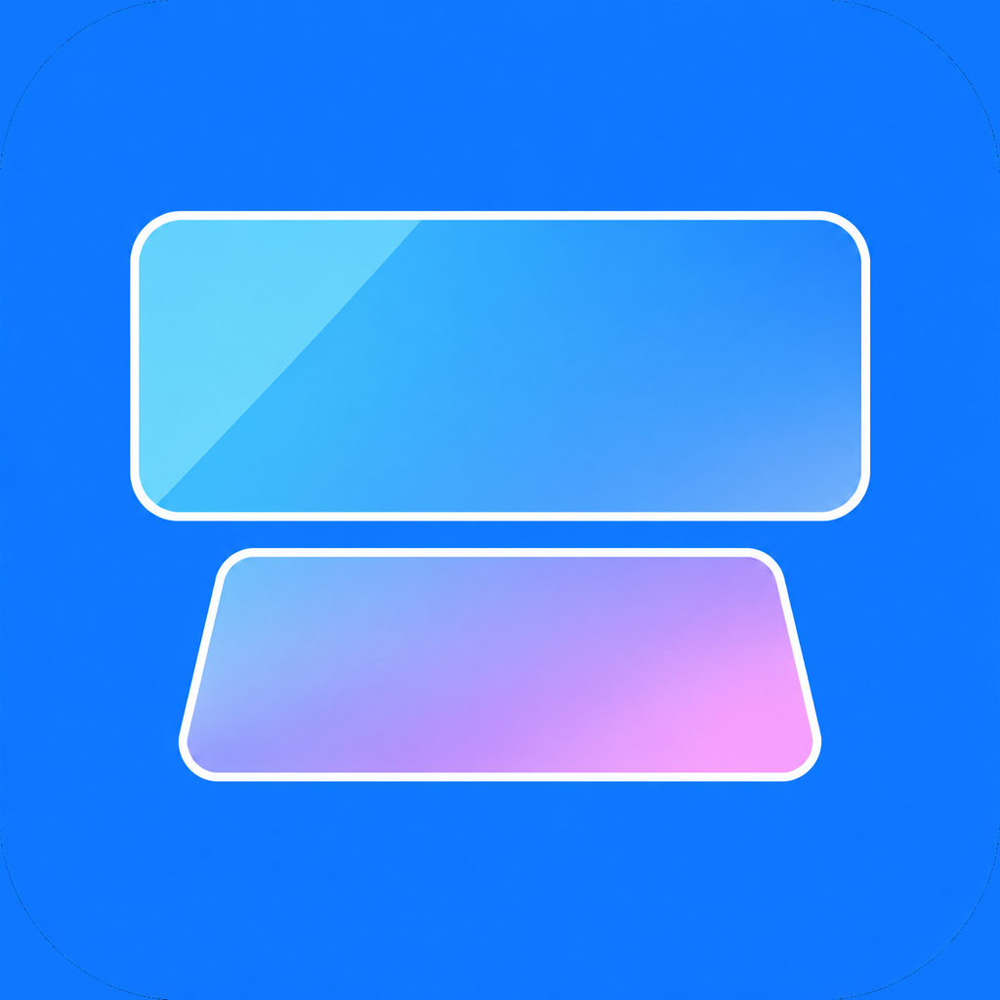
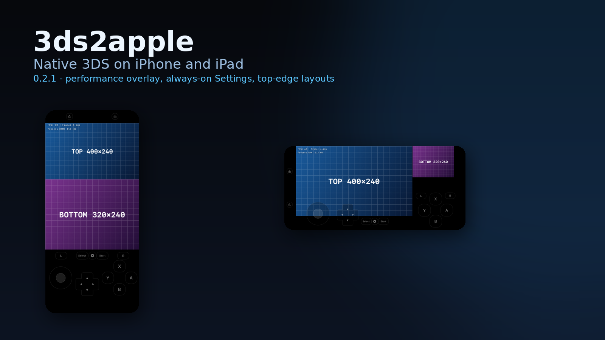
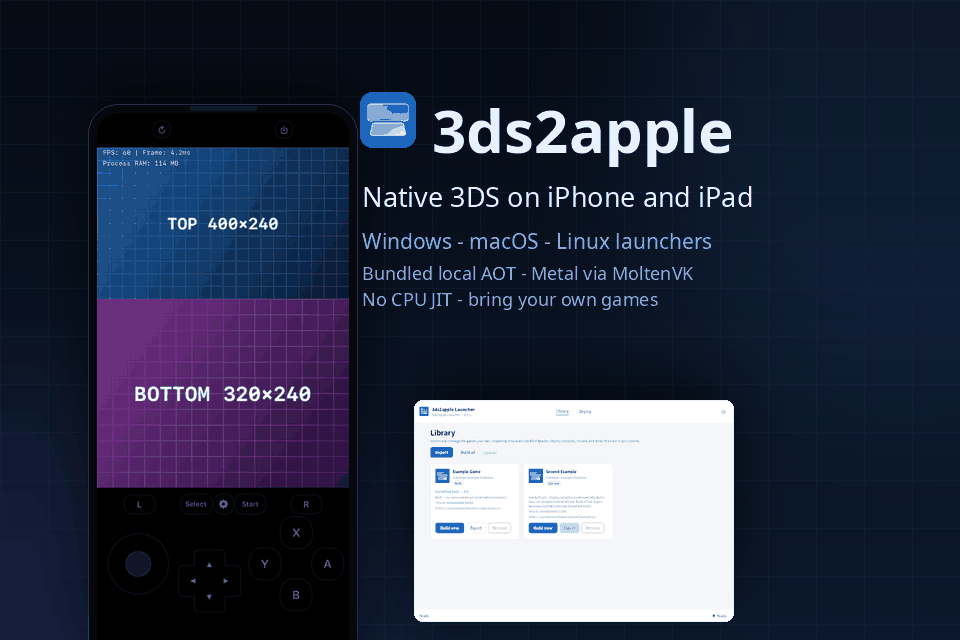
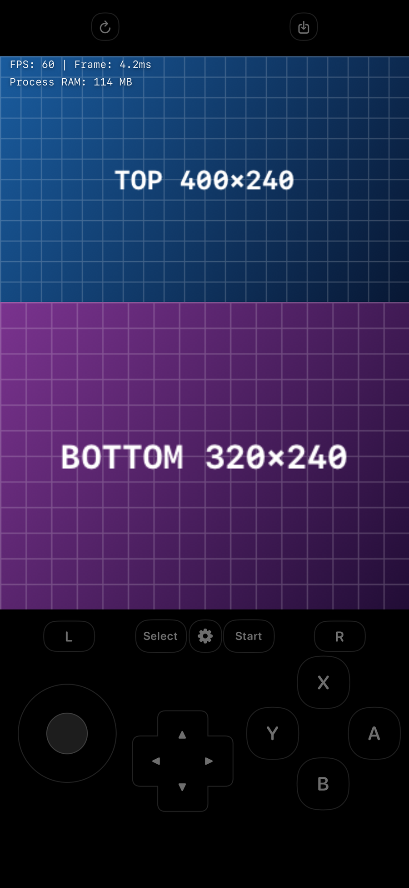
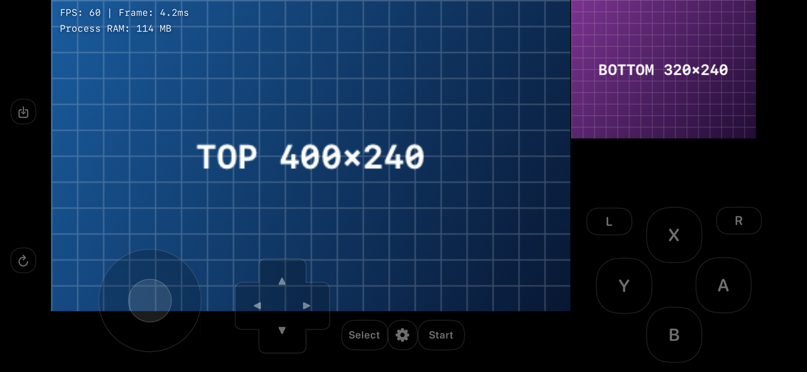

<p align="center"></p>

<h1 align="center">3ds2apple</h1>

<p align="center">
  <a href="README.md">EN</a> · <a href="README.zh-CN.md">简体中文</a> · <a href="README.ja.md">日本語</a> · <a href="README.ko.md">한국어</a>
</p>

<p align="center">
  <a href="#download"><b>Download</b></a> ·
  <a href="https://hfykratos.github.io/3ds2apple/">Website</a> ·
  <a href="https://hfykratos.github.io/3ds2apple/press/">Press kit</a> ·
  <a href="https://github.com/HFYKratos/3ds2apple/releases">Releases</a> ·
  <a href="https://github.com/HFYKratos/3ds2apple/discussions">Discussions</a> ·
  <a href="CONTRIBUTING.md">Contributing</a>
</p>

<p align="center">
  <a href="LICENSE"></a>
  <a href="https://github.com/HFYKratos/3ds2apple/releases/tag/v0.2.1"></a>
  <a href="https://github.com/HFYKratos/3ds2apple/releases/latest"></a>
  <a href="https://github.com/HFYKratos/3ds2apple/releases"></a>
  <a href="https://github.com/HFYKratos/3ds2apple/actions/workflows/ci.yml"></a>
</p>

**Run your own Nintendo 3DS games natively on iPhone and iPad — AOT-compiled ARM64, Metal via MoltenVK, no CPU JIT and no interpreter fallback.**

## Download

<p align="center">
  <a href="https://github.com/HFYKratos/3ds2apple/releases/download/v0.2.1/3ds2apple-0.2.1-windows-x64.zip"></a>
  <a href="https://github.com/HFYKratos/3ds2apple/releases/download/v0.2.1/3ds2apple-0.2.1-macos-universal.zip"></a>
  <a href="https://github.com/HFYKratos/3ds2apple/releases"></a>
</p>

<p align="center"><sub><b>Latest stable release: v0.2.1</b> · Windows 10/11 launcher (verified path) · macOS 13+ launcher (developer preview, see <a href="https://github.com/HFYKratos/3ds2apple/issues/1">#1</a>) · the iOS app is composed, signed and installed by the launcher with your own Apple ID, so there is no separate iOS download.</sub></p>

<p align="center">
  
</p>

> [!NOTE]
> 3ds2apple is free and open source (Apache-2.0). The launchers and the iOS app ship no games, keys or BIOS: you build your own library from decrypted ROMs that you own and dump yourself.

## 30-second explainer

3ds2apple is a native port pipeline for your own Nintendo 3DS games, not an emulator app. Import a decrypted ROM you dumped yourself into the Windows or macOS launcher: 3dsrecomp translates the 3DS code to C, your local LLVM or Apple clang toolchain builds one ARM64 `GamePack` per title, and the launcher composes a ROM-free base IPA, signs and installs it with your own Apple ID, then pushes only the game data (`GameRom.cci` + `GameInfo.json`) into the app's Documents folder. On the phone, the Zakuro HLE runtime executes that native code directly and MoltenVK turns the PICA200 GPU calls into Metal. One app holds the whole library, and the pause menu covers screen layouts, controls, save states and diagnostics. No games, keys or BIOS are included — bring your own.

## Demo

<p align="center">
  
</p>

<p align="center"><sub>0.2.1 synthetic preview, no game data: portrait controls → landscape controls → in-game menu → performance overlay settings.</sub></p>

## What's new in 0.2.1 (2026-11-25)

- **The picture sits at the top edge.** Landscape Large screen, Side by side and Hybrid now start flush against the top edge — the black band above the picture is gone — while staying horizontally centred with their aspect ratio and integer scaling unchanged.
- **The performance overlay replaces the FPS pill.** An Azahar-style overlay sits at the very top edge of the picture: frame rate, frame time, speed, app memory and available memory, each line switchable, six positions and an optional background; the unavailable battery-temperature row is gone.
- **Settings can never be hidden.** The in-game Settings button stays in the skins' HOME slot and keeps opening the in-game menu. Toggle controls no longer lists it, Adjust size still resizes it, and an older saved hidden set is cleaned up automatically.
- **A default layout from two reference skins.** The shipped virtual controls follow ModernFS in portrait and ModernHybrid in landscape, with Quick save / Quick load beside the notch; untouched old layouts migrate once and custom layouts are kept.
- **The in-game menu is refined.** The same iOS grouped language with a single slide-up animation in portrait, a centred card in landscape, native push/pop sub-pages and the running game's name in the header.
- **Quiet polish.** Settings keeps the iOS 26/27 inset-grouped style, the default hidden set is ZL, ZR, the C-stick, Fast-forward and Swap screens, and SAVE/LOAD return to the notch corners.
- **Still not included:** Delta skin import, cheats, a manual, amiibo, microphone, camera, network/online play and JIT.

## Features at a glance

<table>
  <tr>
    <td align="center" width="25%">⚡<br><b>Native AOT, not emulation</b><br><sub>Every game is recompiled to ARM64 before it runs. No CPU JIT, no interpreter fallback on the shipping path.</sub></td>
    <td align="center" width="25%">📚<br><b>One app, your whole library</b><br><sub>Each selected title is a GamePack inside one signed app; pushed game data survives updates.</sub></td>
    <td align="center" width="25%">🎮<br><b>Full New 3DS controls</b><br><sub>D-pad, A/B/X/Y, L/R, ZL/ZR, Start/Select, a real analog Circle Pad and the C-stick; editable Fast-forward, Quick save, Quick load and Swap screens buttons; MFi, Xbox and DualSense controllers.</sub></td>
    <td align="center" width="25%">🧭<br><b>6 + 3 layouts, all on the GPU</b><br><sub>Six landscape and three portrait presets plus custom rectangles — all drawn by the GPU presenter with zero per-frame readback; four-way rotation and screen swap included.</sub></td>
  </tr>
  <tr>
    <td align="center" width="25%">✏️<br><b>Edit controls in-game</b><br><sub>Pause, drag controls over the picture and tap Done; per-button visibility, 10%–200% size and opacity.</sub></td>
    <td align="center" width="25%">💾<br><b>Saves and save states</b><br><sub>Battery saves in the app container, three instant save-state slots per game, save export and import in the Save Manager.</sub></td>
    <td align="center" width="25%">⏩<br><b>Fast-forward, performance overlay and HUD</b><br><sub>A 2x Fast-forward toggle, editable Quick save and Quick load, an optional performance overlay (frame rate, frame time, speed and memory, with a configurable place and lines), the system Metal HUD (off by default) and one-tap diagnostics export.</sub></td>
    <td align="center" width="25%">🖥️<br><b>Windows and macOS launchers</b><br><sub>Import → compile → sign → install → push from one window; the Windows path needs no Mac and deploys incrementally without touching game data.</sub></td>
  </tr>
</table>

## Screen layouts: six landscape, three portrait

**Settings → Display → Screen layout** keeps the two directions independent.

- **Landscape screen layout (6):** Large screen · Single screen · Side by side · Hybrid · Original · Custom layout.
- **Portrait screen layout (3):** Default · Original · Custom layout.

**Hybrid** shows one large top screen with two small screens stacked beside it; the portrait **Default** places the top screen full width above the bottom screen.

In landscape the picture box is top-aligned: **Large screen**, **Side by side** and **Hybrid** sit flush to the top edge (the black band above the screens is gone), still horizontally centred with their aspect ratio and integer scaling unchanged.

All preset arrangements are drawn by the GPU presenter — the Metal path with zero per-frame screen readback. **Custom layout** places each screen at its own rectangle: edit X/Y/width/height percentages with a live preview under the fields, or drag the screens; custom layouts are drawn by the GPU presenter too (arbitrary rectangles, four-way rotation and top/bottom screen swap), so nothing falls back to a slower readback path. A custom layout still applies from the next game load.

Screen rotation and interface orientation are kept, and render resolution (1x–4x) still applies on the next game load. 0.1.5 removed the old aspect-ratio and integer-scaling switches.

## Controls and the pause menu

The on-screen pad is the complete New 3DS set: D-pad, A/B/X/Y, L/R, ZL/ZR, Start/Select, a real analog Circle Pad and the New 3DS C-stick. The Circle Pad reports true analog values (-1 to 1 per axis, with a small dead zone so a resting finger reads exactly 0) instead of acting as a second D-pad, and the C-stick works the same way. Positions and sizes follow two Delta reference skins (geometry only): **ModernFS** in portrait and **ModernHybrid** in landscape. The skins' HOME slot is a single **Settings** button that opens the in-game menu (the full Settings page is the menu's Global Settings row); the skins' volume keys are intentionally not implemented. Portrait puts the console controls in the black band below the picture (shoulder row, then the main pad; the D-pad is drawn as a single cross — four direction zones, press and slide to change direction — instead of four separate buttons) and Quick save / Quick load in the top corners right under the notch (LOAD left, SAVE right); landscape keeps the previous control geometry with Quick save / Quick load on the left notch side, SAVE in the upper half and LOAD in the lower half, symmetric about the middle of the screen so the landscape Dynamic Island area stays clear. The five controls the skins do not draw — ZL, ZR, the C-stick, Fast-forward and Swap screens — start hidden in both orientations; after enabling them in **Toggle controls** they appear in one starting row across the top of the game (ZL, Fast-forward, C-stick, Swap screens, ZR from left to right) that you can drag anywhere in the edit-layout mode. The system status bar (clock, battery and signal) is hidden while a game runs.

A hardware controller's left stick feeds the Circle Pad and its right stick feeds the C-stick; L2/R2 map to ZL/ZR, and several fingers can hold buttons and drag the sticks at the same time.

The paused game's **Virtual controls** card is where the pad is customised:

- **Show/hide the pad**, show the performance overlay, haptics. Turning the pad off hides every virtual control except the **Settings** button, which stays in its HOME-slot place and still opens the in-game menu.
- **On-screen buttons** — the always-shown Settings button (opens the in-game menu), a Fast-forward toggle (2x on/off), Quick save, Quick load and Swap screens; like the console controls the other buttons can be moved, resized and shown or hidden, while Settings can be moved and resized but never hidden.
- **Edit layout** — drag the controls over the paused picture; the centred **Done** saves the current orientation and resumes.
- **Toggle controls** — visibility is per orientation: ZL, ZR, the C-stick, Fast-forward and Swap screens start hidden in both; every control the default skins draw, including the portrait D-pad, starts visible. The Settings button is not listed because it can never be hidden (Adjust size still resizes it), and an older saved set that hid it is cleaned up automatically. An untouched 0.2.0, 0.2.1-beta1 or 0.2.1-beta2 default set migrates once; a customised set is kept.
- **Adjust size** — 10%–200% per button or group, 100% default (global).
- **Adjust opacity** and **Reset**.

Visibility is per orientation (the Toggle controls sheet edits the current one); size and opacity are global, and portrait and landscape positions stay separate. The C-stick needs a game that uses the New 3DS nub, and a shell built with the current runtime (building `scripts/build-zakuro-ios.sh` from source includes it).

## Edit layout in-game

Pause any game and open **Virtual controls → Edit layout**: every control has its own hit area, so you drag just the one you grabbed over the paused picture, and the centred **Done** saves the current orientation and resumes. The same card gives per-button visibility, 10%–200% size and opacity, and **Reset** restores the defaults. Portrait and landscape positions are stored separately.

<p align="center"><sub>0.2.1 synthetic preview, no game data: portrait controls → landscape controls → in-game menu → performance overlay settings.</sub></p>

## Screenshots

**Desktop launchers** — real 0.2.1 launcher screenshots; the library is the built-in synthetic fixture (empty or demo entries) and no game art appears.

| Windows launcher | Windows launcher (简体中文) | macOS launcher |
|:---:|:---:|:---:|
|  |  |  |
| Library (EN) | Library (中文) | Empty library (dark) |

**iOS app** — 0.2.1 synthetic previews of the game view and performance overlay; no game data.

| Portrait | Landscape |
|:---:|:---:|
|  |  |
| Portrait controls | Landscape controls |

## Quick start

**Requirement:** a decrypted 3DS ROM that you own, an iPhone/iPad on iOS 16+ with Developer Mode enabled, a USB cable, and your own Apple ID for signing. No game data is included.

1. **Download the launcher.** Windows 10/11: extract the zip into a writable folder (not `Program Files`) and run `3ds2apple-launcher.exe`; install *Apple Devices* so the phone is reachable over USB. macOS 13+: unzip `3ds2apple-launcher.app` (developer preview; it also needs Xcode 15+, `xcodegen`, a repository checkout and the built tools).
2. **Import and deploy.** Import your own decrypted `.3ds`/`.cci`, select the games and press the single deploy button: the launcher compiles one GamePack per game, composes a ROM-free IPA, signs and installs it with your own Apple ID, then pushes only the game data.
3. **Play.** Open the app on the phone. Deploy again to add or remove games; pushed game data survives reinstalls and updates, and a clean uninstall clears it.

The full walkthrough, including macOS setup and signing limits, is in [Getting started](#getting-started).

## FAQ

### Is 3ds2apple an emulator?

No. It is a native port and recompilation pipeline: each game is translated to C, compiled to ARM64 ahead of time and run directly through the Zakuro HLE runtime. There is no CPU JIT and no interpreter fallback on the shipping path.

### Does every game work?

Compatibility is per game. Some titles may fail to boot or render incorrectly, and some menus in some titles can render incorrectly — tracked in [#2](https://github.com/HFYKratos/3ds2apple/issues/2). No compatibility or performance guarantee is made; reports with the 16-hex title ID are welcome.

### Where do I get ROMs, keys or BIOS?

Not from this project. 3ds2apple ships no game data and provides no ROM, BIOS or key download or piracy support. Only decrypted ROMs that you legally own and dump yourself are supported.

### Do I need a Mac?

Not for the verified Windows path. The macOS launcher is a **developer preview**: it needs macOS 13+, Xcode 15+ with your Apple ID, `xcodegen`, a repository checkout and the built tools, and its real-device install has not been verified by the maintainers yet (issue [#1](https://github.com/HFYKratos/3ds2apple/issues/1)).

### Is the app on the App Store?

No. The launcher composes and signs the app with your own Apple ID (bundled official Impactor on Windows, Xcode automatic signing on macOS) and installs it over USB. 3ds2apple is not affiliated with or endorsed by Nintendo or Apple.

### Why does the app stop opening after about a week?

A free Apple ID allows 3 apps per device and about 7 days of signing; deploy again to refresh the signature. A paid developer account removes those limits.

### Will redeploying erase saves or game data?

Game data lives in `Documents/Games/<TITLEID>/` and saves/save states live in the app container. Pushed data and saves survive reinstalls and updates; a clean uninstall removes them, so back up anything you care about first. Your ROMs on the computer are never touched.

### How does it perform?

On a physical iPhone, **one retail title** run through the Windows launcher path measured about 57-60 fps with AOT 100% and the Metal GPU renderer by the maintainers; that is one title, not a guarantee — compatibility and performance are per game.

### Are custom screen layouts slower than the presets?

No longer. Since 0.1.6 the GPU presenter draws custom layouts too — arbitrary rectangles, four-way rotation and top/bottom screen swap — so they stay on the same zero-readback Metal path as the presets. A custom layout still applies from the next game load.

## Legal and limits

- **Bring your own games.** No ROMs, keys, BIOS, system files or game assets are provided or linked; there is no piracy support. Only use decrypted ROMs that you legally own and dump yourself.
- **No endorsement.** 3ds2apple is not affiliated with, sponsored or endorsed by Nintendo or Apple, and it is not distributed on the App Store. You sign and install it with your own Apple ID.
- **No guarantees.** Compatibility and performance are per game: some titles may fail to boot or render incorrectly, and some menus in some titles can render incorrectly (issue [#2](https://github.com/HFYKratos/3ds2apple/issues/2)). Compatibility and performance are not guaranteed.
- **macOS is a developer preview.** Its package is not self-contained and its real-device install is not yet verified by the maintainers (issue [#1](https://github.com/HFYKratos/3ds2apple/issues/1)); the Windows path is verified.
- **Custom screen layouts are on the GPU path since 0.1.6.** Arbitrary rectangles, four-way rotation and screen swap are drawn by the GPU presenter (0.1.5 and earlier used a slower readback path); a custom layout still applies from the next game load.
- **No CPU JIT by design.** The shipping path is AOT code plus the Zakuro HLE runtime; there is no interpreter fallback.

## Project links

| | |
|---|---|
| **Website** | <https://hfykratos.github.io/3ds2apple/> |
| **Press kit** | <https://hfykratos.github.io/3ds2apple/press/> |
| **Download** | [GitHub Releases](https://github.com/HFYKratos/3ds2apple/releases) |
| **Issues** | <https://github.com/HFYKratos/3ds2apple/issues> |
| **Discussions** | <https://github.com/HFYKratos/3ds2apple/discussions> |
| **Contributing** | [CONTRIBUTING.md](CONTRIBUTING.md) |
| **License** | [Apache-2.0](LICENSE) |

## Platform support

| Platform | Support |
|---|---|
| **iPhone / iPad** | iOS 16 and later. One app holds the library, the redesigned in-game menu, the full New 3DS control set with in-game layout editing, six landscape and three portrait screen layouts, save states, the performance overlay and per-app settings. |
| **Windows** | Windows 10/11 x64. One self-contained launcher executable; builds, signs, installs and pushes without a Mac. **Verified path.** |
| **macOS** | macOS 13+ (Intel + Apple silicon). SwiftUI launcher using Xcode signing; the package is not self-contained yet and device install is not verified by the maintainers. **Developer preview.** |
| **Build host** | Windows (bundled LLVM/LLD) or macOS (Apple clang + Xcode). |

## Getting started

**Requirement:** a decrypted 3DS ROM that you own, an iPhone/iPad on iOS 16+ with Developer Mode enabled, a USB cable, and your own Apple ID for signing. No game data is included.

### Windows launcher

1. Download `3ds2apple-<version>-windows-x64.zip` and extract it into a writable folder (not `Program Files`). Install *Apple Devices* so the phone is reachable over USB.
2. Run `3ds2apple-launcher.exe` (not code-signed; check the digest, then *More info → Run anyway*). Run Settings → self-test once and expect it green.
3. **Library → Import** your own decrypted `.3ds`/`.cci`; only the ROM header and SMDH icon/metadata are read.
4. **Deploy**: select the games and press the single deploy button. The launcher compiles one GamePack per game, composes a ROM-free IPA, signs and installs it with the bundled Impactor (sign in with your own Apple ID), then pushes only the game data. The launcher checks the phone first: if the installed app and the selected games are already current it skips the deploy entirely; an overwrite update keeps game data, saves and ROMs; if the phone has games that are not in your local library, it lists them and asks before updating (it never deletes them).
5. Open the app on the phone and play. Deploy again to add or remove games; pushed game data stays across reinstalls, a clean uninstall clears it.

### macOS launcher

1. Download `3ds2apple-<version>-macos-universal.zip`; you get `3ds2apple-launcher.app` (not notarised; right-click → *Open* on first launch).
2. The package is **not self-contained yet**: it needs macOS 13+, Xcode 15+ with your Apple ID, `xcodegen`, a repository checkout and the built tools (`scripts/build-zakuro-ios.sh`, the `builder` pack CLI and `tools/devpush`). The launcher looks in its bundle, the checkout and `PATH`.
3. Import → Deploy: Apple clang compiles the GamePacks, Xcode automatic signing + `devicectl` installs the composed IPA, and the launcher pushes the game data. Selection rules match Windows.

### Phone data, saves and limits

- Game data lives in `Documents/Games/<TITLEID>/` (visible in the Files app); saves and save states live in the app container.
- The on-screen controls are edited in the pause menu's **Virtual controls → Edit layout** (drag on the paused picture, then **Done**); the screen layout is under **Settings → Display → Screen layout**. Presets apply immediately; a custom screen layout applies from the next game load.
- A free Apple ID allows 3 apps per device and about 7 days of signing; deploy again to refresh. A paid developer account removes those limits.
- Uninstalling the app removes its data; your ROMs on the computer are never touched.

## Download packages and policy

Public builds are published on [GitHub Releases](https://github.com/HFYKratos/3ds2apple/releases). Each release carries exactly two platform packages:

- `3ds2apple-<version>-windows-x64.zip` — Windows 10/11 launcher: the self-contained `3ds2apple-launcher.exe` plus `LICENSE`, `NOTICE` and `THIRD_PARTY.md`.
- `3ds2apple-<version>-macos-universal.zip` — macOS 13+ launcher: `3ds2apple-launcher.app` (Intel + Apple silicon) plus `LICENSE`, `NOTICE` and `THIRD_PARTY.md`.

From 0.1.1 on, both zips carry those three license texts at their root, byte-identical to the copies in this repository, so a downloaded package is self-contained. They are not published as separate release assets, and the GPL projects listed in [THIRD_PARTY.md](THIRD_PARTY.md) remain read-only references — no GPL code or text is packaged. The 0.1.0 packages predate this and rely on the repository copies. The ROM-free shell template is embedded in both launchers and is not a separate download. GitHub shows the SHA-256 digest of every release asset; no game data is ever attached.

## Build from source

| Component | Build / test |
|---|---|
| Windows launcher | `cd launcher/windows && dotnet build Launcher.slnx -c Release` / `dotnet test Launcher.slnx -c Debug` — see [launcher/windows/README.md](launcher/windows/README.md) |
| macOS launcher | XcodeGen + `xcodebuild` on macOS — see [launcher/macos/README.md](launcher/macos/README.md) |
| iOS app / shell | `scripts/build-zakuro-ios.sh` → `scripts/build-ios-app.sh` → `scripts/package-ipa.sh` — see [scripts/README.md](scripts/README.md) |
| Pack CLI (`3ds2apple-pack`) | `cd builder && cargo build --workspace` / `cargo test --workspace` — see [builder/README.md](builder/README.md) |
| Device bridge (`devpush`) | `cargo build --release --manifest-path tools/devpush/Cargo.toml` — see [tools/devpush/README.md](tools/devpush/README.md) |

Host-side self-checks need no ROM, phone or Xcode:

```bash
cd builder && cargo test --workspace
cd launcher/windows && dotnet test Launcher.slnx -c Debug
bash scripts/tests/perf-selfcheck.sh
bash scripts/tests/aot-selfcheck.sh
bash scripts/tests/game-catalog-selfcheck.sh
bash scripts/tests/desktop-aot-selfcheck.sh
```

## Under the hood

### A native port, not an emulator

Each game is recompiled ahead of time: the 3DS code is translated to C by 3dsrecomp and built into an ARM64 `GamePack` on your own computer with a local LLVM or Apple clang toolchain. The phone runs that native code directly through the Zakuro HLE runtime — there is no CPU JIT and no interpreter fallback. The PICA200 GPU path is translated to Metal by MoltenVK, and the GPU presenter draws every screen layout — presets and custom rectangles alike — straight to a `CAMetalLayer` with zero per-frame screen readback.

### One app, your whole library

Every game you select is compiled into its own `GamePack<TITLEID>.dylib` and composed into a single signed app together with a `GameCatalog.json`. Install one app and the whole library travels with it; adding or removing a game means deploying again, and the pushed game data survives reinstalls and updates. Per-game code must live inside the signed IPA because iOS will not load unsigned code from `Documents`.

Each library card is built from what the launcher already read out of the ROM at import time: the game's own SMDH icon, the title in the app's language, the publisher and the pushed game size. The launcher pushes that metadata in `GameInfo.json` next to the game data, so the phone never parses the ROM. A library pushed by an older launcher keeps working: the card falls back to the catalog name, hides the publisher row and draws a placeholder icon until you deploy again.

### Graphical launchers, next to zero setup

There is a launcher for Windows and one for macOS. Import your own decrypted `.3ds`/`.cci`, pick the games and press the one deploy button: the launcher compiles the GamePacks, composes a ROM-free base IPA, signs and installs it with your own Apple ID (bundled official Impactor/plumesign on Windows, Xcode automatic signing on macOS), then pushes only `GameRom.cci` + `GameInfo.json` into the app Documents folder.

The launchers keep a portable data folder beside the executable/.app, read the ROM SMDH metadata (icon, localized name, publisher), detect the compile hardware and parallelise 3dsrecomp automatically, and show a startup readiness light plus a self-test so a missing tool never fails a deploy silently. On Windows, Deploy is device-aware: it reads the installed app and pushed games first, skips the work when the phone is already up to date, keeps game data and saves when it overwrites an app, and lists/asks about phone games missing from the local library before updating — their data is never deleted.

### What the phone shows while you play

The picture is full-bleed: no title bar, card border or game name. While a game runs the system status bar (clock, battery and signal) is hidden, and the app's own game-view overlay is an optional **performance overlay** (on by default, at the very top edge of the picture, top left; the frame rate, frame time and app memory lines on by default, with optional speed and available memory) plus the on-screen controls (the skins' HOME slot is a **Settings** button that opens the in-game menu and can never be hidden, so it is the only in-game menu entry). Configure the overlay under **Settings → Layout → Performance monitoring → Performance overlay**: enable it, add a background, pick one of six places and choose which lines it shows; the pause menu's **Virtual controls** card also toggles it. Everything else is kept out of the game view: the AOT state, the renderer path, the Metal HUD state and the per-phase frame timings are recorded in the device log and the diagnostics report (the About page repeats the runtime summary for diagnostics, but nothing is drawn over the game).

The Settings page no longer shows the old "Metal backend" info row and no longer has a first-load graphics warm-up switch: a game is revealed as soon as it loads, and the runtime's pipeline cache still makes later loads of the same title warm. Apple's separate system Metal HUD switch (the GPU/FPS overlay) is off by default since 0.1.6 and lives in Settings → Layout → Performance monitoring.

### Real numbers

On a physical iPhone, **one retail title** run through the Windows launcher path measures **about 57-60 fps** with **AOT 100%** and the **Metal GPU** renderer: `zk_perf` reports GPU 4-6 ms per frame, present 10-11 ms and zero screen readback. These numbers are from the maintainers testing that one title; compatibility and performance are per game and are not guaranteed.

## Repository layout

```text
assets/            app icon used by this README
.github/           issue report and pull request templates
ios/app/           iOS app: library, in-game menu, touch controls, save states
ios/zakuro-ios/    Zakuro iOS C ABI: GamePack loader, Metal presenter, perf counters
launcher/windows/  Windows launcher (C#/Avalonia), single-file packaging
launcher/macos/    macOS launcher (SwiftUI), Xcode signing and install
builder/           3ds2apple-pack: ROM import, SMDH metadata, packages, GameCatalog
tools/devpush/     device bridge: usbmuxd/house_arrest/AFC push, install verification
tools/winbuild/    Apple-SDK-free LLVM/LLD GamePack cross-build tooling
scripts/           build, package, release and self-check scripts
licenses/          third-party license texts (Impactor MIT, apple-codesign MPL-2.0)
```

## Honest boundaries

- **Compatibility is per game.** Some titles may fail to boot or render incorrectly, and some menus in some titles can render incorrectly (issue [#2](https://github.com/HFYKratos/3ds2apple/issues/2)); reports with the title ID are welcome — see [Issue reports and performance data](#issue-reports-and-performance-data).
- **Custom screen layouts are on the GPU path since 0.1.6.** Arbitrary rectangles, four-way rotation and top/bottom screen swap are drawn by the GPU presenter; 0.1.5 and earlier used the screen-readback path. A custom layout still applies from the next game load.
- **The C-stick depends on the game.** It is reported through the New 3DS nub API; a title that never reads the nub ignores it, and a shell built from an older runtime does not provide it.
- **A mainland-China iPhone can ask for "wireless data" on the first text input.** This is a known iOS quirk: when the system text input first appears (for example the in-game keyboard overlay), UIKit's own dictation/network path check is attributed to the app, so iOS shows its "allow wireless data" alert. 3ds2apple makes no network requests and its cellular data usage stays at 0 — choose *Don't Allow* or *Wi-Fi only* and everything keeps working (a reinstall can show the alert again). Details in [ios/app/README.md](ios/app/README.md).
- **Older installs and older pushes keep working.** `GameInfo.json` only gained optional fields (schema version stays 1), so game data pushed by a 0.1.0 launcher still validates and plays — until you redeploy, the card has no publisher, no real SMDH icon and no size. An app updated from 0.1.0 keeps its library and saves.
- **The macOS package is a developer preview.** It is not self-contained and its device install has not been verified by the maintainers yet — the real-device acceptance call is tracked in [#1](https://github.com/HFYKratos/3ds2apple/issues/1); the Windows package is the verified path.
- **No ROMs, keys or BIOS are provided.** Only decrypted ROMs that you own are supported.
- **No CPU JIT by design.** The shipping path is AOT code plus the Zakuro HLE runtime; there is no interpreter fallback.

## Issue reports and performance data

Bug reports and compatibility reports are welcome. Start with the [compatibility report form](.github/ISSUE_TEMPLATE/compatibility-report.yml) (GitHub offers it under **New issue**): it asks for the game title, the 16-hex title ID, region and version (base/update/DLC), device model and iOS version, the 3ds2apple version or commit, the AOT state, what happens and how to reproduce it. Never attach ROMs, decryption keys, BIOS/firmware, generated C, screenshots or recordings that contain game art, signed IPAs, Apple credentials or a device UDID.

Every build can export a diagnostics report: open the in-game menu and press **Export logs** (the menu pauses the frame loop, so the stutter counters stop at the moment you tap it), then share the `.txt` through the system share sheet. The home page path **Settings → More → Export logs** works too, but unloading a game resets the frame and stutter counters — use the in-game menu when those numbers matter; the Settings copy still contains the complete session log. Builds from 0.1.1 on also write each export to `Documents/Diagnostics/<timestamp>.txt` in the app container (the last five are kept); the same folder appears in the Files app under **On My iPhone → 3ds2apple → Diagnostics**, or you can pull it over USB with the device bridge:

```bash
devpush ls  --bundle-id com.kratos.3ds2apple --remote Documents/Diagnostics
devpush get --bundle-id com.kratos.3ds2apple --remote Documents/Diagnostics/<timestamp>.txt --local diagnostics.txt
```

The report already carries the build and device state, the AOT proof (`aot_percent`, `aot_fallbacks`), the renderer path, the frame-cap/fast-forward/render-scale settings, per-phase frame timings and both app logs. From 0.1.1 on it also counts stutter (`>33.3 ms` frames) and severe stutter (`>100 ms`), with the per-minute rate, the worst frame, per-phase attribution and the 20 most recent spikes. For a stutter report ("mostly 57-60 fps but it hitches now and then") also say when and where it happens (title + scene/menu), whether a second run is better, and which launcher path and settings you used. **Attach the diagnostics file**: the counters and spikes are the measurement, so a stutter report without it usually just gets a request for it.

Testers with a Mac and an iPhone/iPad are especially useful: the [macOS acceptance form](.github/ISSUE_TEMPLATE/macos-acceptance.yml) walks through the checklist in [launcher/macos/README.md](launcher/macos/README.md#real-device-acceptance) (Xcode signing, `devicectl` install, `devpush` push) and records the result.

## Contributing and release

- [CONTRIBUTING.md](CONTRIBUTING.md) — contribution rules, issue reports and the release policy.
- [Issue templates](.github/ISSUE_TEMPLATE) — compatibility reports and the macOS real-device acceptance checklist.
- [LICENSE](LICENSE) — Apache-2.0.
- [THIRD_PARTY.md](THIRD_PARTY.md) and [NOTICE](NOTICE) — third-party components and legal notices.

## Thanks

3ds2apple stands on open-source work: **Zakuro** (MIT) for the HLE runtime and PICA200 renderer, **3dsrecomp** (MIT) for the static recompiler, **MoltenVK** (Apache-2.0) for Vulkan on Metal, **Impactor** (MIT) and **apple-codesign** (MPL-2.0) for signing from Windows, **pocket-native** (MIT) for the iOS native-port reference, and the LLVM project for the compile toolchain. Thanks also to everyone testing builds on real hardware.

## License and legal

3ds2apple is licensed under **Apache-2.0** (see [LICENSE](LICENSE)). It ships no Nintendo ROMs, decryption keys, BIOS, system files, game assets or gameplay screenshots, and provides no ROM download or piracy support. Only use games that you legally own and dump yourself. 3ds2apple is not affiliated with, sponsored or endorsed by Nintendo or Apple.

Third-party components and licenses are listed in [THIRD_PARTY.md](THIRD_PARTY.md) and [NOTICE](NOTICE). The Windows launcher bundles the official Impactor v2.7.3 + plumesign release files unmodified (MIT; the embedded apple-codesign 0.29.0 is MPL-2.0) and keeps the license texts in [licenses/impactor](licenses/impactor); the macOS launcher signs through Xcode instead and does not bundle Impactor. The iOS shell template and the macOS launcher embed the unmodified MoltenVK 1.4.2 framework (Apache-2.0). GPL projects are read as architecture references only — no GPL code or text is copied into this repository or packaged with it.
