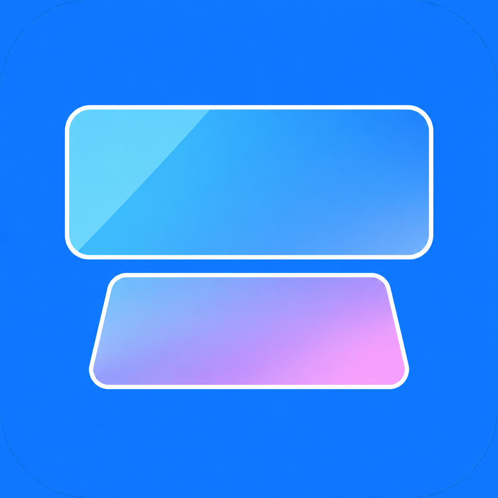
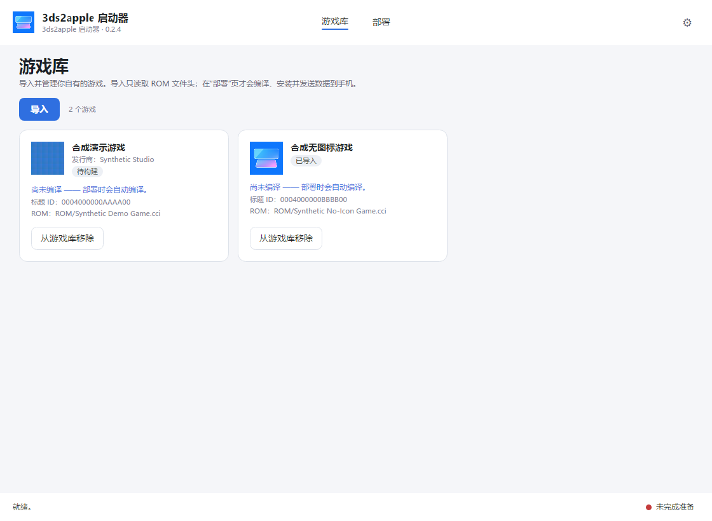
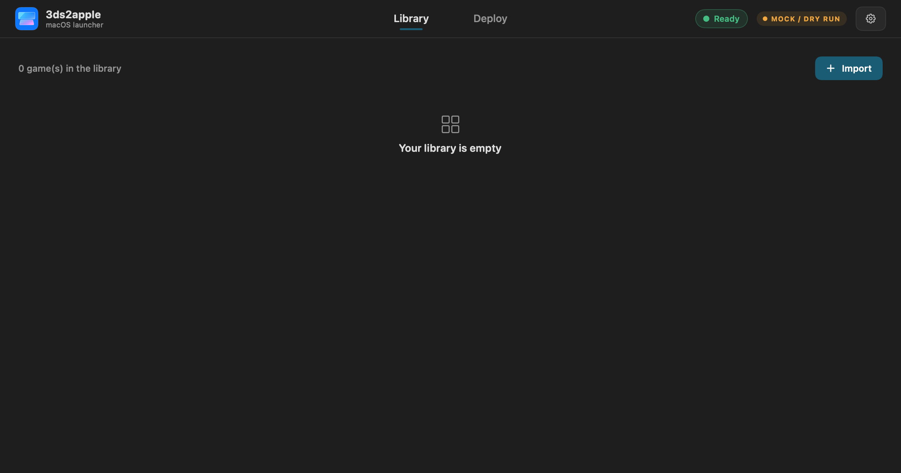

<p align="center"></p>

<h1 align="center">3ds2apple</h1>

[English](README.md) · [简体中文](README.zh-CN.md) · [下载启动器](https://github.com/HFYKratos/3ds2apple/releases) · [全部版本](https://github.com/HFYKratos/3ds2apple/releases) · [参与贡献](CONTRIBUTING.md)

> [!NOTE]
> 3ds2apple 是免费开源软件（Apache-2.0）。启动器与 iOS App 不附带任何游戏、密钥或 BIOS：请用你合法拥有并自行导出的已解密 ROM 构建自己的游戏库。

**把你自有的 Nintendo 3DS 游戏以原生方式运行在 iPhone / iPad 上。** 游戏代码会在本机被提前重编译为原生 ARM64，直接跑在手机处理器上；图形经 MoltenVK 走 Metal。整个游戏库都在同一个 App 里，在 Windows 或 macOS 启动器里点几下就能把一款游戏从导入带到开玩。

平台：iPhone / iPad（iOS 16 及以上）· Windows 10/11（启动器，无需 Mac）· macOS 13+（启动器，Intel + Apple 芯片）· 可在 Windows 或 macOS 上构建 · 许可：Apache-2.0 · **自备游戏**

<p align="center">
  
  
</p>
<p align="center"><sub>Windows 启动器（游戏库，合成演示条目）与 macOS 启动器（空游戏库）。</sub></p>

## 原生移植，不是模拟器

每款游戏都会被提前重编译：3DS 代码先由 3dsrecomp 翻成 C，再用本机的 LLVM 或 Apple clang 工具链编译成 ARM64 `GamePack`。手机通过 Zakuro HLE 运行时直接执行这些原生代码——没有 CPU JIT，也没有解释器兜底。PICA200 GPU 路径由 MoltenVK 转成 Metal，手机壳直接呈现到 `CAMetalLayer`，每帧零屏幕回读。

## 一个 App，装下整个游戏库

你勾选的每款游戏都会编译成独立的 `GamePack<TITLEID>.dylib`，和一个 `GameCatalog.json` 一起被合成进同一个已签名 App。装一个 App 就带走整个游戏库；增删游戏只需重新部署一次，已推送的游戏数据在重装与更新后仍然保留。每游戏代码必须位于已签名的 IPA 内——iOS 不允许从 `Documents` 加载未签名代码。

游戏库卡片上的信息全部来自启动器导入时已读到的 SMDH 元数据：游戏自己的图标、当前语言的标题、发行商和推送的游戏大小。启动器把这些元数据放进 `GameInfo.json` 与游戏数据一起推送，手机端始终不解包 ROM；旧版启动器推送的库照常可用——卡片会回退到 catalog 名称、隐藏发行商一行并显示占位图标，重新部署后即可补全。

## 完整的 3DS 虚拟按键

虚拟按键是完整的 New 3DS 键位：十字键、A/B/X/Y、L/R、ZL/ZR、Start/Select、真模拟量的 Circle Pad 和 New 3DS C 杆。Circle Pad 输出真正的模拟量（每轴 -1…1，带小死区，手指静止时精确为 0），不是第二套十字键；C 杆同理。手柄左摇杆映射 Circle Pad、右摇杆映射 C 杆，L2/R2 映射 ZL/ZR，多根手指可以同时按按键、拖摇杆。

在 **设置 -> 控制 -> 屏幕与按键布局** 里，每个按键都能拖动、缩放、调透明度，也能重置；横屏与竖屏各有一套独立配置。编辑页只改位置、大小和透明度，按键对应的 3DS 键固定（本版本不支持重映射）。C 杆需要游戏本身读取 New 3DS 摇杆，且壳必须用当前运行库构建（用 `scripts/build-zakuro-ios.sh` 从源码构建的壳已包含）。

## 四种屏幕布局

同一个布局页提供四种屏幕排列方式：

- **自动（Automatic，默认）**：保持原有行为——竖屏上下堆叠，横屏大上屏。
- **预设（Preset）**：固定为五种经典排列之一——上下堆叠、左右并排、大上屏、仅上屏、仅下屏。
- **自定义（Metal，Custom (Metal)）**：在预设排列上叠加整体缩放与偏移，仍由 `CAMetalLayer` 直显。
- **自由布局（软件，Free layout (software)）**：每一屏都可以放在任意矩形。需要手动开启，页面会提示它更慢，并因此切换到软件回读显示路径（Metal presenter 只认识那五种固定排列）；从下一次加载游戏起生效。

自定义（Metal）的缩放/偏移和自由布局都按横竖屏分别保存，每个编辑页都能恢复默认。旋转、宽高比、整数缩放与渲染分辨率在四种模式下含义不变。

## 游戏画面上的显示

App 自己在游戏画面上的读数只剩一个**帧率（FPS）**，默认开启：竖屏在标题栏，横屏在顶部安全区的窄条里，永远不压住 3DS 画面、暂停按钮和虚拟按键（可在 设置 -> 性能 里关掉）。其余信息都不再画在画面上：AOT 状态、渲染路径、Metal HUD 状态和各阶段帧耗时只写入设备日志与诊断报告（设置里的「关于」页仍保留运行状态摘要供排查，但不会盖在游戏上）。

设置页也已去掉旧的「Metal backend」信息行和「首次载入图形预热」开关：游戏加载完立即显示，运行库的管线缓存仍会让同一游戏的后续加载变快。Apple 自己的系统 Metal HUD 开关（GPU/FPS 浮层）仍保留在 设置 -> 性能。

## 图形化启动器，几乎零配置

Windows 与 macOS 各有一个启动器。导入你自有的已解密 `.3ds`/`.cci`，勾选游戏，按唯一的一键部署按钮：启动器编译 GamePack、合成不含 ROM 的基础壳 IPA、用你自己的 Apple ID 签名安装（Windows 用内置官方 Impactor/plumesign，macOS 用 Xcode 自动签名），然后只把 `GameRom.cci` + `GameInfo.json` 推送到 App 的 Documents 目录。

启动器会把数据放在 exe/.app 旁的便携目录，读取 ROM 的 SMDH 元数据（图标、本地化名称、发行商），检测编译硬件并自动并行 3dsrecomp，还会显示启动就绪灯与自检——缺工具时不会在部署中途静默失败。

## 实测数据

在真机 iPhone 上经 Windows 启动器链路运行 Pokémon Y：约 **57–60 fps**，**AOT 100%**，**Metal GPU** 渲染；`zk_perf` 显示 GPU 每帧 4–6 ms、present 10–11 ms、屏幕回读 0。以上是维护者针对该游戏的实测数据；兼容性与性能因游戏而异。

## 平台

| 平台 | 支持情况 |
|---|---|
| **iPhone / iPad** | iOS 16 及以上。一个 App 承载游戏库、游戏内菜单、可编辑的完整 New 3DS 虚拟按键、四种屏幕布局、即时存档与帧率显示。 |
| **Windows** | Windows 10/11 x64。单文件自包含启动器；无需 Mac 即可编译、签名、安装、推送。 |
| **macOS** | macOS 13+（Intel + Apple 芯片）。SwiftUI 启动器，使用 Xcode 签名；分发包尚不自包含，真机安装尚未由维护者验证。 |
| **构建主机** | Windows（内置 LLVM/LLD）或 macOS（Apple clang + Xcode）。 |

## 快速开始

**前提**：你自有的已解密 3DS ROM、开启开发者模式的 iOS 16+ iPhone/iPad、USB 数据线，以及用于签名的你自己的 Apple ID。不包含任何游戏数据。

### Windows 启动器

1. 下载 `3ds2apple-<version>-windows-x64.zip`，解压到可写目录（不要放 `Program Files`）。安装 *Apple 设备*，保证手机可通过 USB 访问。
2. 运行 `3ds2apple-launcher.exe`（未做代码签名；校验 digest 后在 SmartScreen 选「更多信息 -> 仍要运行」）。先跑一次 Settings -> 自检，应为绿色。
3. **游戏库 -> 导入** 你自有的已解密 `.3ds`/`.cci`；只读取 ROM 头与 SMDH 图标/元数据。
4. **部署**：勾选游戏后按唯一的一键部署按钮。启动器为每个游戏编译 GamePack、合成不含 ROM 的 IPA、用内置 Impactor（登录你自己的 Apple ID）签名安装，然后只推送游戏数据。
5. 在手机上打开 App 开玩。增删游戏重新部署即可；已推送数据在重装后保留，彻底卸载 App 会清空。

### macOS 启动器

1. 下载 `3ds2apple-<version>-macos-universal.zip` 得到 `3ds2apple-launcher.app`（未公证；首次右键 ->「打开」）。
2. 分发包**尚不自包含**：需要 macOS 13+、已登录 Apple ID 的 Xcode 15+、`xcodegen`、仓库 checkout，以及构建好的工具（`scripts/build-zakuro-ios.sh`、`builder` 的 pack CLI、`tools/devpush`）。启动器会在自身 bundle、checkout 与 `PATH` 中查找。
3. 导入 -> 部署：Apple clang 编译 GamePack，Xcode 自动签名 + `devicectl` 安装合成后的 IPA，随后推送游戏数据。选择规则与 Windows 相同。

### 手机数据、存档与限制

- 游戏数据位于 `Documents/Games/<TITLEID>/`（可在「文件」App 查看）；存档与即时存档保存在 App 容器内。
- 虚拟按键与四种屏幕布局都在 **设置 -> 控制 -> 屏幕与按键布局** 里编辑；按键布局与三种 Metal 屏幕模式立即生效，自由布局从下一次加载游戏起生效。
- 免费 Apple ID 每台设备限 3 个 App、签名约 7 天；到期重新部署即可续签。付费开发者账号没有这些限制。
- 卸载 App 会删除其数据；你电脑上的 ROM 不受影响。

## 下载

公开发布只走 [GitHub Releases](https://github.com/HFYKratos/3ds2apple/releases)。每次发布只附两个平台包：

- `3ds2apple-<version>-windows-x64.zip` —— Windows 10/11 启动器：自包含的 `3ds2apple-launcher.exe`，外加 `LICENSE`、`NOTICE`、`THIRD_PARTY.md`。
- `3ds2apple-<version>-macos-universal.zip` —— macOS 13+ 启动器：`3ds2apple-launcher.app`（Intel + Apple 芯片），外加 `LICENSE`、`NOTICE`、`THIRD_PARTY.md`。

从 0.1.1 起，两个 zip 根级都带这三份许可文本，与仓库根文件逐字节一致，下载的包因此自包含；它们不作为单独的 Release 资产发布。[THIRD_PARTY.md](THIRD_PARTY.md) 里列出的 GPL 项目仍然只是只读参考——不打包任何 GPL 代码或文本。0.1.0 的包早于此项，依赖仓库内的副本。不含 ROM 的壳模板已内嵌在两个启动器中，无需单独下载。GitHub 会显示每个发布资产的 SHA-256 digest；发布中不含任何游戏数据。

## 从源码构建

| 组件 | 构建 / 测试 |
|---|---|
| Windows 启动器 | `cd launcher/windows && dotnet build Launcher.slnx -c Release` / `dotnet test Launcher.slnx -c Debug` —— 见 [launcher/windows/README.md](launcher/windows/README.md) |
| macOS 启动器 | 在 macOS 上用 XcodeGen + `xcodebuild` —— 见 [launcher/macos/README.md](launcher/macos/README.md) |
| iOS App / 壳 | `scripts/build-zakuro-ios.sh` -> `scripts/build-ios-app.sh` -> `scripts/package-ipa.sh` —— 见 [scripts/README.md](scripts/README.md) |
| Pack CLI（`3ds2apple-pack`） | `cd builder && cargo build --workspace` / `cargo test --workspace` —— 见 [builder/README.md](builder/README.md) |
| 设备桥（`devpush`） | `cargo build --release --manifest-path tools/devpush/Cargo.toml` —— 见 [tools/devpush/README.md](tools/devpush/README.md) |

宿主机自检（无需 ROM、手机或 Xcode）：

```bash
cd builder && cargo test --workspace
cd launcher/windows && dotnet test Launcher.slnx -c Debug
bash scripts/tests/perf-selfcheck.sh
bash scripts/tests/aot-selfcheck.sh
bash scripts/tests/game-catalog-selfcheck.sh
bash scripts/tests/desktop-aot-selfcheck.sh
```

## 仓库结构

```text
assets/            本 README 使用的 App 图标
.github/           问题报告与 PR 模板
ios/app/           iOS App：游戏库、游戏内菜单、触摸控制、即时存档
ios/zakuro-ios/    Zakuro iOS C ABI：GamePack 加载器、Metal presenter、性能计数
launcher/windows/  Windows 启动器（C#/Avalonia）与单文件打包
launcher/macos/    macOS 启动器（SwiftUI）、Xcode 签名安装
builder/           3ds2apple-pack：ROM 导入、SMDH 元数据、包与 GameCatalog
tools/devpush/     设备桥：usbmuxd/house_arrest/AFC 推送、安装校验
tools/winbuild/    不依赖 Apple SDK 的 LLVM/LLD GamePack 交叉构建工具
scripts/           构建、打包、发布与自检脚本
licenses/          第三方许可文本（Impactor MIT、apple-codesign MPL-2.0）
```

## 实话实说的边界

- **兼容性因游戏而异。** 部分游戏可能无法启动或渲染异常；欢迎带上 title ID 反馈——见[问题反馈与性能数据](#问题反馈与性能数据)。
- **自由布局是性能取舍。** 它走软件回读显示路径（Metal presenter 只认识那五种固定排列），从下一次加载游戏起生效，比其余三种模式慢；自动、预设与自定义（Metal）仍走 GPU 路径。
- **C 杆依赖游戏支持。** 它通过 New 3DS 摇杆 API 上报；不读取该摇杆的游戏会忽略它，用旧运行库构建的壳也不提供它。
- **旧安装与旧推送仍然兼容。** `GameInfo.json` 只新增了可选字段（schema 版本仍为 1），0.1.0 启动器推送的数据仍能校验并运行；在重新部署之前，卡片没有发行商、没有真实 SMDH 图标、也没有大小。从 0.1.0 升级上来的 App 会保留游戏库与存档。
- **macOS 包是开发者预览。** 尚不自包含，真机安装也还未由维护者验证——真机验收征集见 [#1](https://github.com/HFYKratos/3ds2apple/issues/1)；Windows 包是已验证路径。
- **不提供 ROM、密钥或 BIOS。** 只支持你合法拥有并自行导出的已解密 ROM。
- **设计上没有 CPU JIT。** 正式路径是 AOT 代码 + Zakuro HLE 运行时，没有解释器兜底。

## 问题反馈与性能数据

欢迎提交 bug 与兼容性报告：从[兼容性报告模板](.github/ISSUE_TEMPLATE/compatibility-report.yml)开始（GitHub 会在 **New issue** 里提供）。请附上游戏名、16 位 title ID、区域与版本（base/update/DLC）、设备型号与 iOS 版本、使用的 3ds2apple 版本或 commit、AOT 状态、现象与复现步骤。**禁止**上传 ROM、解密密钥、BIOS/固件、生成的 C、含游戏画面的截图或录像、签名 IPA/pack、Apple 凭据或设备 UDID。

每个版本都能导出诊断报告：打开游戏内菜单点 **Export logs / 导出日志**（菜单会暂停帧循环，点下的瞬间卡顿计数就冻结），再用系统分享面板分享 `.txt`。主页齿轮的 **设置 -> 更多 -> 导出日志** 也能导出，但卸载游戏会把帧率/卡顿计数清零——需要这些数字时请用游戏内菜单；设置页导出的那份仍包含完整会话日志。0.1.1 起每次导出还会写入 App 容器的 `Documents/Diagnostics/<时间戳>.txt`（保留最近 5 份）；同一目录可在「文件」App 的「我的 iPhone -> 3ds2apple -> Diagnostics」里看到，也可以用设备桥通过 USB 拉取：

```bash
devpush ls  --bundle-id com.kratos.3ds2apple --remote Documents/Diagnostics
devpush get --bundle-id com.kratos.3ds2apple --remote Documents/Diagnostics/<时间戳>.txt --local diagnostics.txt
```

报告里已包含构建与设备状态、AOT 证明（`aot_percent`、`aot_fallbacks`）、渲染路径、帧率上限/快进/渲染分辨率设置、各阶段帧耗时以及两次会话的 App 日志。0.1.1 起还会记录卡顿（`>33.3 ms` 帧）与严重卡顿（`>100 ms`）计数、每分钟次数、最差帧、按阶段归因和最近 20 条尖峰事件。如果是卡顿反馈（例如「大部分时间 57–60 fps 但偶发卡顿」），再说明发生的时机与场景（游戏 + 场景/菜单）、第二次运行是否更顺，以及使用的启动器链路与设置。**请附上诊断文件**——计数与尖峰就是测量数据，没有文件的卡顿反馈通常只会被要求补上文件。

有 Mac + iPhone/iPad 的验证者尤其欢迎：[macOS 真机验收模板](.github/ISSUE_TEMPLATE/macos-acceptance.yml)会按 [launcher/macos/README.md](launcher/macos/README.md#real-device-acceptance) 的清单逐项收集结果（Xcode 签名、`devicectl` 安装、`devpush` 推送）。

## 贡献与发布

- [CONTRIBUTING.md](CONTRIBUTING.md) —— 贡献规则、问题反馈与发布规范。
- [问题模板](.github/ISSUE_TEMPLATE) —— 兼容性报告与 macOS 真机验收清单。
- [LICENSE](LICENSE) —— Apache-2.0。
- [THIRD_PARTY.md](THIRD_PARTY.md) 与 [NOTICE](NOTICE) —— 第三方组件与法律声明。

## 致谢

3ds2apple 建立在开源工作之上：**Zakuro**（MIT，HLE 运行时与 PICA200 渲染器）、**3dsrecomp**（MIT，静态重编译器）、**MoltenVK**（Apache-2.0，Vulkan on Metal）、**Impactor**（MIT）与 **apple-codesign**（MPL-2.0，Windows 签名）、**pocket-native**（MIT，iOS 原生移植参考），以及 LLVM 项目的编译工具链。也感谢所有在真机上测试构建的人。

## 许可证与法律

3ds2apple 使用 **Apache-2.0** 许可（见 [LICENSE](LICENSE)）。本仓库不含任何 Nintendo ROM、解密密钥、BIOS、系统文件、游戏资源或游戏画面截图，也不提供 ROM 下载或盗版支持。请只使用你合法拥有并自行导出的游戏。

第三方组件及许可见 [THIRD_PARTY.md](THIRD_PARTY.md) 与 [NOTICE](NOTICE)。Windows 启动器原样内置官方 Impactor v2.7.2 + plumesign 发布文件（MIT；其中内嵌的 apple-codesign 0.29.0 为 MPL-2.0），许可文本保存在 [licenses/impactor](licenses/impactor)；macOS 启动器改用 Xcode 签名，不内置 Impactor。iOS 壳模板与 macOS 启动器内嵌未修改的 MoltenVK 1.4.2 框架（Apache-2.0）。GPL 项目仅作为架构参考阅读，不复制其代码或文本，也不会随包分发。